# Ejercicio 2: guía para entender todo (Hopfield con los QR)

Esta guía explica, en lenguaje simple, los conceptos, **cada gráfico** que generamos, los problemas que encontramos y las soluciones que probamos. Sirve para estudiar antes de presentar.

- Las imágenes se ven si antes se corren los scripts, porque los PNG no se suben a git. Desde `TP4/`:
  ```
  python3 analysis/hopfield_qr.py
  python3 analysis/hopfield_qr_controles.py
  python3 analysis/hopfield_qr_variante.py
  python3 analysis/hopfield_qr_ortogonalidad.py
  python3 analysis/hopfield_qr_mejoras.py
  ```
- Los números salen de los CSV de cada carpeta y están explicados en detalle en los README de `reports/ejercicio2/` y sus subcarpetas.
- La versión corta, armada como diapos, está en [`ejercicio2_problemas.md`](ejercicio2_problemas.md).

---

## 1. Los conceptos, en simple

### La red de Hopfield

- **Qué es:** una memoria. Se le "guardan" algunos patrones y, cuando se le muestra uno dañado, tiene que devolver el original más parecido.
- **Patrones:** cada QR es una grilla de 37×37 = **1369 módulos** (cuadraditos). Negro = +1 y blanco = −1.
- **Neuronas:** la red tiene **una neurona por módulo** (N = 1369). Cada neurona está conectada con todas las demás, y cada conexión tiene un peso wᵢⱼ.

### Cómo guarda los QR: la regla de Hebb

Para cada par de módulos, la red mira si en los QR guardados **suelen tener el mismo color**. Si sí, el peso entre ellos es positivo; si suelen tener colores distintos, es negativo.

```
wᵢⱼ = (1/N) · Σ (sobre los 5 QR) ξᵢ · ξⱼ        y        wᵢᵢ = 0
```

Eso es todo lo que "aprende": la tabla de pesos W queda fija.

### Cómo recupera: el campo y la votación

Se le pasa un QR dañado (el **patrón de consulta**). En cada paso, cada neurona hace una **votación**:

```
campo de la neurona i:   hᵢ = Σⱼ wᵢⱼ · Sⱼ
nuevo color:             sign(hᵢ)   (positivo → negro, negativo → blanco)
```

Todas las neuronas votan a la vez (**actualización sincrónica**, como en el apunte). Se repite hasta que nada cambia: eso es un **estado estable**. Una **iteración** es una de esas votaciones completas.

### Solapamiento: qué tan parecidos son dos patrones

```
m = (módulos iguales − módulos distintos) / N
```

| m | Significa |
|---|---|
| 1 | idénticos |
| **0** | **ortogonales:** sin relación, la mitad de los módulos iguales |
| −1 | opuestos |

Para pasarlo a porcentaje de módulos iguales: **(1 + m) / 2**. Dos patrones al azar dan m ≈ 0,03. Nuestros QR dan entre **0,58 y 0,86**: comparten entre el 79 % y el 93 % de los módulos.

### Crosstalk: la interferencia entre QR

Cuando la red está sobre un QR guardado, el campo de cada neurona se parte en dos:

```
campo = señal (el propio QR, vale 1) + crosstalk (lo que empujan los otros 4 QR)
```

- **Señal:** empuja siempre a favor del color correcto, con fuerza 1.
- **Crosstalk:** cada uno de los otros QR empuja según **cuánto se parece** al QR actual (su solapamiento) y **qué color tiene** en ese módulo.
- **Con QR ortogonales** el crosstalk es casi 0 y gana la señal: el QR queda estable.
- **Con QR parecidos** el crosstalk puede empujar en contra con más de 1. Esa neurona se da vuelta **aunque el QR no tenga ningún daño**.

### Energía: el "paisaje" de la red

```
H = −½ · Σ wᵢⱼ · Sᵢ · Sⱼ
```

Es un número que mide qué tan "cómodo" está un estado: más bajo = más cómodo.
- Si dos neuronas con peso positivo tienen el mismo color, la energía baja.
- Si dos neuronas con peso negativo tienen el mismo color, sube.

**La imagen para recordar:** la red es una pelota que rueda cuesta abajo. Cada vez que una neurona cambia para seguir a su campo, la energía baja. La pelota se queda quieta en un **pozo** (mínimo de energía), que es un estado estable.

- **Lo ideal:** que los pozos sean los QR guardados. El QR dañado está en una ladera y rueda hasta su QR.
- **Nuestro problema:** con Hebb, el pozo más hondo es la **mezcla** de los 5 QR, no ningún QR.

Un detalle: el apunte demuestra que la energía nunca sube cuando cambia **una neurona por vez**. Con actualización sincrónica, en la que cambian varias juntas, puede subir. En los QR no subió nunca, pero es lo que observamos, no una garantía.

### Estados a los que puede llegar la red

| Estado | Qué es |
|---|---|
| **Recuperación correcta** | Devuelve exactamente el QR original |
| **Otro patrón almacenado** | Devuelve otro de los 5 QR |
| **Patrón inverso** | Devuelve un QR con los colores invertidos |
| **Estado espurio** | Un estado estable que no es ninguno de los anteriores |
| **Estado mezcla** | Un espurio particular: sign(ξ₁ + … + ξ₅), en cada módulo el color de la mayoría de los 5 QR. **Es adonde cae todo con Hebb** |

### Capacidad

Según el apunte, la red guarda como mucho **0,15·N patrones**. Con N = 1369 son unos **205**. Nosotros guardamos 5. Pero esa cuenta **supone patrones al azar (ortogonales)**.

### Pseudoinversa (no está en el apunte)

Otra forma de calcular W:

```
W = Ξᵀ (ΞΞᵀ)⁻¹ Ξ
```

En vez de sumar los patrones, calcula W para que **cada patrón guardado sea exactamente estable**, aunque se parezcan entre sí. Con patrones ortogonales da lo mismo que Hebb. La usamos **sólo como comparación**.

---

## 2. La historia en una página

1. **Problema:** con Hebb, la red no recupera **ningún** QR: 0 de 1100 intentos. Todo cae a la mezcla, incluso un QR sin daño.
2. **¿Está mal la red?** No. Con 5 patrones al azar del mismo tamaño recupera el 100 %.
3. **¿Es la cantidad?** No. La red guarda unos 100 patrones al azar, pero sólo 2 QR.
4. **Es el parecido:** los QR comparten el 70 % de sus módulos. Con 5 patrones, la red se corta de golpe a partir de un 25 % compartido.
5. **¿Por qué se parecen?** Por el formato QR (los cuadrados de las esquinas y las líneas fijas) y porque las 5 URL comparten los primeros 72 caracteres.
6. **Intento 1, sacar los módulos compartidos:** mejora de 2 a 3 QR, pero no llega a 5, porque lo que queda también se parece.
7. **Solución A, dos redes de Hebb:** guardar 3 QR en una red y 2 en otra. Recupera los 5 hasta con 35 % de ruido.
8. **Solución B, pseudoinversa:** recupera los 5 hasta con 35 % de ruido, pero no está en el apunte.
9. **El caso del enunciado, una esquina rota:** el lector de QR solo no lee el código; con la red (solución A o B) sí.

---

## 3. Los gráficos, uno por uno

### 3.1 Informe principal: Hebb con los 5 QR (`reports/ejercicio2/`)

#### `solapamientos.png`: cuánto se parecen los QR

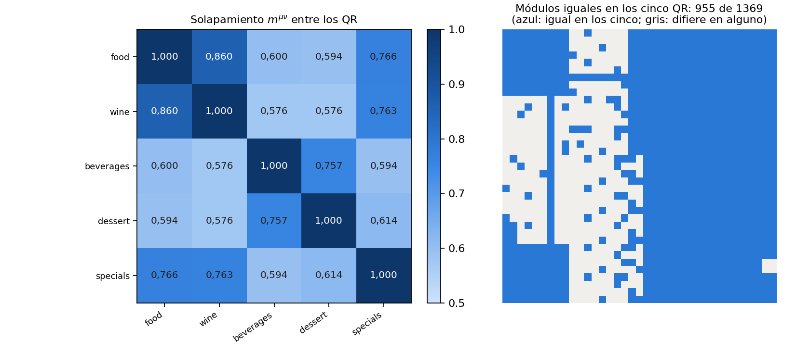

- **Qué muestra:**
  - **Izquierda:** una tabla de colores con el solapamiento m entre cada par de QR. Más oscuro = más parecidos.
  - **Derecha:** el dibujo del QR con **en azul los 955 módulos que son iguales en los 5**.
- **Cómo leerlo:** fuera de la diagonal, todos los números están entre 0,58 y 0,86. Lo ideal para Hebb sería cerca de 0. El par más parecido es menú principal–vinos (0,86).
- **Qué concluir:** casi el 70 % del QR es igual en los cinco: los cuadrados de las esquinas y la mitad derecha. Para la red son "cinco versiones del mismo".

#### `crosstalk.png`: qué neuronas se dan vuelta solas

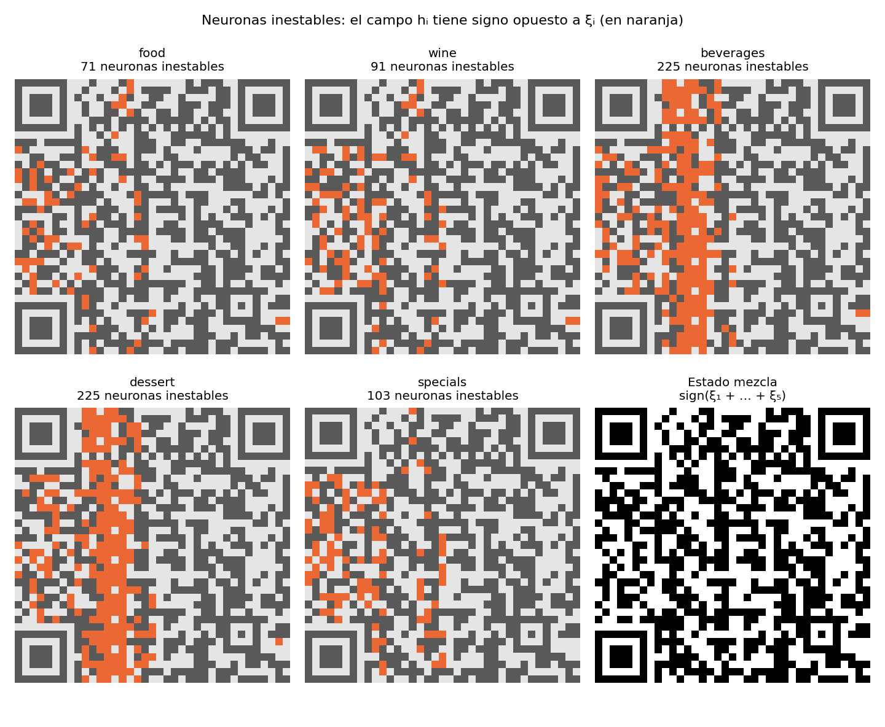

- **Qué muestra:** los 5 QR sin ruido, con **en naranja las neuronas inestables**: aquellas en las que el crosstalk le gana a la señal. El sexto panel es el **estado mezcla**.
- **Cómo leerlo:** cuantos más puntos naranja, más se "rompe" el QR solo. Son 71 (menú), 91 (vinos), 103 (especiales) y 225 (cócteles y postres). Ninguno cae en los módulos compartidos.
- **Qué concluir:** ningún QR es estable. Las neuronas inestables son justo los módulos donde ese QR está en **minoría** frente a los otros 4, así que la red lo empuja hacia lo que dice la mayoría: la mezcla.

#### `categorias.png`: qué devuelve la red según el ruido

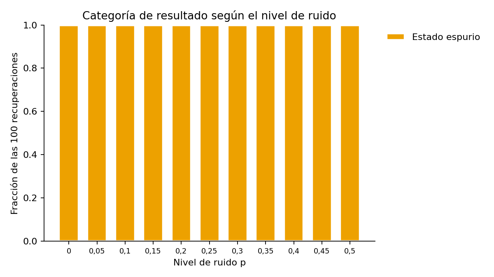

- **Qué muestra:** para cada nivel de ruido p (de 0 a 0,5), de qué tipo son las 100 salidas.
- **Cómo leerlo:** todas las barras son **"estado espurio"**, en todos los niveles.
- **Qué concluir:** 0 recuperaciones correctas de 1100, **incluso con p = 0** (el QR sin ningún daño).

#### `ejemplos.png`: cómo se ve en imágenes

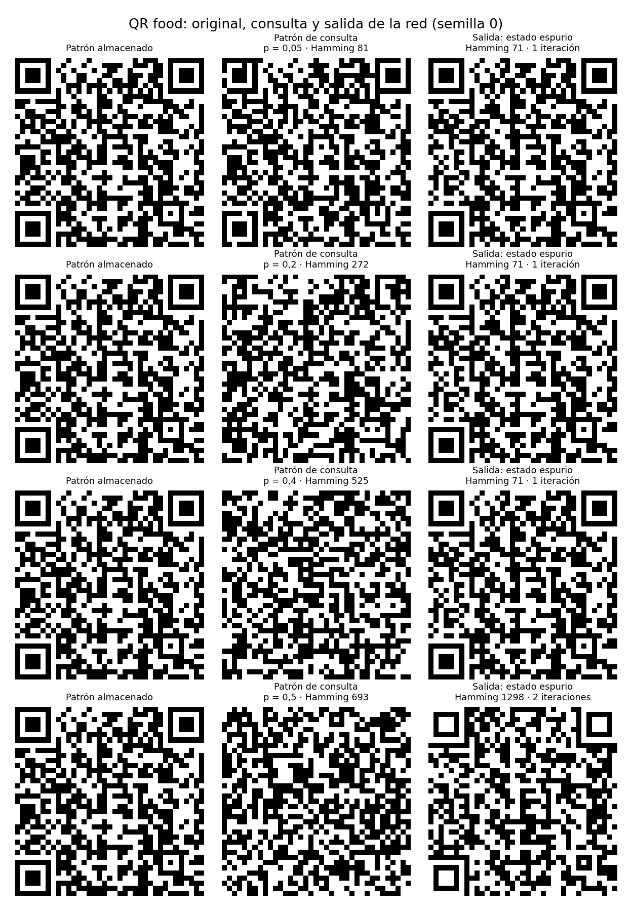

- **Qué muestra:** por fila, un nivel de ruido. Las columnas son el QR original, la consulta con ruido y lo que devuelve la red.
- **Cómo leerlo:** la columna de salida es **siempre la misma imagen** (la mezcla), salvo con p = 0,5, donde a veces es su inverso.
- **Qué concluir:** la red responde lo mismo sin importar qué le muestres. No distingue entre los 5 menús.

#### `iteraciones.png`: cuántos pasos tarda

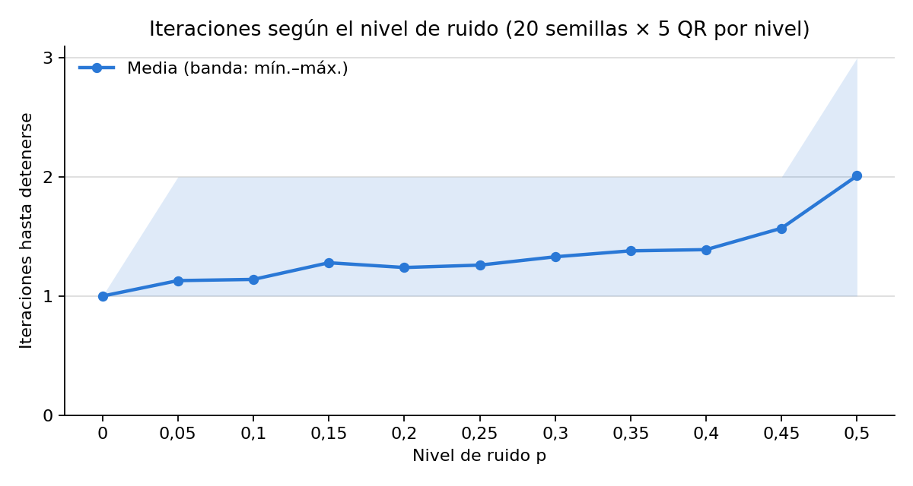

- **Qué muestra:** la cantidad de iteraciones hasta quedarse quieta, según el ruido. La línea es la media y la banda va del mínimo al máximo.
- **Cómo leerlo:** con poco ruido tarda 1 paso; con p = 0,5, unos 2 (máximo 3).
- **Qué concluir:** la red **converge rápido, pero al lugar equivocado**. Nunca entra en ciclos ni llega al tope.

#### `energia_ejemplos.png`: la energía en cada paso

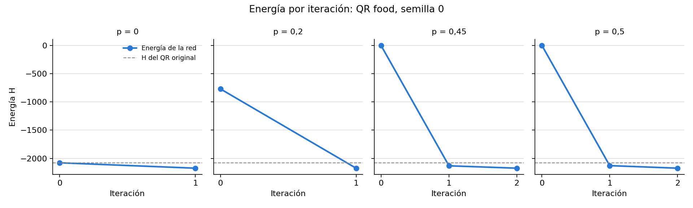

- **Qué muestra:** la energía en cada paso para una consulta del menú principal, con 4 niveles de ruido. La línea punteada es la **energía del QR original** (−2077,45).
- **Cómo leerlo:** la energía siempre baja (la pelota rueda) y termina en **−2172,88**, **por debajo de la línea punteada**.
- **Qué concluir:** el pozo más hondo no es el QR sino la mezcla. Por eso, incluso empezando en el QR exacto (p = 0), la red se va de ahí. Esto contradice la idea de que "los mínimos son los patrones guardados", que vale sólo si los patrones son casi ortogonales.

---

### 3.2 Controles: ¿el problema es la red o son los QR? (`reports/ejercicio2/controles/`)

Misma red, mismo tamaño y mismas consultas, pero con patrones **generados al azar** en lugar de los QR.

#### `control1_azar_vs_qr.png`: la prueba de que la red funciona

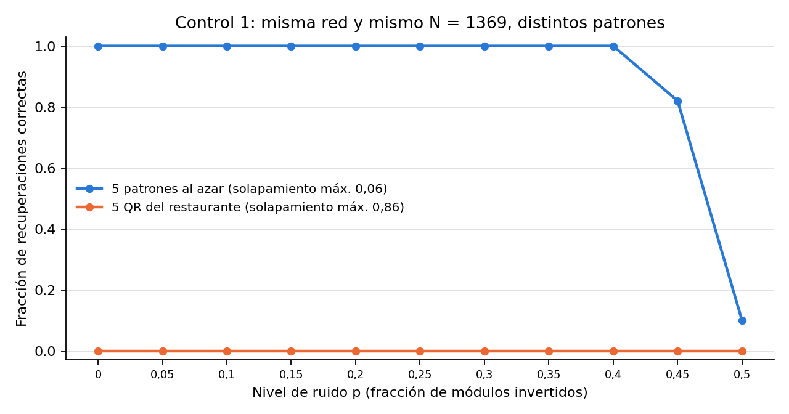

- **Qué muestra:** la fracción de recuperaciones correctas según el ruido, con 5 patrones al azar (azul) y con los 5 QR (naranja).
- **Cómo leerlo:** azul en 100 % hasta p = 0,4; naranja en 0 siempre.
- **Qué concluir:** **la implementación está bien**; el problema son los QR. Es la primera pregunta que va a hacer un docente.

#### `control2_compartidos.png`: el umbral del 25 %

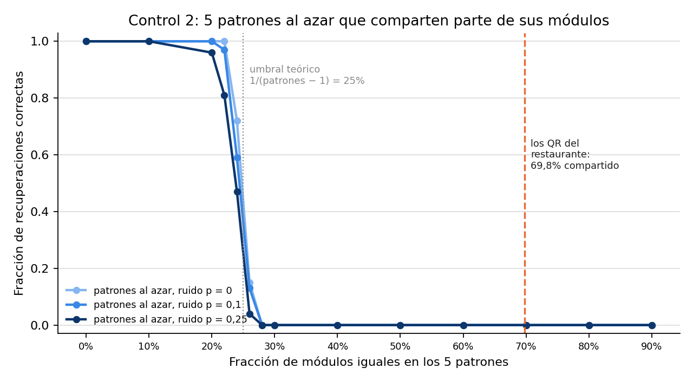

- **Qué muestra:** 5 patrones al azar a los que se les fuerza una fracción f de módulos iguales, de 0 % a 90 %. El eje y es la fracción correcta.
- **Cómo leerlo:**
  - hasta 20 % compartido recupera todo;
  - con 24 % ya cae (72 % correctas sin ruido);
  - desde 28 %, **nada**.

  La línea gris punteada (25 %) es el umbral teórico; la naranja (70 %) es donde están nuestros QR.
- **Por qué 25 %:** pensemos en un módulo no compartido donde los otros 4 patrones tienen el color contrario. Ahí la señal vale 1 y el crosstalk empuja en contra con 4·f. Si f > 1/4, gana el crosstalk. Uno de cada 16 de los módulos no compartidos está en esa situación, así que ningún patrón queda estable. Con k patrones el umbral es 1/(k − 1).
- **Qué concluir:** los QR están casi 3 veces por encima del límite. Con 2 patrones el umbral es 100 % (por eso entran de a 2); con 3 es 50 % (por eso los QR completos fallan de a 3).

#### `control3_capacidad.png`: cuántos patrones entran

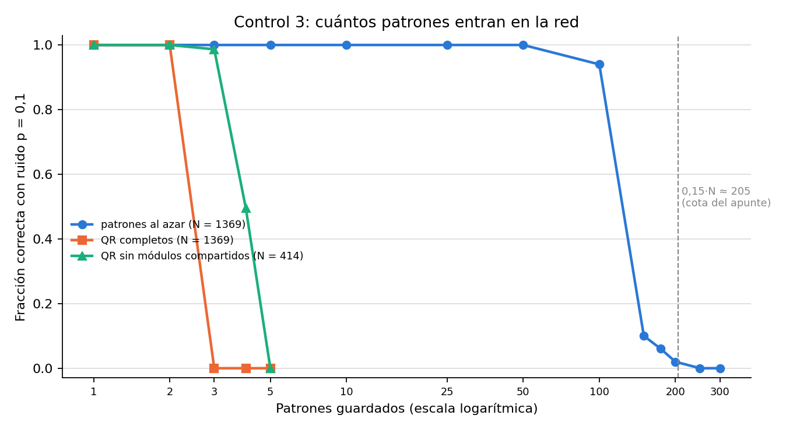

- **Qué muestra:** la fracción correcta (con 10 % de ruido) según cuántos patrones se guardan. El eje x está en escala logarítmica.
- **Cómo leerlo:** al azar (azul) aguanta unos **100**. Los QR completos (naranja) caen con **3**. Los QR sin módulos compartidos (verde), con 4 o 5. La línea gris es la cota del apunte (0,15·N ≈ 205).
- **Qué concluir:** **no es la cantidad**: la misma red guarda 100 patrones al azar y sólo 2 QR.

---

### 3.3 Variante: sacar los módulos compartidos (`reports/ejercicio2/variante/`)

**La idea:** los 955 módulos iguales en los 5 QR no sirven para distinguirlos. Se sacan, la red trabaja con los **414** que difieren y al final se reponen los 955 con su valor conocido. "Antes" = QR completo; "después" = sin módulos compartidos.

#### `1_solapamientos.png`: el parecido antes y después


- **Qué muestra:** dos tablas de solapamiento. Rojo = parecidos, azul = parecidos "al revés", gris = ortogonales.
- **Cómo leerlo:** antes todo es rojo (0,58 a 0,86). Después hay de todo, de −0,40 a +0,54.
- **Qué concluir:** mejora, pero no llega a 0. Menú y vinos siguen pareciéndose (0,54). Y un parecido negativo **también interfiere**, porque el crosstalk usa m con su signo.

#### `2_estabilidad.png`: interferencia con los 5 guardados


- **Qué muestra:** tres paneles por QR, antes (azul) y después (naranja):
  1. crosstalk medio, con la señal = 1 punteada;
  2. neuronas que la red da vuelta en el primer paso;
  3. módulos mal al terminar.
- **Cómo leerlo:** el crosstalk baja de ~2,1 a 0,67–0,95 y las neuronas inestables de 71–225 a 16–34. Pero ninguna barra llega a 0.
- **Qué concluir:** que el crosstalk medio quede por debajo de 1 no alcanza: en algunas neuronas sigue ganando, y basta con eso para que el QR no sea estable.

#### `3_capacidad.png`: cuántos QR entran a la vez


- **Qué muestra:** de todos los grupos posibles de 2, 3, 4 y 5 QR, cuántos quedan con todos sus QR estables.
- **Cómo leerlo:** con 3 QR, antes 0 de 10 y **después 10 de 10**. Con 4, 0 → 1 de 5. Con 5, nada en los dos casos.
- **Qué concluir:** la mejora más clara: **de 2 a 3 QR**. No llega a 5.

#### `4_barrido_ruido.png`: recuperación con ruido


- **Qué muestra:**
  - **Izquierda:** la fracción correcta en 4 configuraciones (antes/después × 3/5 QR).
  - **Derecha:** cuántos módulos quedan mal, con dos referencias **sin red**: la consulta tal cual (gris) y la consulta con sólo los módulos compartidos repuestos (verde).
- **Cómo leerlo:** sólo "después, 3 QR" recupera (95,7 % con p = 0,25). A la derecha, la línea naranja queda muy por debajo de la verde.
- **Qué concluir:** reponer los 955 módulos conocidos ya arregla parte del ruido "gratis", y por eso está la línea verde. **La red hace el resto:** con p = 0,25, de 103 módulos mal baja a 2.

#### `5_ternas.png`: qué grupos de 3 funcionan mejor


- **Qué muestra:** un mapa de calor. Las filas son los 10 grupos de 3 QR, ordenados por el solapamiento de su par más parecido; las columnas, el nivel de ruido. Los colores son la fracción correcta.
- **Cómo leerlo:** las filas de arriba (pares poco parecidos) son oscuras (bien) hasta mucho ruido. Las 3 de abajo **son las que tienen menú + vinos** y se aclaran antes.
- **Qué concluir:** cuanto más se parecen dos QR guardados juntos, peor recupera. Es la misma causa, en escala.

#### `6_lector.png`: ¿un lector real lee el resultado?


- **Qué muestra:** la fracción de veces que el lector OpenCV lee la URL correcta, para cada configuración y para las referencias sin red.
- **Cómo leerlo:** sin red (verde y gris), el lector deja de leer con apenas 5 % de ruido. "Después, 3 QR" lee hasta con 40 %. Antes no lee nunca.
- **Qué concluir:** con 3 QR, la red **sí** le sirve al lector. Con 5 sólo se lee vinos, porque queda a 18 módulos y la corrección de errores del QR lo absorbe.

#### `7_ejemplos.png`: antes y después en imágenes


- **Qué muestra:** el menú principal guardado con vinos y cócteles, con 3 niveles de ruido. Las columnas son original, consulta, salida antes y salida después.
- **Cómo leerlo:** "antes" es siempre la misma imagen (a 40 módulos del original). "Después" es el QR exacto (0 módulos mal) aun con 525 módulos dañados.

---

### 3.4 Ortogonalidad: los mismos experimentos que las notas de letras (`reports/ejercicio2/ortogonalidad/`)

#### `1_ranking.png`: la ortogonalidad anticipa el resultado

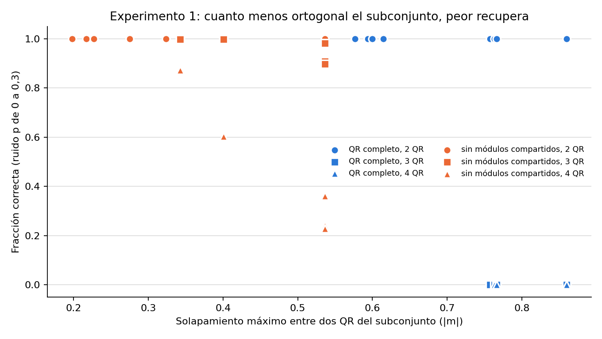

- **Qué muestra:** cada punto es un grupo de QR. El eje x es el solapamiento de su par más parecido y el eje y la fracción correcta. Azul = QR completos, naranja = sin compartidos; círculo, cuadrado y triángulo = 2, 3 y 4 QR.
- **Cómo leerlo:** todos los pares están arriba (funcionan). Los grupos de 3 y 4 completos están abajo (0 %). Sin compartidos, los grupos más a la izquierda (menos parecidos) recuperan más.
- **Qué concluir:** como en las notas (GRTV contra HMNW), el grupo más ortogonal recupera mejor. **Menú + vinos es nuestro "HMNW".**

#### `2_crosstalk.png`: el crosstalk en cada neurona

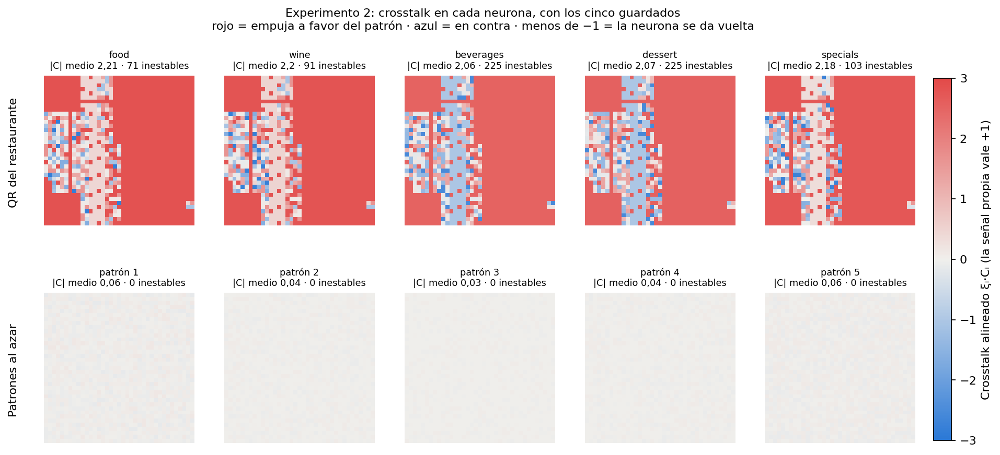

- **Qué muestra:** cada cuadrito es una neurona, pintada según cómo la empujan los otros QR.
  - **Rojo:** a favor.
  - **Azul:** en contra.
  - **Azul más fuerte que −1:** se da vuelta.

  Arriba los 5 QR; abajo los 5 patrones al azar.
- **Cómo leerlo:** en los QR, la mitad derecha es roja fuerte (ahí los 5 coinciden y empujan a favor) y la franja izquierda tiene azul (ahí difieren y empujan en contra). Los patrones al azar son grises parejos (crosstalk ≈ 0).
- **Qué concluir:** se ve **dónde** está el problema: en la franja donde los QR difieren, los otros 4 le ganan a la señal.

#### `3a_paso_a_paso_completo.png`: paso a paso con Hebb y los 5 QR

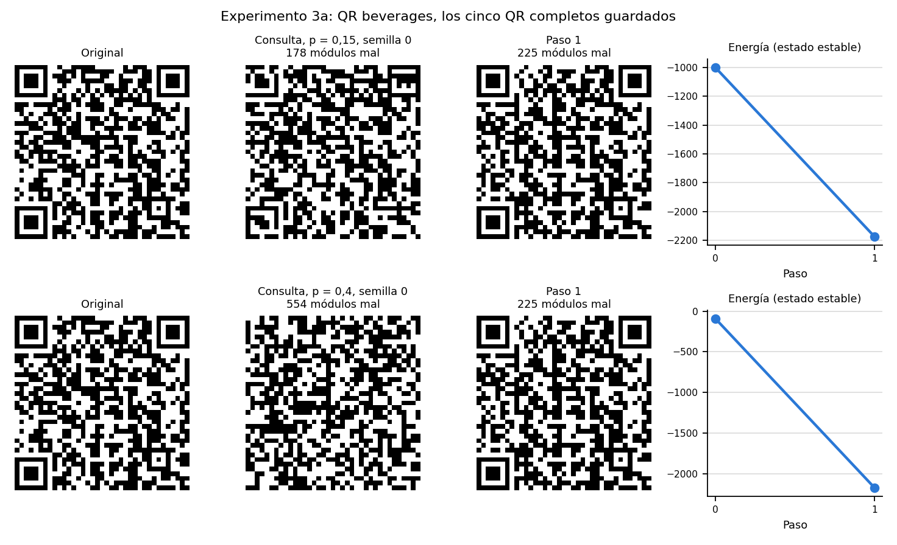

- **Qué muestra:** el QR de cócteles con 15 % y con 40 % de ruido: la consulta, cada paso de la red y la curva de energía.
- **Cómo leerlo:** en 1 paso las dos consultas llegan al **mismo estado**, a 225 módulos del original (la mezcla). La energía baja de golpe.
- **Qué concluir:** la energía baja, pero hacia la mezcla, no hacia el QR.

#### `3b_paso_a_paso_variante.png`: paso a paso con 3 QR sin compartidos

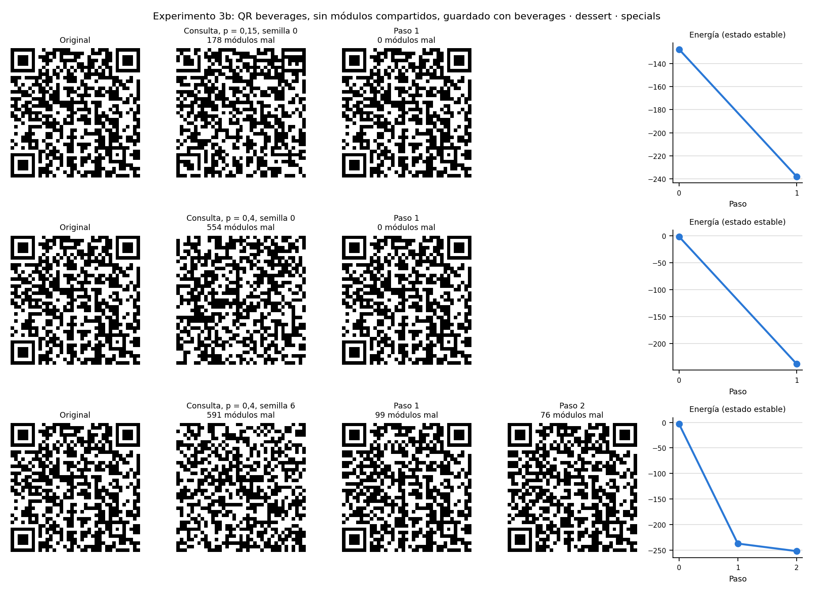

- **Qué muestra:** lo mismo, guardando sólo cócteles, postres y especiales, sin los módulos compartidos. La tercera fila es un caso con 40 % que falla.
- **Cómo leerlo:** con 15 % y 40 % (semilla 0) llega al QR **exacto en 1 paso**. En la tercera fila cae, en 2 pasos, en un estado espurio a 76 módulos.
- **Qué concluir:** ese espurio termina con energía **−251,93**, más baja que los 3 QR guardados (de −245,55 a −229,32). La energía baja, pero **eso no garantiza terminar en un patrón guardado**.

#### `4_tasa_por_qr.png`: grupo más ortogonal contra menos ortogonal

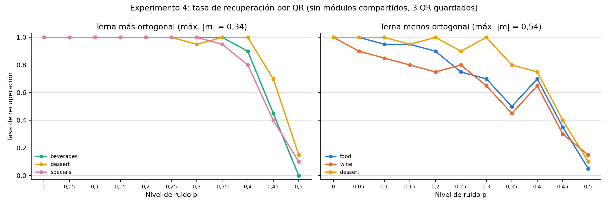

- **Qué muestra:** la tasa de recuperación de cada QR según el ruido. A la izquierda, el grupo de 3 más ortogonal; a la derecha, el menos ortogonal.
- **Cómo leerlo:** a la izquierda, los 3 QR están en 100 % hasta p = 0,25. A la derecha, vinos ya falla con p = 0,05 (90 %).
- **Qué concluir:** el mismo QR (postres está en los dos grupos) rinde distinto según con quién se lo guarde.

#### Sin gráfico: `resolucion.csv`, los QR al doble de resolución

- **Qué hicimos:** cada módulo pasa a 2×2 neuronas, así que N = 5476 y la capacidad del apunte da 821.
- **Resultado:** el solapamiento sigue en 0,86 y el resultado es el mismo: 0 % correctas, todo a la mezcla.
- **Qué concluir:** **más neuronas no ayudan si el parecido no cambia**. Es lo mismo que les pasó a las notas con las letras de 15×15.

---

### 3.5 Soluciones: pseudoinversa, dos redes y daño por zonas (`reports/ejercicio2/mejoras/`)

Los métodos que se comparan:

| Método | Qué hace |
|---|---|
| **Hebb** (azul) | La red del informe principal |
| **Pseudoinversa** (naranja) | La otra regla de aprendizaje |
| **Pseudoinversa sin compartidos** (verde) | La misma, sobre los 414 módulos que difieren |
| **Dos redes** (amarillo) | Hebb sin compartidos, con {menú, cócteles, postres} en una red y {vinos, especiales} en otra. La consulta pasa por las dos y se queda con la salida que es un QR guardado |
| **QR más cercano, sin red** (gris punteado) | Comparar con los 5 originales y elegir el más parecido. Es el "techo": lo mejor posible |
| **Lector solo** (rosa punteado) | El lector OpenCV lee el QR dañado directamente |

En cada figura, el panel izquierdo es la fracción que devuelve el QR exacto y el derecho la fracción que el lector lee bien.

#### `1_ruido.png`: con ruido al azar

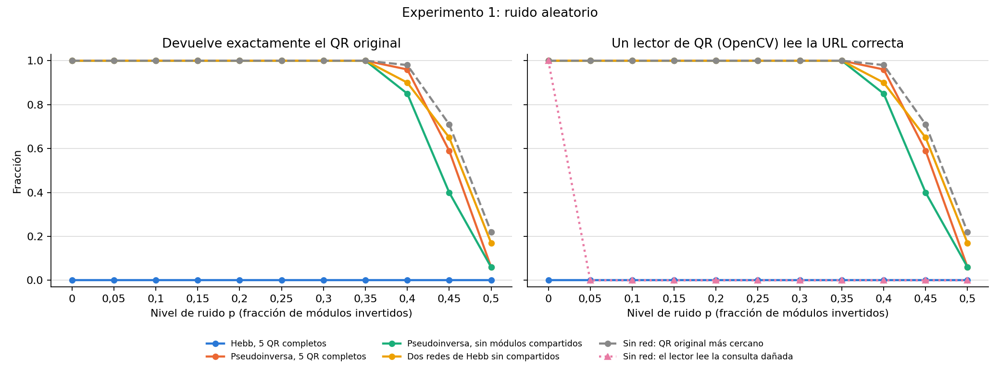

- **Cómo leerlo:** la pseudoinversa y las dos redes están en 100 % hasta p = 0,35, casi pegadas al techo gris. Hebb, en 0. El lector solo lee únicamente sin ruido.
- **Qué concluir:** **el problema tiene arreglo**. Las dos redes logran casi lo mismo que la pseudoinversa usando sólo Hebb, que es lo visto en clase.

#### `2_esquina.png`: una esquina rota, el caso del enunciado

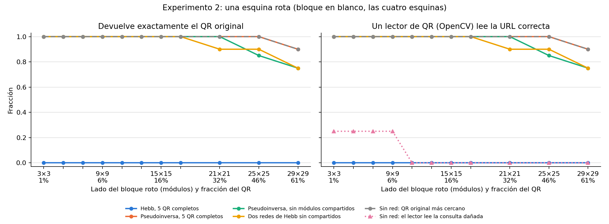

- **Qué muestra:** se pone en blanco un bloque de una esquina, de 3×3 a 29×29 módulos (1 % a 61 % del QR), en las 4 esquinas.
- **Cómo leerlo:**
  - el lector solo (rosa) lee **sólo 1 de las 4 esquinas** (la inferior derecha, que no tiene cuadrado de posición) y sólo hasta 9×9;
  - la pseudoinversa y las dos redes recuperan el 100 % hasta 17×17 (21 % del QR);
  - la pseudoinversa, hasta 25×25 (46 %).
- **Qué concluir:** **acá la red sí le sirve al lector**. Si se rompe una esquina con cuadrado de posición, el lector ni encuentra el QR; la red lo reconstruye.

#### `3_mancha.png`: una mancha negra en cualquier lugar

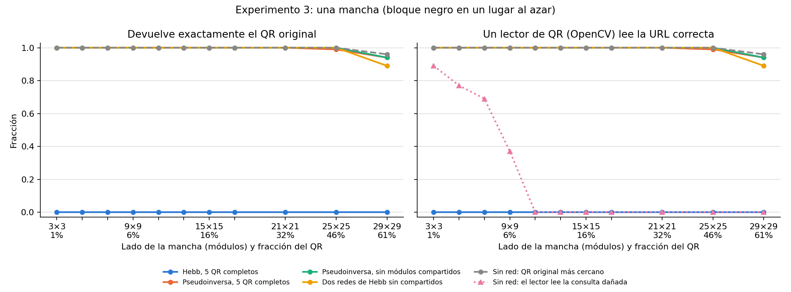

- **Cómo leerlo:** el lector solo aguanta manchas chicas (89 % con 3×3, 37 % con 9×9) y nada desde 11×11. Con la red, se recupera hasta 21×21 (32 % del QR).
- **Qué concluir:** la corrección de errores del QR sirve para daños chicos; la red, para daños grandes.

#### `4_ejemplo_esquina.png`: la esquina rota en imágenes

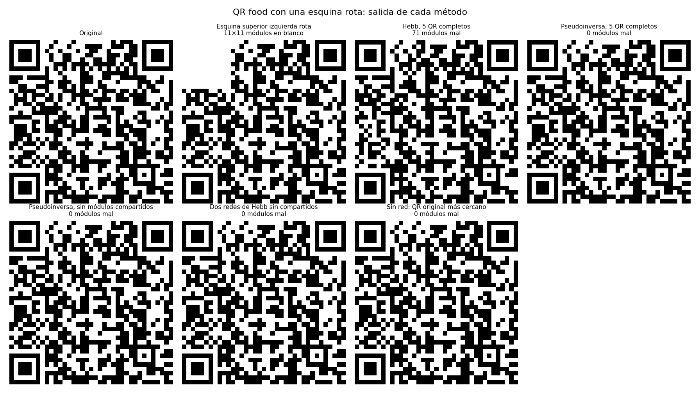

- **Qué muestra:** el menú principal con la esquina superior izquierda rota (11×11, se pierde un cuadrado de posición) y la salida de cada método.
- **Cómo leerlo:** Hebb devuelve la mezcla (71 módulos mal). Los otros métodos devuelven el QR exacto, **con el cuadrado de posición reconstruido**.

#### Sin gráfico: `energia.csv`, la energía con cada regla

| | Hebb | Pseudoinversa |
|---|---|---|
| Energía de los QR | −2077,45 a −1789,71, ninguno estable | **−682,00 los cinco, todos estables** |
| Energía de la mezcla | **−2172,88**, la más baja y estable | −607,89, más alta y no estable |

- **Qué concluir:** con la pseudoinversa, los QR pasan a ser los pozos de energía, como espera el apunte.

---

## 4. Problemas y soluciones: resumen

| # | Problema | Evidencia | Gráfico |
|---|---|---|---|
| 1 | La red no recupera ningún QR | 0 de 1100; todo a la mezcla, aun sin ruido | `categorias.png`, `ejemplos.png` |
| 2 | No es la implementación | Al azar: 100 % | `control1_azar_vs_qr.png` |
| 3 | No es la cantidad | ~100 al azar contra 2 QR | `control3_capacidad.png` |
| 4 | Los QR se parecen demasiado | 70 % compartido; m de 0,58 a 0,86; la red se corta a partir del 25 % | `solapamientos.png`, `control2_compartidos.png` |
| 5 | Por qué se parecen | Formato QR + 72 caracteres de URL en común | `solapamientos.png` (derecha) |
| 6 | El crosstalk le gana a la señal | 2,1 contra 1; 71 a 225 neuronas inestables | `crosstalk.png`, `ortogonalidad/2_crosstalk.png` |
| 7 | La mezcla tiene menos energía que los QR | −2172,88 contra −2077,45 o más | `energia_ejemplos.png` |
| 8 | La red empeora al lector | Lee 0 de 1100 salidas | (CSV del lector) |
| 9 | Más neuronas no ayudan | Al doble de resolución, igual 0 % | `resolucion.csv` |
| 10 | Sacar lo común no alcanza para 5 | De 2 a 3 QR; menú–vinos sigue en 0,54 | `variante/3_capacidad.png` |
| 11 | El ruido al azar no es el daño real | El enunciado habla de una esquina rota | `mejoras/2_esquina.png` |

| Solución | Resultado | ¿Es de clase? |
|---|---|---|
| Sacar los módulos compartidos | 3 QR sí, 5 no | Sí (Hebb) |
| **Dos redes de Hebb** | **5 QR, 100 % hasta 35 % de ruido o 21 % arrancado** | **Sí (Hebb)** |
| Pseudoinversa | 5 QR, 100 % hasta 35 % de ruido o 46 % arrancado | No: sólo comparación |
| Comparar con los 5 originales | Lo mejor posible, pero no es una red | No es Hopfield |
| Regenerar los QR con máscaras distintas | Sin probar | Propuesta |

---

## 5. Preguntas que puede hacer el docente

**¿No será que la red está mal implementada?**
No. Con 5 patrones al azar del mismo tamaño recupera el 100 % (control 1), y la red reproduce el ejemplo del apunte (mismos pesos y misma energía).

**Si la capacidad es 0,15·N ≈ 205, ¿por qué no entran 5?**
Porque esa cota supone patrones casi ortogonales. Los QR comparten el 70 % de los módulos. Medido: la red guarda unos 100 patrones al azar, pero sólo 2 QR.

**¿Qué es el estado mezcla y por qué cae ahí?**
En cada módulo toma el color de la mayoría de los 5 QR. Con Hebb tiene menos energía que cualquier QR, así que es el pozo más hondo y todo rueda hacia ahí.

**¿Por qué con más de 25 % compartido deja de funcionar?**
En un módulo donde los otros 4 tienen el color contrario, la señal vale 1 y el crosstalk 4·f. Si f > 1/4, gana el crosstalk. Esos módulos son 1 de cada 16, así que ningún patrón queda estable.

**¿Sacar los módulos compartidos no es hacer trampa?**
Reponer los módulos conocidos arregla parte del ruido sin la red. Por eso lo comparamos contra esa referencia sin red: con p = 0,25, reponer deja 103 módulos mal y la red los baja a 2. La mejora de la red es real.

**¿Usaron algo que no se vio en clase?**
La pseudoinversa, sólo como comparación y aclarado en el informe. La solución "de clase" es la de dos redes de Hebb.

**¿Para qué sirve la red si se conocen los 5 QR originales?**
Para elegir cuál de los 5 es, alcanza con compararlo con los originales. Lo que sí aporta la red es **reconstruir la imagen completa**, por ejemplo un cuadrado de posición arrancado, para que el lector pueda leerla. Con una esquina rota, el lector solo no lee y con la red sí.

**¿Por qué sólo actualización sincrónica?**
Es la del apunte y el enunciado no pide otra. La probamos antes con asincrónica y el resultado fue el mismo: misma mezcla, apenas menos pasos.
