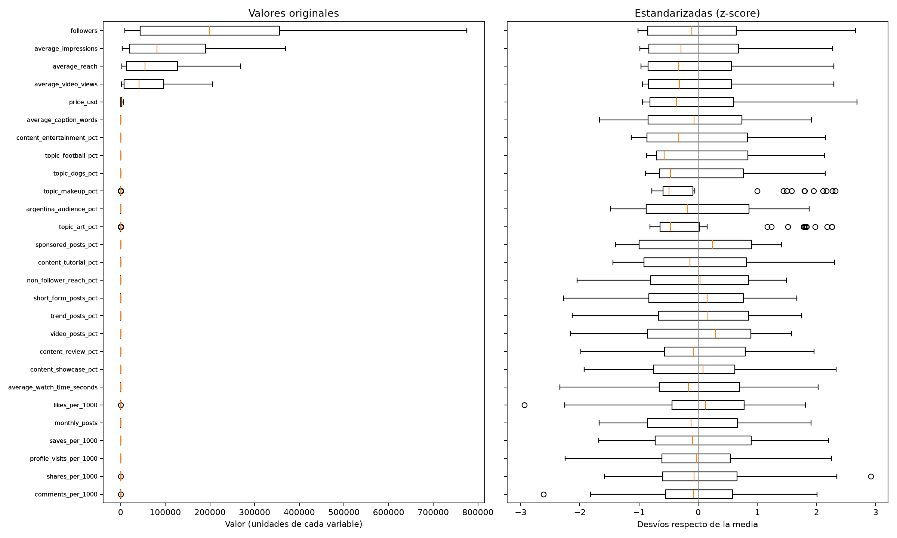
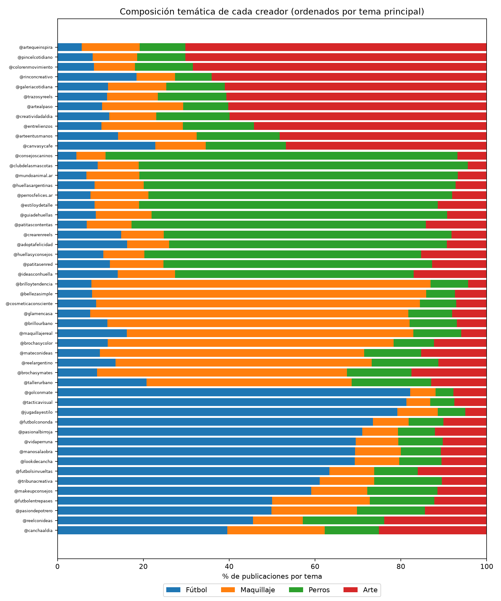
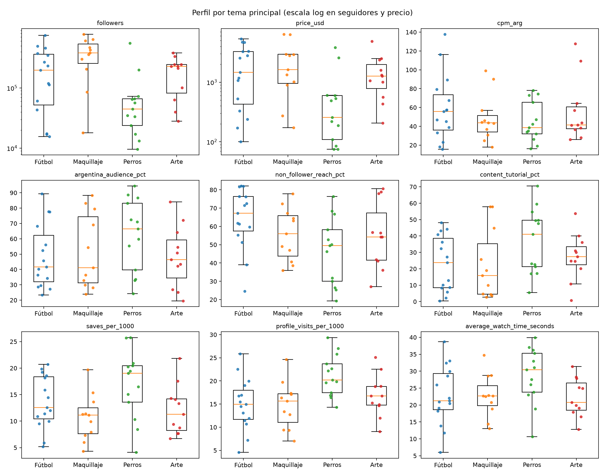
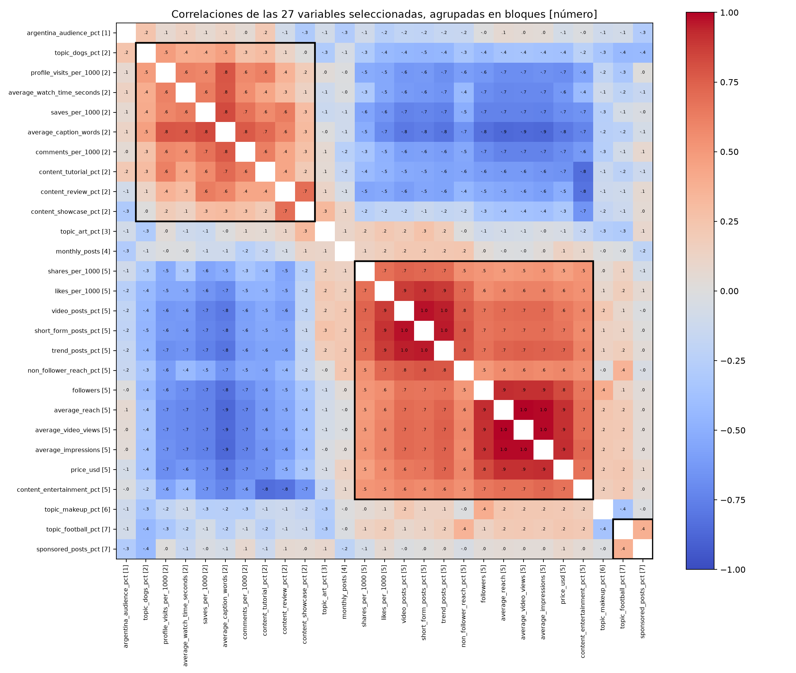
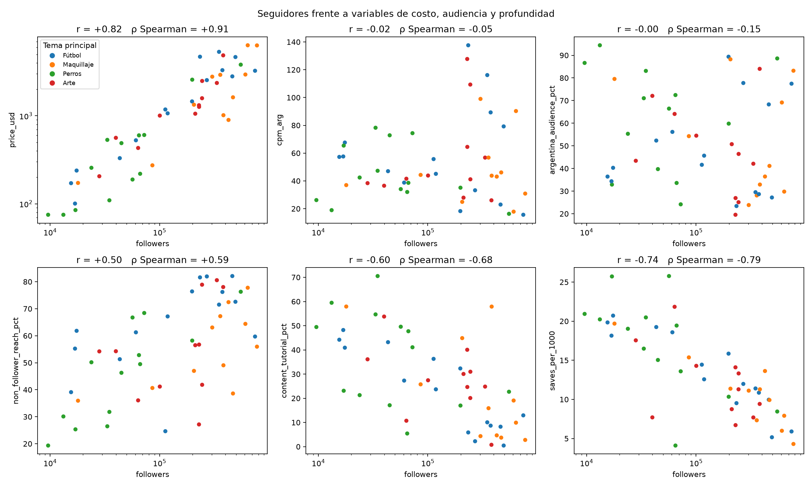
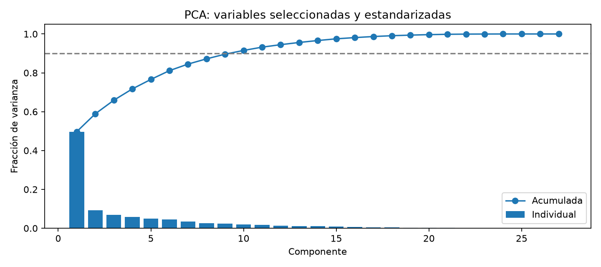
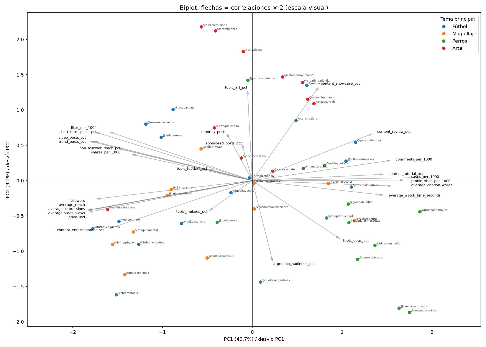
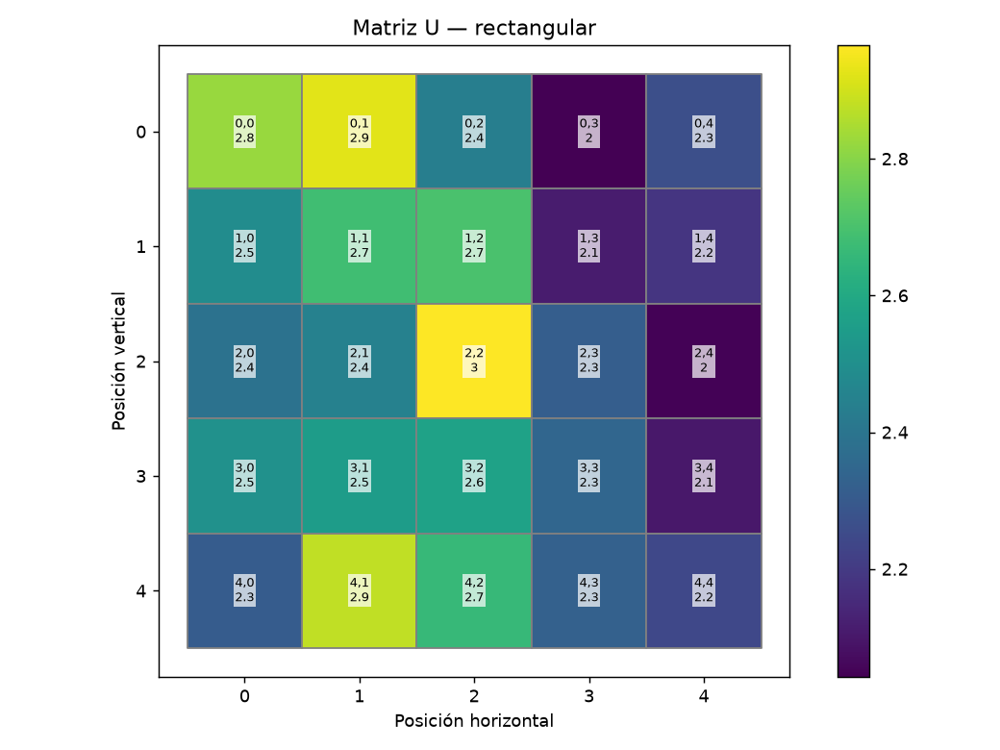

# Ejercicio 1: EDA y PCA inicial

## Actualización: barrido de geometría completado

El [análisis de 300 corridas de Kohonen](geometria_kohonen/README.md) agrega evidencia de geometría, topología, inicialización y duración: 60 configuraciones con cinco semillas, tablas agregadas y una figura listas para versionar. Hay candidatos para seguir comparando; todavía no es una elección global de hiperparámetros ni de representación. La interpretación de campañas de este documento corresponde al modelo exploratorio 5×5 de 500 épocas, y deberá revisarse al seleccionar el modelo final.

## Reproducción

Desde TP4: `python3 analysis/eda_pca.py`. Requiere las dependencias de `requirements.txt` y `data/creadores.csv`. El PCA usa la implementación compartida de `src.tp4.pca`, mediante SVD de NumPy, sin scikit-learn. Las validaciones, representaciones, tablas y gráficos están separados en módulos de `analysis`. Genera tablas y gráficos en esta carpeta. Las pruebas verifican ortogonalidad, reconstrucción completa, autovalores y coherencia con el preprocesamiento. Esta etapa no implementa todavía Kohonen ni Oja.

## Calidad y exploración

Hay **50 creadores, 33 columnas y 31 variables numéricas**. No hay faltantes, infinitos, filas duplicadas, identificadores repetidos ni nombres repetidos. Los porcentajes están entre 0 y 100; temas, propósitos del contenido y publicidad suman 100 por fila. No es necesario imputar.

Las escalas son muy diferentes: seguidores van de 9.604 a 775.589; precios de USD 75 a 6.334,71; audiencia argentina de 19,55% a 94,43%. Por eso centrar sin escalar daría mayor influencia a las unidades grandes. **Se aplica z-score con desvío muestral a cada variable seleccionada.** Los parámetros quedan en `escalado.csv` para transformar creadores nuevos con la misma referencia.

El criterio de 1,5 IQR señala 11 observaciones en maquillaje y 11 en arte. No se eliminan: son porcentajes válidos y la especialización es justamente información útil para los clientes. También señala cinco alcances argentinos estimados, tres engagements totales y un valor en likes, comentarios y compartidos. Son señales para inspección, no evidencia de errores. No se recortan ni se borran creadores. Ver `atipicos.csv`, `descriptivos.csv` y `distribuciones.png`.

Sin escalar, seguidores, impresiones, alcance y reproducciones concentran el **99,996% de la varianza total** de las 27 variables seleccionadas (seguidores solo, 65%); el desvío de seguidores es 148.000 veces el de comentarios. Una distancia euclídea en unidades originales sería, en la práctica, una distancia por tamaño. Estandarizadas, todas quedan en el mismo rango (izquierda frente a derecha). Después de estandarizar quedan fuera de los bigotes los especialistas de maquillaje y arte, que se explican en la sección siguiente, y valores aislados de likes, comentarios y compartidos.

## Exploración orientada al caso de uso

Las tablas están en `temas_medianas.csv`, `temas_especializacion.csv`, `bloques_variables.csv` y `seguidores_relaciones.csv`.

### Temas: cada creador tiene uno principal

Por tema principal hay 15 creadores de fútbol, 13 de perros, 11 de maquillaje y 11 de arte. **Ninguno es mixto**: el tema principal ocupa entre 39,6% y 82,2% de las publicaciones (mediana 66,9%), y el segundo nunca supera el 25,1%. Por eso las distribuciones de cada tema son bimodales: un grupo de especialistas (≈60–80%) y el resto (≈5–20%). Los "atípicos" IQR de maquillaje y arte son esos especialistas: hay solo 11, frente a 39 no especialistas, y caen fuera de los bigotes. El nombre de usuario no es una guía confiable: `@vidaperruna` y `@makeupconsejos` publican mayormente fútbol, y `@estiloydetalle`, perros.

| Mediana por tema principal | Fútbol | Maquillaje | Perros | Arte |
| --- | ---: | ---: | ---: | ---: |
| Seguidores | 198.136 | 383.128 | 44.870 | 229.175 |
| Precio USD | 1.457 | 1.622 | 256 | 1.264 |
| USD por 1.000 cuentas AR | 55,7 | 43,8 | 38,6 | 41,6 |
| Audiencia argentina | 41,6% | 41,1% | 66,4% | 46,4% |
| Alcance a no seguidores | 67,2% | 56,0% | 49,5% | 54,3% |
| Tutoriales | 23,7% | 15,9% | 41,1% | 27,4% |
| Guardados / 1.000 | 12,6 | 11,1 | 19,0 | 11,3 |
| Visitas al perfil / 1.000 | 14,9 | 15,6 | 20,2 | 16,8 |
| Tiempo de visualización (s) | 21,3 | 22,7 | 30,4 | 20,8 |

- **Perros** es el tema más distinto: creadores chicos y baratos, con más audiencia argentina, más tutoriales, guardados, visitas y tiempo de visualización. Es favorable para los refugios, cuyo objetivo es local.
- **Maquillaje** reúne los creadores más grandes y los que menos tutoriales publican.
- **Fútbol** tiene el mayor alcance a no seguidores y el mayor costo por cuenta argentina alcanzada: el descubrimiento ocurre en buena parte fuera de Argentina.
- Las cajas se superponen mucho y cada grupo tiene entre 11 y 15 creadores: las medianas describen tendencias, no grupos separables. Dentro de cada tema hay creadores chicos y grandes (fútbol va de 16 mil a 745 mil seguidores), así que el tema no reemplaza al resto de las variables.

### Bloques de variables

La matriz de correlaciones se ordenó con un agrupamiento jerárquico de enlace promedio y distancia **1 − r con signo**, cortando donde la correlación media dentro del bloque baja de 0,3. Se usa el signo a propósito: con 1 − |r| alcance y profundidad quedarían juntos por ser opuestos.

| Bloque | Variables | r media interna | Contenido |
| --- | ---: | ---: | --- |
| Visibilidad / formato viral | 12 | 0,71 | Seguidores, alcance, impresiones, reproducciones, precio, video, short, tendencias, likes, compartidos, alcance a no seguidores, entretenimiento |
| Profundidad | 9 | 0,47 | Texto, guardados, comentarios, visitas, tiempo de visualización, tutoriales, reseñas, exhibición, perros |
| Fútbol y publicidad | 2 | 0,38 | `topic_football_pct`, `sponsored_posts_pct` |
| Variables sueltas | 1 c/u | — | Audiencia argentina, arte, maquillaje, publicaciones mensuales |

Los dos bloques grandes son **opuestos**: las 108 correlaciones entre ellos son todas negativas, de −0,14 a −0,86, con media −0,57: 21 de las 27 variables describen un mismo eje, de grande y viral a chico y elaborado. Eso explica que PC1 retenga casi la mitad de la varianza. Las variables que más importan para elegir por cliente (tema y audiencia argentina) casi no correlacionan con ese eje ni entre sí.

**Implicancia para Kohonen.** Con z-score, cada variable aporta lo mismo a la distancia euclídea. El bloque de visibilidad aporta 12 coordenadas de información muy parecida, y la audiencia argentina, una sola. El mapa tenderá a organizarse primero por tamaño y profundidad, y a separar poco por tema y geografía. No es un error, pero hay que tenerlo en cuenta al leer la grilla. Si interesa que el tema pese más, las alternativas son la representación de 24 variables preparada en la batería (`04_representation`) o pesos por bloque. La selección actual no se cambia: es una decisión que se evalúa con el SOM, no con el EDA.

### Seguidores frente al objetivo de las campañas

| Seguidores frente a | Pearson | Spearman |
| --- | ---: | ---: |
| Precio USD | +0,82 | +0,91 |
| USD por 1.000 cuentas AR | −0,02 | −0,05 |
| Audiencia argentina | −0,00 | −0,15 |
| Alcance a no seguidores | +0,50 | +0,59 |
| Tutoriales | −0,60 | −0,68 |
| Guardados / 1.000 | −0,74 | −0,79 |

Spearman, que usa rangos y no se ve afectado por la asimetría de seguidores, confirma cada relación y a veces la refuerza. Los seguidores predicen el **precio** pero no el **costo por cuenta argentina alcanzada** ni la **proporción de audiencia argentina**: un creador grande es más caro en total sin ser más eficiente para llegar a Argentina. A más seguidores, más descubrimiento y menos contenido profundo. Esto adelanta, con datos crudos, la respuesta sobre "seleccionar solo por seguidores" de la sección de campañas.

## Selección de variables

Se excluyen `creator_id` y `name` de la matriz numérica; permanecen para identificar resultados. De las 31 variables numéricas se conservan **27**:

| Variable excluida | Motivo | Información conservada |
| --- | --- | --- |
| `price_ars` | Es exactamente 1.500 veces el precio USD, salvo precisión flotante | `price_usd` |
| `organic_posts_pct` | Es 100 menos publicidad | `sponsored_posts_pct` |
| `total_engagement_per_1000` | Es la suma de las cuatro interacciones | Likes, comentarios, guardados y compartidos por separado |
| `estimated_argentina_reach` | Es alcance × porcentaje argentino, redondeado; error máximo 0,499 cuentas | Alcance y porcentaje argentino |

Esto evita dar peso adicional a información calculada. El alcance argentino es una relación **no lineal**: eliminarlo puede cambiar la geometría lineal del PCA. La decisión es preservar sus dos factores para distinguir volumen de pertinencia geográfica; se conserva en el CSV original para evaluar campañas.

No se descartan automáticamente seguidores, alcance, impresiones o reproducciones por su alta correlación: miden aspectos diferentes del caso de uso y la consigna pide agrupar considerando todas las variables. Queda el riesgo de dar más peso al bloque de escala/visibilidad por tener varias medidas similares. Comparar una representación con una medida por bloque o pesos por bloque es una alternativa para Kohonen; el PCA por sí solo no corrige ese peso semántico.

**Validación con Kohonen.** El [barrido de representaciones](representacion_kohonen/README.md) (360 corridas) confirma la selección de 27 variables. Con las 31 originales, la pureza de tema de las neuronas baja de 0,77 a 0,67 (4×4) y de 0,84 a 0,73 (5×5). Quitar seguidores, impresiones y vistas (24 variables) no mejora la separación por tema y la pierde por audiencia argentina en 5×5 (0,48 frente a 0,58, con 0,43 al azar). Los logaritmos y PCA 2 tampoco mejoran sin perder otra dimensión.

Se conservan los cuatro temas y los cuatro propósitos. Cada grupo suma 100, de modo que introduce una dependencia lineal exacta después del centrado: la matriz de 27 columnas tiene rango 25. SVD lo maneja y aparecen dos componentes de varianza nula. Conservar todos mantiene simetría entre categorías; eliminar una categoría por grupo es posible pero modifica las distancias al elegir una referencia. Una transformación composicional ILR es otra opción si interesa interpretar proporciones relativas; requiere una geometría distinta y revisar el tratamiento de ceros si llegan datos nuevos. No se aplica en esta primera versión.

## PCA y reducción

| Representación | PC1 | PC2 | PC1 + PC2 | Componentes ≥80% | ≥90% | ≥95% |
| --- | ---: | ---: | ---: | ---: | ---: | ---: |
| 31 variables, z-score | 47,97% | 9,76% | 57,72% | 6 | 10 | 13 |
| **27 seleccionadas, z-score** | **49,71%** | **9,19%** | **58,89%** | **6** | **10** | **13** |
| 27 seleccionadas, log1p en magnitudes y z-score | 52,40% | 8,57% | 60,97% | 6 | 9 | 12 |

En la variante log se transforman seguidores, alcance, impresiones, reproducciones y precio USD. Comprime diferencias absolutas entre creadores grandes y destaca diferencias relativas. **La base inicial elegida es sin log**: mantiene la interpretación de las magnitudes originales y el aumento de varianza retenida por las dos primeras componentes con log es modesto. Ese porcentaje no mide calidad comercial ni demuestra que una transformación sea superior. Log sigue siendo una alternativa razonable si la agrupación buscada prioriza diferencias relativas.

**Decisión:** usar PC1–PC2 como visualización, no como representación suficiente para entrenar la red. Retienen 58,89%, perdiendo 41,11%. Para Kohonen se propone una base de comparación con las 27 variables estandarizadas y otra con **10 componentes sin whitening**, que retienen **91,53%**. Se elige el umbral del 90% como compromiso explícito, no como regla universal. Las alternativas son 6 componentes (81,12%), 13 (95,63%) o conservar todas las dimensiones informativas. La decisión final requiere medir error de cuantización, error topográfico y estabilidad del SOM; aún no fueron evaluados. Whitening igualaría los pesos de componentes con distinta varianza y puede amplificar dimensiones débiles; no se utiliza.

## Interpretación

Los números siguientes son **correlaciones variable-componente**, no coeficientes del autovector. Están en `cargas_correlacion.csv`; los coeficientes para proyectar están en `coeficientes.csv`. El signo de una componente es arbitrario: el script fija positivo su coeficiente de mayor módulo.

- **PC1 (49,71%)**: hacia valores negativos aparecen impresiones (−0,918), reproducciones (−0,913), alcance (−0,909), tendencias (−0,900), seguidores (−0,869) y precio (−0,869). Hacia valores positivos: longitud del texto (+0,937), guardados (+0,841), visitas al perfil (+0,773), comentarios (+0,767) y tutoriales (+0,729). Sugiere un contraste entre visibilidad/formato breve y contenido más elaborado con interacciones de profundidad. Son asociaciones del catálogo; no prueban causalidad ni ventas.
- **PC2 (9,19%)**: predominan exhibición de productos/resultados (+0,659) y arte (+0,632), en oposición a audiencia argentina (−0,568) y perros (−0,411). Mezcla contenido y geografía: no corresponde etiquetarla como una dimensión pura de calidad o de temática.
- **PC3 (7,00%)**: publicidad (+0,731) y fútbol (+0,659), frente a perros (−0,462). Agrega diferenciación comercial y temática ausente del plano inicial.
- **PC4 (5,83%)**: maquillaje (+0,640) frente a fútbol (−0,586). Refuerza que PC1–PC2 no resumen todas las diferencias relevantes para los clientes.

En el biplot los puntos son scores divididos por el desvío de cada componente, y las flechas son correlaciones multiplicadas por dos para legibilidad. Es un biplot de correlación con escala visual explícita: no interpretar la distancia punto-flecha como cantidad original ni usar distancias del dibujo como distancias de entrenamiento. El color indica el tema con porcentaje máximo, solo como ayuda descriptiva; no son clusters descubiertos. Las flechas se proyectan sobre dos ejes que representan únicamente el 58,89% de la varianza.

## Implicancias para las campañas y límites

Para refugios conviene explorar afinidad con perros, audiencia argentina y visitas al perfil/comentarios, junto al costo. Para fútbol hay perfiles con alcance y descubrimiento y otros más educativos: depende del objetivo y presupuesto; PC3 y PC4 aportan información temática. Para belleza y materiales de arte se debe revisar afinidad temática y reseñas/tutoriales/exhibición, además de volumen y precio. **No elegir automáticamente por PC1 ni por seguidores.** Tener más guardados o visitas tampoco demuestra conversiones: el catálogo no contiene ventas, consultas ni adopciones atribuibles.

No se seleccionan ganadores de campaña en esta etapa. El próximo paso es entrenar y comparar SOM con estas representaciones, contrastar las regiones con las componentes e interpretar perfiles y costos. Con solo 50 registros y 27 variables, conviene evaluar estabilidad frente a semillas y cambios de muestra antes de dar por firmes los grupos. Los ejes dependen del catálogo: una actualización mensual puede rotarlos; para comparar meses hay que conservar el preprocesamiento/modelo de referencia o documentar el reajuste.

Los CSV y JSON generados contienen información derivada de los datos y se excluyen de Git junto con el CSV original. Los PNG se versionan para que el informe muestre los gráficos; se regeneran con el mismo script.

## Kohonen: perfiles por región y matriz U

Desde TP4: `python3 analysis/som_campanas.py`. Usa el preprocesamiento por defecto (27 variables, z-score, sin log) y la misma configuración de `configs/kohonen.json` (5×5 rectangular, 500 épocas, semilla 0): QE = 2,545, TE = 0,06. Genera `som_perfiles.csv` (ocupación, temas, medianas y variables más altas/bajas del prototipo de cada neurona), `som_fronteras.csv`, `som_matriz_u.png` y `som_ocupacion.png`. **Los hiperparámetros todavía no son los finales**: al fijarlos hay que volver a correr y revisar este texto.

| Región | Neuronas | Perfil |
| --- | --- | --- |
| Arriba a la derecha | 0,2 – 0,4; 1,3; 1,4 | Creadores chicos (medianas de 17 mil a 57 mil seguidores, USD 85–330). Textos largos, guardados y visitas al perfil altos; poco video, short y tendencias. Mayormente perros; algo de fútbol y maquillaje. |
| Abajo a la izquierda | 3,0; 3,1; 4,0; 4,1 | Creadores grandes y caros (medianas de 350 mil a 620 mil seguidores, USD 2.900–4.700). Alcance, impresiones y views altos, entretenimiento y tendencias; pocos comentarios, guardados y texto. En 4,0 conviven los cuatro temas: el tamaño pesa más que la temática. |
| Abajo a la derecha | 3,3 – 4,4 | Arte y exhibición de productos/resultados, tamaño medio. |
| Arriba a la izquierda | 0,0; 1,0 | Maquillaje de tamaño medio-grande, tutoriales y compartidos. |

La diagonal de la grilla, desde abajo a la izquierda (grandes, formato breve) hacia arriba a la derecha (chicos, contenido elaborado), reproduce PC1. La separación entre arte/exhibición (abajo a la derecha) y perros (arriba) se corresponde con PC2. Los temas que el biplot no separa (fútbol frente a maquillaje, PC3–PC4) aparecen en neuronas distintas dentro de un mismo nivel de tamaño.

**Matriz U.** Cada celda es la distancia media entre el prototipo de la neurona y los de sus vecinas inmediatas. Un valor alto indica que, al cruzar esa neurona, los perfiles cambian mucho: es una frontera entre grupos. Un valor bajo indica una zona homogénea. Los valores van de 2,0 a 3,0, así que no hay bordes muy marcados: los grupos se superponen, algo esperable con 50 creadores. Las zonas más homogéneas son la esquina de creadores chicos (0,3; 2,4; 3,4 ≈ 2,0–2,1). Las fronteras más altas son:

- 4,1 → 4,2 (3,70): de grandes generalistas a arte (`topic_art_pct` +1,8; alcance −1,0).
- 1,1 → 1,2 (3,37): de entretenimiento a reseñas y exhibición.
- 0,0 → 0,1 (3,07): de maquillaje a perros.
- 2,2 (U = 3,0) está en el centro, rodeada de perfiles distintos. Las neuronas 1,2 y 3,2 no tienen creadores: son prototipos intermedios entre grupos, también una señal de frontera.

## Campañas

`analysis/som_campanas.py` también genera `campanas.csv`: para cada tema, los tres mejores creadores según cada criterio, con su neurona. Supuestos propios de esta sección, que hay que explicitar:

- Un creador es candidato para un tema si es su tema principal, el de mayor porcentaje de publicaciones (fútbol 15, perros 13, maquillaje 11, arte 11). Todos tienen un tema dominante claro: el principal ocupa entre 39,6 % y 82 % (mediana 67 %).
- **Costo por alcance argentino** (`cpm_arg`): USD por cada 1.000 cuentas alcanzadas en Argentina = precio / alcance argentino estimado × 1.000. Aquí sí se usa `estimated_argentina_reach`: no entra al modelo, pero es la métrica directa del objetivo de la agencia.
- **Descubrimiento**: `non_follower_reach_pct`.
- **Profundidad educativa**: `content_tutorial_pct`, el porcentaje de publicaciones que explican un procedimiento. Es la medida más literal de "educativa", pero solo mide lo que ofrece el creador, no cómo responde la audiencia (ver "Alcance frente a profundidad").

Promedios del top 3 de cada criterio:

| Tema | Criterio | Seguidores | USD | USD / 1.000 AR | Alcance a no seguidores | Tutoriales | Guardados / 1.000 | Audiencia AR |
| --- | --- | ---: | ---: | ---: | ---: | ---: | ---: | ---: |
| Fútbol | Seguidores | 566.704 | 3.571 | 39,3 | 71,5 % | 7,2 % | 7,0 | 57,6 % |
| Fútbol | Costo alcance AR | 468.351 | 2.505 | 19,0 | 72,7 % | 17,8 % | 10,6 | 78,4 % |
| Fútbol | Descubrimiento | 322.101 | 3.348 | 64,6 | 81,9 % | 5,5 % | 10,5 | 56,5 % |
| Fútbol | Profundidad | 25.264 | 201 | 54,0 | 48,5 % | 45,2 % | 19,1 | 41,0 % |
| Perros | Seguidores | 274.276 | 2.331 | 41,9 | 67,6 % | 26,9 % | 10,8 | 57,5 % |
| Perros | Costo alcance AR | 191.464 | 1.321 | 20,5 | 41,9 % | 43,9 % | 16,5 | 89,9 % |
| Perros | Descubrimiento | 226.886 | 1.536 | 41,6 | 70,5 % | 37,8 % | 15,9 | 59,7 % |
| Perros | Profundidad | 27.132 | 239 | 48,2 | 29,4 % | 61,6 % | 19,1 | 82,9 % |
| Maquillaje | Seguidores | 674.103 | 5.197 | 46,3 | 66,0 % | 10,6 % | 6,1 | 60,7 % |
| Maquillaje | Costo alcance AR | 529.927 | 3.532 | 24,6 | 55,8 % | 22,2 % | 7,2 | 80,2 % |
| Maquillaje | Descubrimiento | 474.562 | 3.385 | 63,4 | 72,5 % | 10,2 % | 9,6 | 31,4 % |
| Maquillaje | Profundidad | 202.439 | 842 | 35,2 | 44,0 % | 53,6 % | 14,1 | 66,9 % |
| Arte | Seguidores | 319.966 | 3.239 | 41,3 | 66,8 % | 18,9 % | 10,1 | 57,5 % |
| Arte | Costo alcance AR | 211.057 | 2.162 | 30,2 | 62,9 % | 28,2 % | 8,6 | 68,9 % |
| Arte | Descubrimiento | 319.807 | 2.938 | 64,1 | 79,2 % | 15,2 % | 9,5 | 50,4 % |
| Arte | Profundidad | 99.089 | 695 | 67,6 | 45,2 % | 43,3 % | 13,1 | 45,0 % |

**Fútbol: ¿alcance masivo, descubrimiento o profundidad?** Para vender ropa de entrenamiento en Argentina conviene priorizar **alcance argentino a bajo costo con descubrimiento**: frente al top por seguidores, cuesta la mitad por cuenta argentina alcanzada (19,0 frente a 39,3), tiene más audiencia argentina (78 % frente a 58 %) e igual alcance a no seguidores, por un precio 30 % menor. Dos de los tres creadores son los mismos (`@golconmate` y `@tribunacreativa`): la diferencia es cambiar `@futbolsinvueltas`, tercero en seguidores pero con 27 % de audiencia argentina y USD 79,2 por cada 1.000 cuentas argentinas, por `@futbolcononda` (89 % argentina, USD 18,3). Los creadores de profundidad publican 45 % de tutoriales y son muy baratos (USD 201 en promedio), pero 59 % de su audiencia está fuera de Argentina y cada cuenta argentina cuesta casi el triple (54,0 frente a 19,0). Sirven como complemento educativo, no como base.

**Refugios de perros.** El objetivo son consultas y adopciones, que son locales: la audiencia argentina pesa más que el tamaño. El criterio de costo elige creadores con 90 % de audiencia argentina y 44 % de tutoriales, a la mitad del precio del top por seguidores. Dos de ellos (`@huellasyconsejos` y `@consejoscaninos`, USD 75 cada uno) están en la neurona 0,4, la región de creadores chicos con visitas al perfil y comentarios altos, coherente con generar consultas. El tercero, `@crearenreels`, es grande (551 mil seguidores) y también encabeza el top por seguidores: ahí ambos criterios coinciden. Perros es el tema donde mejor van juntas profundidad y audiencia local: el top de profundidad (62 % de tutoriales) tiene 83 % de audiencia argentina, y los tres están en la neurona 0,4. `@huellasyconsejos` aparece en ambos criterios.

**Maquillaje y arte.** En ambos, el criterio de costo baja el precio por cuenta argentina (24,6 frente a 46,3; 30,2 frente a 41,3) y sube la audiencia argentina. En maquillaje, `@brochasymates` aparece en el top de costo y en el de profundidad (45 % de tutoriales, 88 % de audiencia argentina, USD 24,9 por cada 1.000 cuentas argentinas): equilibra los dos objetivos. En arte, el top de profundidad tiene el costo por cuenta argentina más alto del tema (67,6), por `@creatividadaldia` (20 % de audiencia argentina).

**Descubrimiento.** En los cuatro temas, el top por alcance a no seguidores es caro por cuenta argentina alcanzada (USD 41,6 a 64,6 por cada 1.000, frente a 19,0 a 30,2 del criterio de costo). En maquillaje solo 31 % de su audiencia es argentina: buena parte del descubrimiento ocurre fuera del público objetivo. Para una campaña local conviene usarlo como criterio secundario, filtrando antes por audiencia argentina o costo.

**Alcance frente a profundidad.** En los cuatro temas, el top de profundidad tiene muchos menos seguidores que el de seguidores (de 25 mil a 202 mil, frente a 274 mil a 674 mil). No es un efecto de la métrica elegida: todas las variables asociables a profundidad correlacionan negativamente con los seguidores (tutoriales −0,60, guardados −0,74, largo del texto −0,82, tiempo de visualización −0,68, comentarios −0,69). En este catálogo no hay creadores grandes con contenido profundo. Hay que elegir entre volumen y profundidad, o combinar creadores de ambos tipos.

**Otras formas de medir profundidad.** Los tutoriales miden lo que el creador ofrece. Se podrían sumar variables de respuesta de la audiencia, por ejemplo como promedio de z-scores:

| Variable | Qué agrega | Limitación |
| --- | --- | --- |
| `saves_per_1000` | Se guarda lo que resulta útil para volver a verlo; correlaciona 0,57 con tutoriales | También se guarda contenido inspirador o gracioso |
| `average_caption_words` | Explicaciones más desarrolladas | Mide la forma, no la calidad |
| `average_watch_time_seconds` | La audiencia consume el contenido completo | Depende de la duración de cada video |
| `comments_per_1000` | Preguntas y conversación | También sube con polémicas |

`shares_per_1000` no sirve para esto: correlaciona negativamente con tutoriales (−0,42) y guardados (−0,56), y positivamente con formato breve (+0,72). Pertenece al bloque viral, no al de profundidad.

**Seleccionar solo por seguidores.** Ventaja: es simple, no requiere modelo y da volumen y descubrimiento (correlación de seguidores con alcance a no seguidores: +0,50). Desventajas: los seguidores no predicen el costo por cuenta argentina alcanzada (−0,02) ni el engagement (+0,14), y correlacionan negativamente con tutoriales (−0,60) y guardados (−0,74). En los cuatro temas el top por seguidores es el más caro y no el de mayor audiencia argentina. La selección por perfil requiere más análisis y supuestos (métrica de costo, definición de profundidad), y ninguna de las dos mide ventas ni adopciones reales.

**Mantenimiento.**

- **Nueva campaña:** no hace falta reentrenar. Se definen tema y objetivo, se filtra y ordena con las métricas, y la grilla indica qué región y qué creadores parecidos mirar.
- **Nuevos creadores:** se proyectan con `Preprocessor.transform` y `predict` sobre el modelo existente. Si son muchos o de perfiles nuevos, hay que reentrenar.
- **Nuevas variables:** cambia la dimensión de entrada: hay que rehacer preprocesamiento, PCA, SOM y Oja, y revisar el tamaño de grilla.
- **Actualización mensual:** cambian medias y desvíos; reentrenar puede rotar las componentes y mover creadores de neurona. Conviene conservar el preprocesamiento del mes de referencia para comparar y documentar cada reentrenamiento.

## Bitácora de experimentos

La [bitácora](bitacora/README.md) conserva la cronología, las decisiones sobre duración y los límites de las conclusiones. El [inventario CSV](bitacora/experimentos.csv) registra el estado de cada ejecución al corte; el barrido de representaciones sigue en curso.
