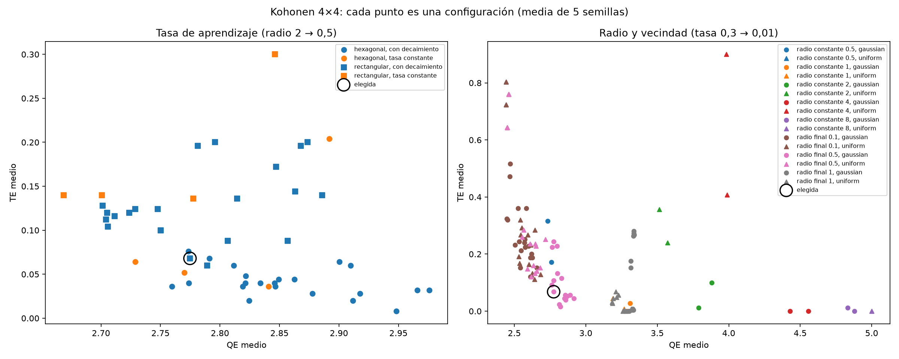

# Kohonen: tasa de aprendizaje y radio

Desde TP4, con las corridas locales: `python3 -m analysis.hyperparameter_summary`. Genera `aprendizaje.csv`, `vecindad.csv` y `comparacion.png`.

**840 corridas, sin fallas.** Todas en 4×4, el tamaño elegido en el [barrido de geometría](../geometria_kohonen/README.md), con 27 variables estandarizadas, 1.000 épocas (decaimiento durante las primeras 500), inicialización desde muestras, ambas topologías y 5 semillas:

- **Tasa de aprendizaje** (`02_learning`, 260 corridas): inicial 0,05–0,6; final 0,001–0,05 o igual a la inicial; decaimiento lineal, exponencial o constante. Radio fijo de 2 a 0,5, gaussiano.
- **Radio y vecindad** (`03_neighborhood`, 580 corridas): inicial 0,5–8; final 0,1, 0,5, 1 o constante; decaimiento lineal o exponencial; vecindad gaussiana o uniforme. Tasa fija de 0,3 a 0,01, exponencial.

Cada punto es una configuración, con la media de 5 semillas. El círculo es la configuración elegida: rectangular, tasa 0,3 → 0,01 exponencial, radio gaussiano 2 → 0,5 exponencial. Tiene QE = 2,775, TE = 0,068, ARI entre semillas 0,87 y 1 % de neuronas vacías.

## Radio: define si el mapa conserva vecindades

El radio final es lo que más mueve las métricas, y QE y TE se oponen:

| Radio final (gaussiana, rectangular) | QE | TE | Qué pasa |
| --- | ---: | ---: | --- |
| 0,1 | 2,47–2,60 | 0,21–0,52 | Al final solo se actualiza la ganadora: el SOM se comporta como k-medias y pierde la topología |
| **0,5** | **2,76–2,83** | **0,07–0,24** | Compromiso; con inicio 2 y decaimiento exponencial, el menor TE del grupo |
| 1 | 3,31–3,34 | 0,15–0,28 | Los prototipos quedan atados a sus vecinos y se acercan entre sí: peor ajuste |
| Constante 2–8 | 3,88–4,88 | 0,00–0,10 | Todo el mapa se mueve junto: 31–75 % de neuronas vacías |

- **Vecindad uniforme con radio menor a 1** no incluye a ninguna vecina, y el TE sube a 0,64–0,80 en ambas topologías.
- **Un radio inicial de 8 en una grilla 4×4** abarca todo el mapa al principio. No mejora frente a 2 y, en rectangular, sube el TE a 0,22–0,23.
- El QE más bajo del barrido (2,44) es de configuraciones sin vecindad efectiva. Por eso **no se elige minimizando QE**: un error de cuantización bajo con TE alto es un agrupamiento sin mapa, y la matriz U y las regiones dejan de tener sentido.

## Tasa de aprendizaje: importa menos, salvo si no decae

| Tasa (rectangular) | QE | TE | ARI |
| --- | ---: | ---: | ---: |
| Constante 0,6 | 2,85 | 0,30 | 0,40 |
| Constante 0,3 | 2,67 | 0,14 | 0,68 |
| Constante 0,05–0,1 | 2,70–2,78 | 0,14 | 0,84–0,87 |
| Que termina en 0,001 | 2,71–2,89 | 0,09–0,20 | 0,77–0,92 |
| **0,3 → 0,01 exponencial** | **2,78** | **0,07** | **0,87** |
| 0,6 → 0,01 exponencial | 2,79 | 0,06 | 0,94 |

- **Una tasa constante alta impide converger.** Con 0,6 los prototipos siguen saltando con cada muestra: TE 0,30 y asignaciones que cambian entre semillas (ARI 0,40).
- **Las tasas que bajan hasta 0,001** dejan de aprender en la segunda mitad del decaimiento y terminan con más QE o más TE.
- **0,3 y 0,6 → 0,01 exponencial son equivalentes.** Al entrenar 5 semillas con 0,6, las 5 regiones de interpretación resultan idénticas (ARI 1 con las de 0,3), con estabilidad entre semillas algo mayor (0,84 frente a 0,79). Se mantiene 0,3: no cambia ningún resultado.
- **Hexagonal** tiene menos TE (0,01–0,08 en casi todas las configuraciones con decaimiento) y algo más de QE, como en geometría, pero menor estabilidad (ARI 0,59–0,82). La rectangular se mantiene porque sus regiones son más estables ([análisis de regiones](../som/README.md)).

## Decisión

**Se confirman los valores del modelo de interpretación**: tasa 0,3 → 0,01 y radio gaussiano 2 → 0,5, ambos con decaimiento exponencial. Las alternativas con menor QE pierden la topología o la estabilidad, y la única con un TE algo menor (tasa 0,6) da las mismas regiones.
