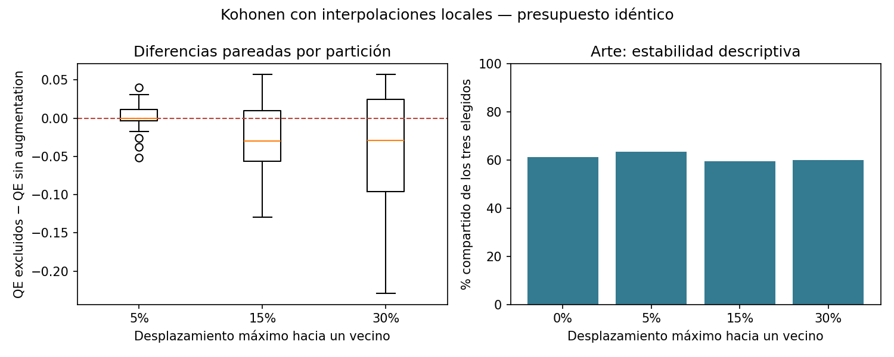

# Augmentation en Kohonen — 22/10/2026

**Se probó y se mantiene el entrenamiento actual.** Las interpolaciones locales son compatibles con Kohonen y produjeron pequeñas mejoras medias de cuantización sobre perfiles excluidos, pero ninguna intensidad cumplió todos los criterios fijados antes del experimento. No hay evidencia suficiente aquí para adoptar augmentation como mejora de la solución.

Se completaron **240/240 entrenamientos**, más una referencia. La prueba inicial de funcionamiento se ejecutó aparte. Pasaron **112 tests del TP4**, incluidos cinco controles nuevos de augmentation. Se conservaron resultados livianos, sin pesos, redes ni perfiles sintéticos, y no se hizo push.

## Qué se hizo y por qué sigue siendo Kohonen

El SOM mantiene sus 16 neuronas en grilla rectangular 4×4, su elección de ganadora y su actualización habitual de ganadora y vecinas. Cambian las presentaciones durante el entrenamiento. Para cada perfil A se busca entre sus tres vecinos más cercanos del mismo tema principal y se elige B. Con probabilidad 1/2 se presenta A intacto; en el resto se presenta:

`A' = (1 − α) A + α B`, con `α` uniforme entre cero y la intensidad máxima.

Ejemplo ilustrativo: si A tiene 100.000 seguidores y B tiene 120.000, con `α = 0,15` se presentan 103.000 seguidores. El mismo coeficiente interpola todas las variables de ese perfil. **15 % es el desplazamiento hacia B, no ruido independiente de ±15 % en cada columna.** No equivale a generar nuevos creadores reales.

El escalador y los vecinos usan solo los 40 creadores incluidos de cada partición. Las mezclas convexas conservan límites, positividad y las composiciones porcentuales, con el redondeo presente en los originales. Las columnas derivadas descartadas por el preprocesador no intervienen en la generación. Se restringe el vecino al mismo tema para reducir mezclas temáticamente incoherentes; esto es una decisión de augmentation basada en las variables de entrada, no una etiqueta de éxito comercial.

Se compararon las intensidades 0, 0,05, 0,15 y 0,30 en **20 particiones de 40/50 creadores y tres semillas por partición**. Cada condición tuvo las mismas **40.000 actualizaciones**, inicialización y orden de presentaciones de su contraparte. El generador de perturbaciones es independiente del de entrenamiento. La comparación no obtiene más actualizaciones al generar copias.

El [protocolo completo](PROTOCOLO.md) describe semillas, métricas, límites y reproducción. `pilot/protocol.json` se escribió antes de entrenar e identifica todas las tareas y hashes de datos y código.

## Resultado principal: perfiles reales excluidos

Se evalúan los diez perfiles excluidos, originales y sin perturbaciones. Los resultados se promedian primero entre las tres semillas de cada partición, para describir después las 20 particiones.

| Desplazamiento máximo | QE medio de excluidos ↓ | Reducción relativa frente a cero ↑ | Particiones con menor QE que cero | TE medio de excluidos ↓ |
| --- | ---: | ---: | ---: | ---: |
| Sin augmentation | 3,6662 | Referencia | — | 0,2950 |
| 5 % | 3,6661 | 0,002 % | 11/20 (55 %) | 0,3050 |
| 15 % | 3,6413 | 0,680 % | 14/20 (70 %) | 0,2533 |
| 30 % | 3,6276 | 1,053 % | 12/20 (60 %) | 0,2767 |

El nivel 5 % prácticamente no modifica el error de excluidos. El 15 % tiene una mejora más frecuente y menor TE, pero su reducción de QE no alcanza el 1 % predeclarado. El 30 % supera apenas el 1 % de mejora media, aunque en **ocho de las 20 particiones no mejora** el QE.

| Intensidad | Diferencia media de QE, augmentation − cero | Percentiles 5–95 de las diferencias por partición |
| --- | ---: | ---: |
| 5 % | −0,00009 | −0,03871 a +0,03134 |
| 15 % | −0,02494 | −0,08649 a +0,04480 |
| 30 % | −0,03859 | −0,13805 a +0,05046 |

Valores negativos indican mejora. En los tres niveles hay variación entre particiones y los rangos incluyen deterioros. Los percentiles son descriptivos; las particiones se superponen y no constituyen muestras independientes de una población nueva. Estos resultados no demuestran que augmentation sea inútil: no alcanzaron los requisitos prácticos de esta prueba.

## ¿Mejoró la selección para arte?

Las regiones se alinean por coincidencia con la referencia completa y se mantienen las reglas actuales de selección por tema, región objetivo y costo. Se evalúa siempre el catálogo de 50 originales proyectados. Es una comparación descriptiva, no una validación independiente de ventas ni de semántica de las regiones.

| Intensidad | Solapamiento medio de los tres elegidos con la referencia | Corridas que conservan el trío completo | Corridas con menos de tres candidatos |
| --- | ---: | ---: | ---: |
| Sin augmentation | 61,1 % | 10/60 (16,7 %) | 7/60 (11,7 %) |
| 5 % | 63,3 % | 13/60 (21,7 %) | 7/60 (11,7 %) |
| 15 % | 59,4 % | 11/60 (18,3 %) | 11/60 (18,3 %) |
| 30 % | 60,0 % | 15/60 (25,0 %) | 14/60 (23,3 %) |

Hay un comportamiento irregular: el 30 % conserva el trío completo en más corridas, pero también duplica los casos que no encuentran tres candidatos, y el solapamiento medio cae ligeramente. El 5 % mejora algo esta estabilidad descriptiva sin mejorar de forma apreciable el error principal. No se resolvió la fragilidad de arte.

## ¿Agregó demasiado ruido?

No apareció un deterioro generalizado del SOM, pero sí cambios en sus fronteras. El ARI medio entre semillas de una misma partición fue 0,874 sin augmentation, 0,851 con 5 %, 0,822 con 15 % y 0,860 con 30 %. Frente al modelo sin augmentation de igual partición y semilla, los ARI fueron 0,878; 0,763 y 0,695: al aumentar la intensidad cambian más las agrupaciones, sin una mejora consistente del objetivo principal o de arte.

La distancia media de desplazamiento de las presentaciones, incluyendo las intactas, fue 0,056; 0,169 y 0,338 en distancia euclídea de las 27 coordenadas estandarizadas. Esas cifras no son un porcentaje por variable. La interpolación apunta hacia vecinos y puede suavizar diferencias reales además de variaciones indeseadas; su coherencia algebraica no garantiza realismo.

## Decisión fijada por el protocolo

Para pasar a confirmación se exigía simultáneamente: reducción de QE de excluidos de al menos 1 %, mejora en al menos 70 % de particiones, aumento de TE no mayor a 0,02 y caída de solapamiento medio de arte no mayor a 0,02.

- **5 %:** falla mejora mínima de QE y frecuencia de mejora.
- **15 %:** falla mejora mínima de QE.
- **30 %:** falla frecuencia de mejora.

Todos pasaron las tolerancias medias de TE y arte, pero ninguna condición pasó el conjunto completo. Son umbrales prácticos predeclarados, no una prueba de significación estadística. **No se habilitó la segunda etapa de 120 entrenamientos y se mantiene el SOM actual.** No se ajustaron los criterios ni las intensidades después de ver el resultado.

Para la presentación: «Probamos augmentation mediante interpolaciones locales dentro del mismo tema, con igual cantidad de actualizaciones. La reducción media de error fue pequeña y dependió de la partición; no mejoró de forma suficiente y consistente la solución, por lo que conservamos Kohonen sin augmentation».

La conclusión se limita a este catálogo, estas intensidades y una perturbación activa durante todo el entrenamiento. Otras familias de augmentation o un calendario que la retire al final no fueron probados. La prioridad práctica sigue siendo revisar las regiones y los candidatos fronterizos de arte.

## Archivos y verificación

En `pilot/`: `protocol.json`, `reference.json`, `runs.jsonl`, `runs.csv`, `splits.csv`, `summary.csv`, `summary.json`, `campaigns.csv`, `selection.json` y la figura. El consolidado verificó correspondencia exacta con las tareas y 40.000 actualizaciones por modelo. Se verificaron hashes de datos y fuentes después de entrenar; `verification.json` registra también el código usado para consolidar y los controles nuevos. La figura se inspeccionó visualmente.
