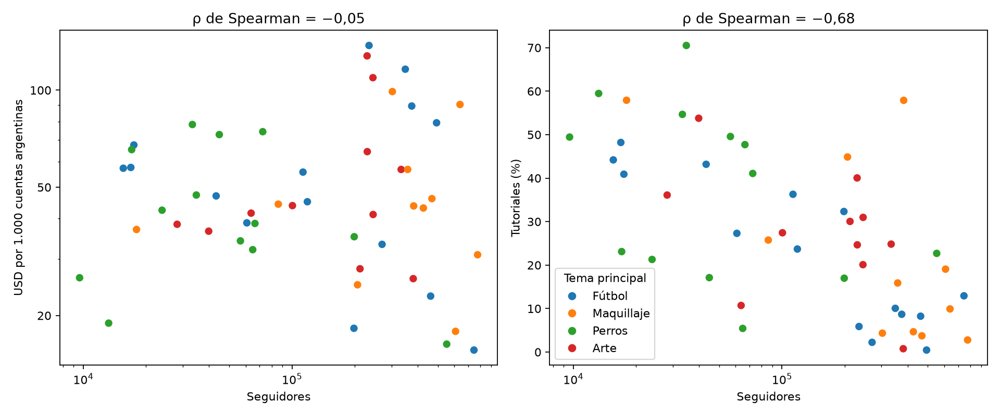
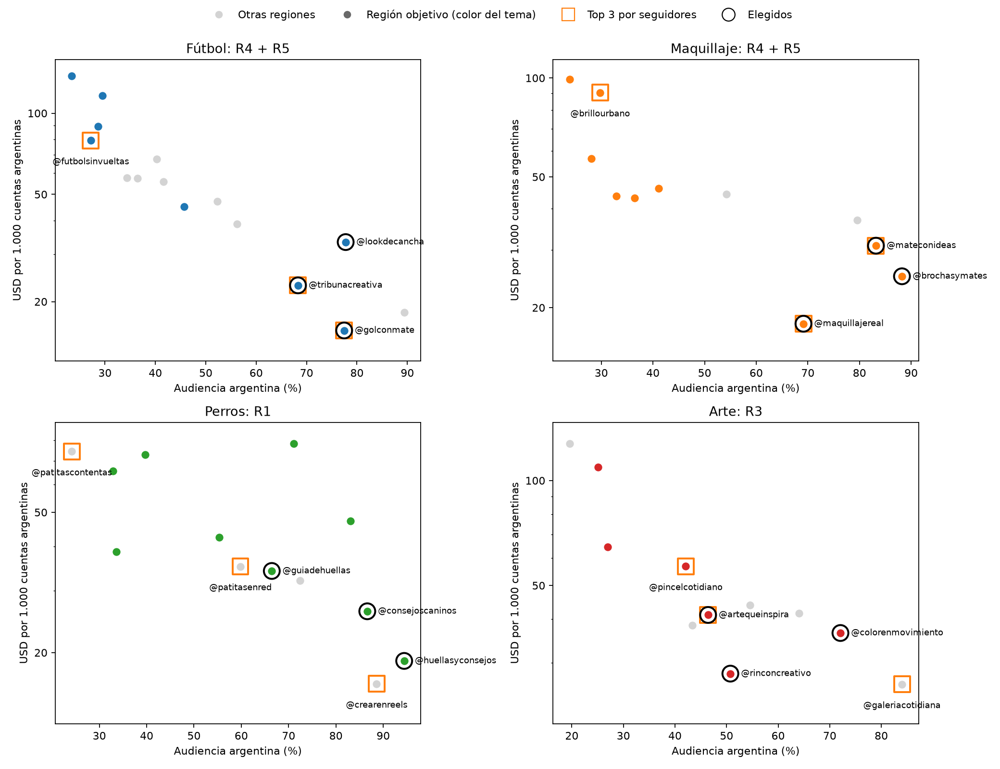
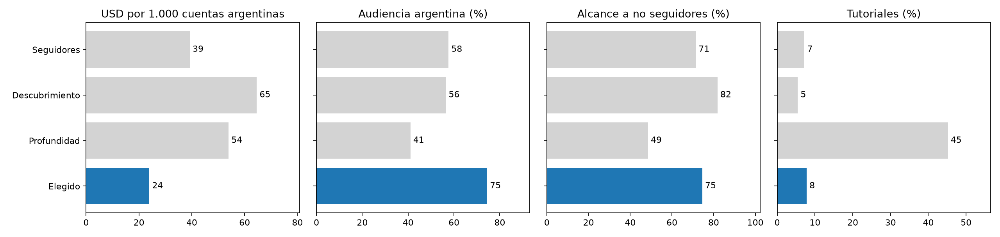
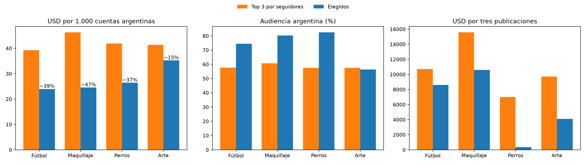

# Decisiones para las campañas

Este documento junta las decisiones del ejercicio 1.4. La evidencia está en los análisis anteriores:

- [EDA y PCA](../README.md);
- [Kohonen: regiones y campañas](../som/README.md);
- [índice de Oja](../oja/README.md).

Las cifras y los gráficos de esta carpeta se regeneran con `python3 -m analysis.som_campanas`.

## El problema, en los datos

La agencia elige por seguidores, y las campañas no llegan al público. El catálogo explica por qué:

- **Los seguidores no predicen el costo de llegar al público argentino.** La correlación de rangos entre seguidores y USD por cada 1.000 cuentas argentinas alcanzadas es −0,05. Un creador grande puede ser barato o carísimo por cuenta argentina, según cuánto de su audiencia está en el país.
- **Tamaño y profundidad se excluyen.** La correlación de rangos de seguidores es −0,68 con tutoriales, −0,79 con guardados y −0,92 con el largo del texto. No hay creadores grandes con contenido educativo.
- **El tema no depende del tamaño.** Cada creador tiene un tema principal claro (40–82 % de sus publicaciones) y hay creadores grandes y chicos de los cuatro temas.

## Cómo se elige

Se elige en dos pasos, porque el mapa de Kohonen separa tamaño, estilo y tema (η² de 0,47 a 0,71; pureza de tema 0,66 frente a 0,41 al azar), pero **no** audiencia argentina ni costo (η² ≤ 0,08, igual que al azar):

1. **Tipo de creador.** Se elige la región del mapa cuyo perfil coincide con el objetivo del cliente. Solo son candidatos los creadores cuyo tema principal es el del cliente.
2. **Creadores concretos.** Dentro de esa región se ordena por **costo por cuenta argentina alcanzada**: USD por publicación / alcance argentino estimado × 1.000. Combina precio, alcance y audiencia argentina en una sola cifra, que es lo que la agencia paga por llegar a su público. Los reemplazos son los siguientes en ese orden.

Supuestos:

- El público de los cuatro clientes está en Argentina.
- El catálogo no tiene ventas, consultas ni adopciones: todo lo que sigue optimiza llegar al público adecuado con el contenido adecuado, no conversiones medidas.
- La elección de región por cliente es un juicio sobre qué contenido sirve a cada objetivo; se explica en cada caso.

## Decisión por cliente

Cada panel muestra los creadores del tema del cliente: abajo a la derecha están los baratos por cuenta argentina y con mucha audiencia local. Los cuadrados son el top 3 por seguidores y los círculos, la selección propuesta.

### Refugios de perros: comunidad local (R1)

El objetivo, consultas y adopciones, es local y requiere confianza. R1 reúne a los 9 creadores de comunidad de perros:

- tutoriales (49 % en la mediana);
- más visitas al perfil (22,7 por 1.000) y guardados (20,2 por 1.000) que cualquier otra región;
- 66 % de audiencia argentina;
- USD 189 por publicación.

| Elegido | Seguidores | USD | USD / 1.000 AR | Audiencia AR | Tutoriales | Visitas al perfil / 1.000 |
| --- | ---: | ---: | ---: | ---: | ---: | ---: |
| `@huellasyconsejos` | 13 mil | 75 | 18,9 | 94 % | 59 % | 23,7 |
| `@consejoscaninos` | 10 mil | 75 | 26,2 | 87 % | 49 % | 22,7 |
| `@guiadehuellas` | 57 mil | 189 | 34,1 | 66 % | 50 % | 20,2 |

**Las tres publicaciones cuestan USD 339, frente a USD 6.993 con los tres de más seguidores.** Esos tres pagan 41,9 por cada 1.000 cuentas argentinas, frente a 26,4, con 27 % de tutoriales; `@patitascontentas` tiene solo 24 % de audiencia argentina. Con presupuesto de refugio, la misma inversión alcanza para varias tandas con creadores de comunidad.

- **Reemplazos**: `@estiloydetalle` (38,6) y `@clubdelasmascotas` (42,4) son los siguientes por costo, pero tienen 34 % y 55 % de audiencia argentina. Para una campaña de adopción conviene `@ideasconhuella`: 83 % de audiencia argentina, 70 % de tutoriales y USD 110, aunque cueste 47,3 por cada 1.000 cuentas argentinas.

### Ropa de entrenamiento para fútbol: descubrimiento con audiencia argentina (R4 + R5)

La consigna pregunta si conviene alcance masivo, descubrimiento o profundidad educativa. Promedios del top 3 de fútbol con cada criterio:

| Criterio | USD / 1.000 AR | Audiencia AR | Alcance a no seguidores | Tutoriales | USD por publicación |
| --- | ---: | ---: | ---: | ---: | ---: |
| Alcance masivo (seguidores) | 39,3 | 58 % | 72 % | 7 % | 3.571 |
| Descubrimiento (alcance a no seguidores) | 64,6 | 57 % | 82 % | 6 % | 3.348 |
| Profundidad educativa (tutoriales) | 54,0 | 41 % | 49 % | 45 % | 201 |
| **Elegido: R4 + R5 y costo** | **24,0** | **75 %** | **75 %** | **8 %** | **2.867** |

**Se prioriza el descubrimiento, filtrado por audiencia argentina.** La ropa de entrenamiento es un producto que se vende mostrándolo a gente que todavía no sigue al creador: R4 y R5 son las regiones donde 58–74 % del alcance llega a no seguidores.

- **El top de descubrimiento puro es el más caro** (64,6), porque su alcance a no seguidores se va fuera del país.
- **La profundidad educativa** es barata por publicación, pero 59 % de su audiencia está fuera de Argentina y cada cuenta argentina cuesta más del doble. En el mapa son los creadores de nicho de R2, con 47 % de publicaciones patrocinadas. Sirven como complemento, por ejemplo para explicar cómo usar la prenda, no como base de la campaña.

| Elegido | Región | Seguidores | USD | USD / 1.000 AR | Audiencia AR | Alcance a no seguidores |
| --- | --- | ---: | ---: | ---: | ---: | ---: |
| `@golconmate` | R5 | 745 mil | 3.251 | 15,6 | 77 % | 60 % |
| `@tribunacreativa` | R5 | 462 mil | 2.806 | 23,0 | 68 % | 82 % |
| `@lookdecancha` | R4 | 270 mil | 2.544 | 33,3 | 78 % | 82 % |

- **Reemplazos**: el siguiente en la región es `@jugadayestilo` (45,1; 46 % de audiencia argentina). Después vienen los masivos con 27–29 % de audiencia argentina (79–89 USD por cada 1.000 cuentas argentinas), que no sirven. Se propone una excepción: `@futbolcononda`. El mapa lo ubica en R2 por su contenido de reseñas, pero tiene 89 % de audiencia argentina, 76 % de alcance a no seguidores y el segundo costo más bajo del tema (18,3).

### Productos de belleza: alcance argentino (R4 + R5)

En maquillaje, los creadores con alcance y audiencia argentina están en las regiones de entretenimiento; R2 tiene solo dos de maquillaje. La selección coincide con la de solo costo:

| Elegido | Región | Seguidores | USD | USD / 1.000 AR | Audiencia AR | Tutoriales |
| --- | --- | ---: | ---: | ---: | ---: | ---: |
| `@maquillajereal` | R5 | 608 mil | 2.947 | 17,9 | 69 % | 19 % |
| `@brochasymates` | R4 | 206 mil | 1.337 | 24,9 | 88 % | 45 % |
| `@mateconideas` | R5 | 776 mil | 6.311 | 30,9 | 83 % | 3 % |

**Frente a los tres de más seguidores**, el costo por cuenta argentina baja de 46,3 a 24,6, y las tres publicaciones de USD 15.593 a USD 10.595. El cambio es reemplazar a `@brillourbano` (30 % de audiencia argentina, 90,3) por `@brochasymates`, que además publica 45 % de tutoriales: para productos de belleza, mostrar cómo se aplican es parte de la venta.

- Si el presupuesto es limitado, `@mateconideas` es una de las dos publicaciones más caras del catálogo. Se puede reemplazar por `@tallerurbano` (USD 897, pero 36 % de audiencia argentina) o `@cosmeticaconsciente` (58 % de tutoriales y 33 % de audiencia argentina).

### Materiales de arte: exhibición (R3)

R3 reúne a 6 de los 11 creadores de arte. Es la región con más exhibición de productos y resultados (26 %) y 30 % de tutoriales: el contenido que muestra el material en uso.

| Elegido | Seguidores | USD | USD / 1.000 AR | Audiencia AR | Tutoriales |
| --- | ---: | ---: | ---: | ---: | ---: |
| `@rinconcreativo` | 212 mil | 1.056 | 27,9 | 51 % | 30 % |
| `@colorenmovimiento` | 40 mil | 562 | 36,5 | 72 % | 54 % |
| `@artequeinspira` | 245 mil | 2.489 | 41,2 | 46 % | 31 % |

**Las tres publicaciones cuestan USD 4.107, frente a USD 9.718 con los tres de más seguidores**, con el doble de tutoriales (38 % frente a 19 %).

- **Arte es el caso más débil**: la audiencia argentina de R3 es baja (42 % en la mediana). El costo por cuenta argentina (35,2) mejora el del top por seguidores (41,3), pero no el de ordenar solo por costo (30,2), y la audiencia argentina queda en 56 %.
- Si el cliente prioriza alcance local sobre demostración, conviene `@galeriacotidiana` (R5): 84 % de audiencia argentina y 26,0, pero 1 % de tutoriales y USD 4.867 por publicación.
- **Reemplazo**: `@pincelcotidiano` (56,8; 42 % de audiencia argentina).

## Frente a elegir solo por seguidores

| Tema | USD / 1.000 AR: seguidores → elegido | Audiencia AR | Tres publicaciones (USD) |
| --- | --- | --- | --- |
| Fútbol | 39,3 → **24,0** | 58 % → 75 % | 10.712 → 8.601 |
| Perros | 41,9 → **26,4** | 58 % → 83 % | 6.993 → 339 |
| Maquillaje | 46,3 → **24,6** | 61 % → 80 % | 15.593 → 10.595 |
| Arte | 41,3 → **35,2** | 58 % → 56 % | 9.718 → 4.107 |

**Ventajas de elegir por seguidores:**

- Es simple, no necesita modelo y se explica en una línea.
- Asegura volumen y descubrimiento: los grandes tienen 66–72 % de alcance a no seguidores.

**Desventajas:**

- Paga por audiencia que no es el público. En los cuatro temas aparece al menos un creador grande con mucha audiencia extranjera: `@futbolsinvueltas` (27 %), `@brillourbano` (30 %), `@patitascontentas` (24 %), `@pincelcotidiano` (42 %).
- Es la opción más cara por publicación.
- Deja afuera a todo el contenido educativo y de comunidad.

**Ventajas de la selección propuesta:**

- Baja el costo por cuenta argentina en los cuatro temas, entre 15 % y 47 %.
- Ajusta el tipo de contenido al objetivo de cada cliente.
- El mapa también sirve para encontrar reemplazos del mismo perfil.

**Desventajas de la selección propuesta:**

- Depende de supuestos: la métrica de costo, qué región sirve a cada objetivo, que el público es argentino.
- Requiere mantener un modelo.
- Con 50 creadores, algunas regiones tienen pocos candidatos por tema (en fútbol, R4 + R5 tienen solo 3 creadores con más de 50 % de audiencia argentina), así que a veces hace falta una excepción justificada.

**Elegir por el mayor índice de Oja tampoco sirve.** El índice es PC1: ordena por visibilidad frente a profundidad, no por tema, costo ni audiencia argentina. En cada tema, el creador más barato por cuenta argentina queda entre los puestos 44 y 49 de 50.

## Mantenimiento

El sistema se compone de:

- el preprocesamiento: las 27 variables, con sus medias y desvíos (`escalado.csv`, `Preprocessor.state()`);
- el mapa entrenado;
- las regiones;
- la asignación de regiones a clientes (`TARGET_REGIONS` en `analysis/som_campanas.py`);
- la métrica de costo.

**Nueva campaña de un cliente existente, o de un rubro que ya está en el catálogo.** No se reentrena nada. Se define el objetivo, se elige la región, y se filtra y ordena por costo. Es inmediato.

**Cliente de un rubro nuevo** (por ejemplo, cocina). El catálogo no tiene una variable de ese tema, así que el mapa no puede agruparlo. Hay que medir el nuevo tema por creador, lo que es una variable nueva (ver abajo).

**Nuevos creadores.** Se transforman con el preprocesamiento guardado y se ubican en la neurona más cercana (`Preprocessor.transform` y `Kohonen.predict`), sin reentrenar. Conviene controlar su error de cuantización:

- Si queda por encima de los valores del catálogo, el creador no se parece a ningún prototipo y su región no es confiable.
- Si son muchos creadores, o de perfiles nuevos, hay que reentrenar. El tamaño del mapa (4×4 para 50 creadores) y la cantidad de regiones se eligieron con estos datos; con un catálogo mucho mayor hay que repetir el barrido de geometría.

**Nuevas variables.** Cambia la dimensión de entrada, así que se rehace todo:

- **EDA**: si la variable es redundante, derivada o tiene una escala extrema.
- **PCA**: las componentes cambian, así que el índice de Oja también.
- **Barridos y regiones**: con las regiones nuevas hay que revisar qué región corresponde a cada cliente.

Antes de incorporarla conviene preguntarse si es una variable nueva o una combinación de las existentes. Por ejemplo, el alcance argentino estimado no entra al modelo porque es alcance × porcentaje argentino.

**Actualización mensual.** Las variables son medias de fin de mes, así que cada mes cambian los valores, las medias y los desvíos. Hay dos opciones:

- **Proyectar con el modelo del mes de referencia**, sin reentrenar. Las regiones quedan fijas y un creador que cambia de región indica que cambió su perfil. Es la opción para comparar meses.
- **Reentrenar.** Los prototipos y las regiones pueden moverse, y las etiquetas R1–R5 se reordenan por seguidores. Hay que comparar con el mes anterior (ARI entre particiones) y revisar la asignación a clientes. El índice de Oja puede invertir su signo y hay que reorientarlo.

En cualquiera de las dos, **el costo por cuenta argentina se recalcula cada mes sin tocar el modelo**: no es una variable de entrada. Precios, alcances y audiencia argentina del mes cambian el orden dentro de cada región aunque el mapa sea el mismo. El tipo de cambio no afecta: el modelo usa el precio en USD y excluye `price_ars`.

Se recomienda reentrenar cuando se acumulen creadores nuevos o se detecte que muchos cambian de región, y documentar cada reentrenamiento con su fecha, sus métricas y la comparación con el modelo anterior.
