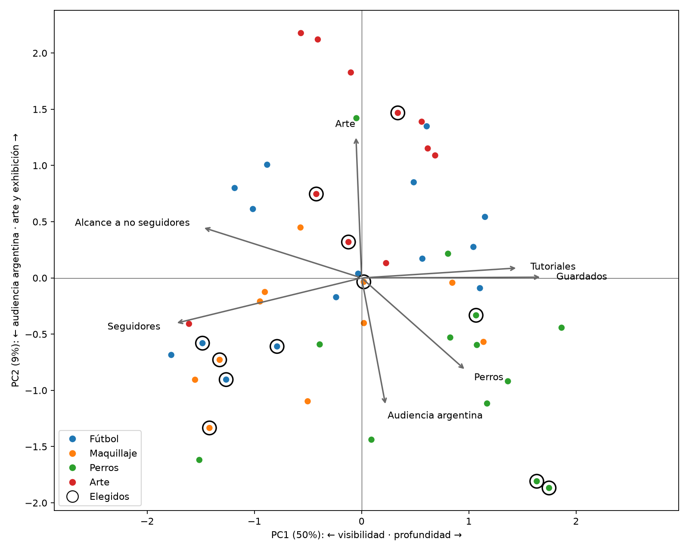
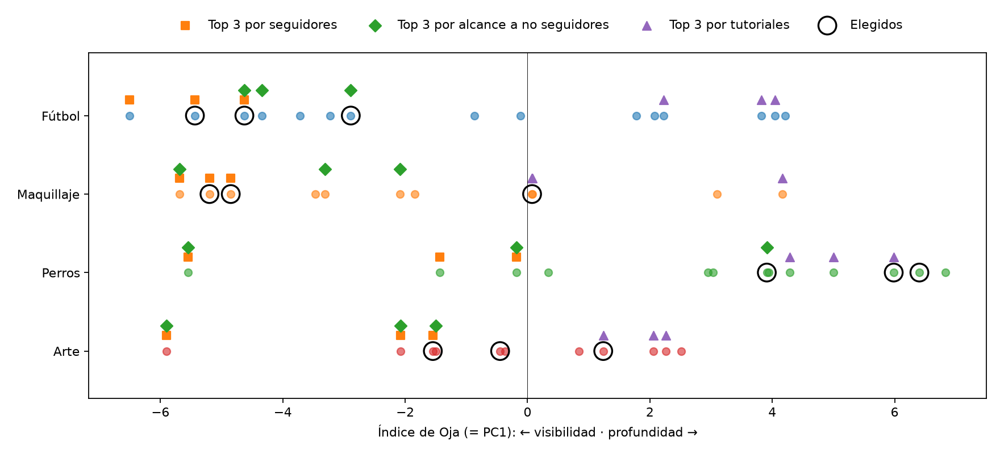
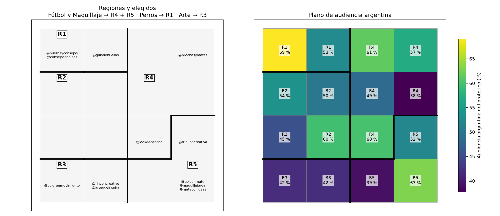
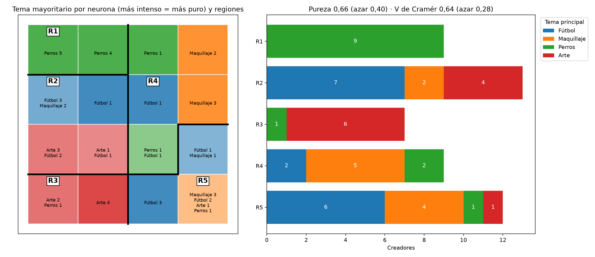
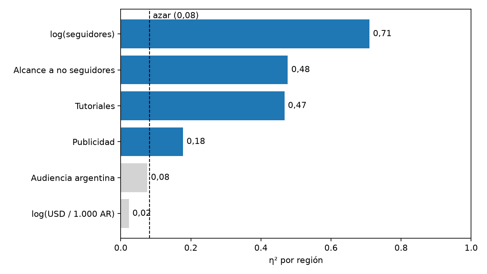

# Decisiones para las campañas

Este documento junta las decisiones del ejercicio 1.4 y las apoya en los resultados de los métodos:

- [EDA y PCA](../README.md);
- [Kohonen: regiones](../som/README.md);
- [índice de Oja](../oja/README.md).

Las cifras y los gráficos de esta carpeta se regeneran con `python3 -m analysis.som_campanas`.

## Qué dicen los métodos

### PCA: alcance y profundidad son los dos extremos de un mismo eje

- **PC1 (50 % de la varianza) es visibilidad frente a profundidad.** De un lado cargan seguidores (−0,87), alcance (−0,91), precio (−0,87) y alcance a no seguidores (−0,74). Del otro, tutoriales (+0,73), guardados (+0,84), visitas al perfil (+0,77) y largo del texto (+0,94).
- **Alcance masivo y descubrimiento están del mismo lado; la profundidad educativa, del opuesto.** No son tres opciones independientes: elegir una es elegir una posición sobre PC1, y ningún creador es alto en las dos puntas.
- **La audiencia argentina carga en PC2 (−0,57), casi perpendicular a seguidores** (+0,11 en PC1). Los seguidores no dicen nada sobre cuánto del público está en Argentina: por eso elegir por seguidores no llega al público de los clientes.
- **PC2 opone arte y exhibición (+0,63 y +0,66) a audiencia argentina y perros.** El contenido de arte del catálogo llega menos a Argentina, y el de perros, más.

### Oja: el mismo eje, como índice por creador

La regla de Oja converge a PC1 (coseno 1 − 2·10⁻¹⁰), así que su índice ubica a cada creador sobre el eje visibilidad–profundidad. En cada tema, el top por seguidores y el top por alcance a no seguidores quedan a la izquierda, y el top por tutoriales a la derecha:

| Tema | Top por seguidores | Top por alcance a no seguidores | Top por tutoriales | Elegidos |
| --- | ---: | ---: | ---: | ---: |
| Fútbol | −5,5 | −4,0 | +3,4 | −4,3 |
| Maquillaje | −5,2 | −3,7 | +1,4 | −3,3 |
| Perros | −2,4 | −0,6 | +5,1 | +5,4 |
| Arte | −3,2 | −3,2 | +1,9 | −0,3 |

Índice medio de cada top 3. **Ordenar por el índice no sirve para elegir**: su mayor valor es el creador más profundo y su menor valor el más visible, y ninguno de los dos tiene en cuenta tema, costo ni audiencia argentina (en cada tema, el creador más barato por cuenta argentina queda entre los puestos 44 y 49 de 50). **Sirve para decidir hacia qué extremo ir según el objetivo** y para comprobar dónde cae la selección.

### Kohonen: cinco tipos de creador, ordenados sobre el mismo eje

El mapa agrupa a los creadores en cinco regiones contiguas, estables entre semillas (ARI 0,79). Recorren PC1 de un extremo al otro y además separan los temas:

| Región | Perfil | PC1 medio | PC2 medio |
| --- | --- | ---: | ---: |
| R1 | Perros, comunidad y tutoriales | +4,7 | −1,3 |
| R2 | Nicho: reseñas y tutoriales patrocinados | +2,5 | +0,8 |
| R3 | Arte: exhibición y tendencias | −0,7 | +2,3 |
| R4 | Entretenimiento mediano | −1,3 | −0,7 |
| R5 | Entretenimiento masivo | −4,9 | −0,6 |

**Las regiones también separan los temas**, aunque el tema es solo 4 de las 27 variables de entrada:

- R1 tiene solo perros (9 de 9) y R3, casi solo arte (6 de 7). Maquillaje ocupa la columna derecha (R4 y la esquina de R5) y fútbol, el centro de R2 y R5.
- La pureza de tema, la fracción de creadores que comparten región con la mayoría de su tema, es 0,66. Con las mismas regiones asignadas al azar es 0,40.
- La V de Cramér, la asociación entre dos variables categóricas (0 independientes, 1 una determina a la otra), es 0,64 frente a 0,28 al azar.
- Las regiones de entretenimiento (R4 y R5) mezclan temas: ahí el mapa agrupa primero por tamaño y formato. Por eso fútbol y maquillaje comparten regiones objetivo.

Cada región es un tipo de creador, y el objetivo de cada cliente pide uno: **la decisión de qué tipo de creador contratar sale del mapa**.

### Lo que el mapa no separa: audiencia argentina y costo

Las regiones explican tamaño (η² 0,71), alcance a no seguidores (0,48) y tutoriales (0,47), pero la audiencia argentina (0,08) y el costo por cuenta argentina (0,02) quedan al nivel del azar. El plano de audiencia argentina (derecha en la figura del mapa) es alto solo en dos esquinas: la neurona de R1 con perros de comunidad (69 %) y la neurona de R5 con los masivos locales (63 %). En el resto de cada región hay creadores con 25 % y con 90 %.

**Consecuencia: el mapa elige el tipo de creador, pero no los nombres.** Dentro de la región hay que mirar a cada creador.

## Cómo se elige

1. **Tipo de creador: la región del mapa** cuyo perfil y posición en PC1 coinciden con el objetivo del cliente. Solo son candidatos los creadores cuyo tema principal es el del cliente.
2. **Creadores concretos: dentro de la región, el menor costo por cuenta argentina alcanzada** (USD por publicación / alcance argentino estimado × 1.000). Es un supuesto sobre las variables: resume precio, alcance y audiencia argentina, lo que el mapa no separa. Solo ordena dentro de un tipo ya elegido.

Supuestos:

- El público de los cuatro clientes está en Argentina.
- El catálogo no tiene ventas, consultas ni adopciones: la elección optimiza llegar al público adecuado con el contenido adecuado, no conversiones medidas.
- Qué región sirve a cada objetivo es un juicio sobre el perfil de la región; se explica en cada caso.

Cada panel muestra los creadores del tema del cliente: en color los de la región elegida, abajo a la derecha los baratos por cuenta argentina y con mucha audiencia local. Los cuadrados son el top 3 por seguidores y los círculos, la selección.

## Decisión por cliente

### Ropa de entrenamiento para fútbol: descubrimiento (R4 + R5)

La consigna pregunta si conviene alcance masivo, descubrimiento o profundidad educativa. **PCA responde que alcance masivo y descubrimiento son el mismo extremo de PC1 y la profundidad, el opuesto.** Para un producto que se vende mostrándolo a gente que todavía no sigue al creador, se elige el extremo de visibilidad: R4 y R5, las regiones donde 58–74 % del alcance llega a no seguidores.

| Criterio (top 3 de fútbol) | Índice de Oja | USD / 1.000 AR | Audiencia AR | Alcance a no seguidores | Tutoriales |
| --- | ---: | ---: | ---: | ---: | ---: |
| Alcance masivo (seguidores) | −5,5 | 39,3 | 58 % | 72 % | 7 % |
| Descubrimiento (alcance a no seguidores) | −4,0 | 64,6 | 57 % | 82 % | 6 % |
| Profundidad educativa (tutoriales) | +3,4 | 54,0 | 41 % | 49 % | 45 % |
| **Elegido: R4 + R5 y costo** | **−4,3** | **24,0** | **75 %** | **75 %** | **8 %** |

- **La selección queda en el extremo de visibilidad**, como los tops de seguidores y de descubrimiento, pero con 75 % de audiencia argentina: el top por descubrimiento puro es el más caro (64,6) porque su alcance se va fuera del país.
- **La profundidad educativa está en el otro extremo de PC1**: en el mapa son los creadores de nicho de R2, con 47 % de publicaciones patrocinadas y 41 % de audiencia argentina. Sirven como complemento, por ejemplo para explicar cómo usar la prenda, no como base de la campaña.

| Elegido | Región | Seguidores | USD | USD / 1.000 AR | Audiencia AR | Alcance a no seguidores |
| --- | --- | ---: | ---: | ---: | ---: | ---: |
| `@golconmate` | R5 | 745 mil | 3.251 | 15,6 | 77 % | 60 % |
| `@tribunacreativa` | R5 | 462 mil | 2.806 | 23,0 | 68 % | 82 % |
| `@lookdecancha` | R4 | 270 mil | 2.544 | 33,3 | 78 % | 82 % |

- **Reemplazos**: el siguiente en la región es `@jugadayestilo` (45,1; 46 % de audiencia argentina). Después vienen los masivos con 27–29 % de audiencia argentina, que no sirven.
- `@futbolcononda` tiene 89 % de audiencia argentina y 18,3, pero el mapa lo ubica en R2 por su contenido de reseñas y queda en el centro de PC1 (−0,1): es otro tipo de creador. Puede sumarse como complemento entre ambos extremos.

### Productos de belleza: visibilidad con audiencia argentina (R4 + R5)

Maquillaje ocupa la columna derecha del mapa, en las regiones de entretenimiento (R2 tiene solo dos creadores de maquillaje). Dentro de R4 y R5 se ordena por costo, y la selección coincide con la de solo costo:

| Elegido | Región | Seguidores | USD | USD / 1.000 AR | Audiencia AR | Tutoriales |
| --- | --- | ---: | ---: | ---: | ---: | ---: |
| `@maquillajereal` | R5 | 608 mil | 2.947 | 17,9 | 69 % | 19 % |
| `@brochasymates` | R4 | 206 mil | 1.337 | 24,9 | 88 % | 45 % |
| `@mateconideas` | R5 | 776 mil | 6.311 | 30,9 | 83 % | 3 % |

- `@maquillajereal` y `@mateconideas` están en la neurona de R5 con más audiencia argentina (63 %).
- `@brochasymates` queda en el centro de PC1 (+0,1): suma 45 % de tutoriales, y para productos de belleza mostrar cómo se aplican es parte de la venta.
- Frente a los tres de más seguidores, el costo por cuenta argentina baja de 46,3 a 24,6. El cambio es reemplazar a `@brillourbano`, de la misma neurona pero con 30 % de audiencia argentina.
- Si el presupuesto es limitado, `@mateconideas` es una de las dos publicaciones más caras del catálogo. Se puede reemplazar por `@tallerurbano` (USD 897, 36 % de audiencia argentina) o `@cosmeticaconsciente` (58 % de tutoriales, 33 % de audiencia argentina).

### Refugios de perros: comunidad local (R1)

El objetivo, consultas y adopciones, es local y requiere confianza. **R1 es el extremo de profundidad de PC1 (+4,7) y su neurona principal es la de más audiencia argentina del mapa (69 %)**: los dos resultados apuntan a la misma región. Reúne a 9 creadores de perros, con 49 % de tutoriales y más visitas al perfil y guardados que cualquier otra región.

| Elegido | Seguidores | USD | USD / 1.000 AR | Audiencia AR | Tutoriales | Visitas al perfil / 1.000 |
| --- | ---: | ---: | ---: | ---: | ---: | ---: |
| `@huellasyconsejos` | 13 mil | 75 | 18,9 | 94 % | 59 % | 23,7 |
| `@consejoscaninos` | 10 mil | 75 | 26,2 | 87 % | 49 % | 22,7 |
| `@guiadehuellas` | 57 mil | 189 | 34,1 | 66 % | 50 % | 20,2 |

- **La selección queda en +5,4 de índice de Oja, junto al top por tutoriales (+5,1); el top por seguidores, en −2,4.** Elegir por seguidores lleva a perros a otro tipo de creador.
- Las tres publicaciones cuestan USD 339, frente a USD 6.993 con los tres de más seguidores.
- `@crearenreels` es más barato por cuenta argentina (16,3), pero está en R5: entretenimiento masivo, 23 % de tutoriales y USD 3.814 por publicación. Es otro tipo de creador para otro objetivo.
- **Reemplazos**: `@ideasconhuella` (R1, 83 % de audiencia argentina, 70 % de tutoriales, USD 110). Le siguen `@estiloydetalle` y `@clubdelasmascotas`, con 34 % y 55 % de audiencia argentina.

### Materiales de arte: exhibición (R3)

R3 reúne a 6 de los 11 creadores de arte. Es la región con más exhibición de productos y resultados (26 %) y 30 % de tutoriales: el contenido que muestra el material en uso.

| Elegido | Seguidores | USD | USD / 1.000 AR | Audiencia AR | Tutoriales |
| --- | ---: | ---: | ---: | ---: | ---: |
| `@rinconcreativo` | 212 mil | 1.056 | 27,9 | 51 % | 30 % |
| `@colorenmovimiento` | 40 mil | 562 | 36,5 | 72 % | 54 % |
| `@artequeinspira` | 245 mil | 2.489 | 41,2 | 46 % | 31 % |

- **Arte es el caso más débil, y PCA explica por qué**: R3 es la región con mayor PC2 (+2,3), el extremo opuesto a la audiencia argentina. Sus neuronas tienen 42 % de audiencia argentina en el prototipo.
- La selección queda en el centro de PC1 (−0,3): ni el extremo de visibilidad del top por seguidores (−3,2) ni el de profundidad del top por tutoriales (+1,9).
- Las tres publicaciones cuestan USD 4.107, frente a USD 9.718 con los tres de más seguidores, con el doble de tutoriales (38 % frente a 19 %). El costo por cuenta argentina (35,2) mejora poco el del top por seguidores (41,3).
- Si el cliente prioriza alcance local sobre demostración, conviene `@galeriacotidiana`: está en la neurona de R5 con más audiencia argentina (84 % la suya, 26,0), pero con 1 % de tutoriales y USD 4.867 por publicación.
- **Reemplazo**: `@pincelcotidiano` (R3; 56,8, 42 % de audiencia argentina).

## Frente a elegir solo por seguidores

| Tema | USD / 1.000 AR: seguidores → elegido | Audiencia AR | Tres publicaciones (USD) |
| --- | --- | --- | --- |
| Fútbol | 39,3 → **24,0** | 58 % → 75 % | 10.712 → 8.601 |
| Perros | 41,9 → **26,4** | 58 % → 83 % | 6.993 → 339 |
| Maquillaje | 46,3 → **24,6** | 61 % → 80 % | 15.593 → 10.595 |
| Arte | 41,3 → **35,2** | 58 % → 56 % | 9.718 → 4.107 |

**Ventajas de elegir por seguidores:**

- Es simple, no necesita modelo y se explica en una línea.
- Asegura volumen y descubrimiento: seguidores y alcance a no seguidores están del mismo lado de PC1.

**Desventajas:**

- Los seguidores no informan la audiencia argentina, que está en otra componente (PC2). En los cuatro temas aparece al menos un creador grande con mucha audiencia extranjera: `@futbolsinvueltas` (27 %), `@brillourbano` (30 %), `@patitascontentas` (24 %), `@pincelcotidiano` (42 %).
- Siempre elige el extremo de visibilidad de PC1, aunque el objetivo pida profundidad, como en perros.
- Es la opción más cara por publicación.

**Ventajas de la selección propuesta:**

- El tipo de creador se ajusta al objetivo de cada cliente, con el mapa y la posición en PC1.
- Baja el costo por cuenta argentina en los cuatro temas, entre 15 % y 47 %.
- El mapa también sirve para encontrar reemplazos del mismo tipo.

**Desventajas de la selección propuesta:**

- Depende de supuestos: qué región sirve a cada objetivo, que el público es argentino y la métrica de costo.
- Requiere mantener un modelo.
- Con 50 creadores, algunas regiones tienen pocos candidatos por tema (en fútbol, R4 + R5 tienen solo 3 creadores con más de 50 % de audiencia argentina).

## Mantenimiento

El sistema se compone de:

- el preprocesamiento: las 27 variables, con sus medias y desvíos (`escalado.csv`, `Preprocessor.state()`);
- el mapa entrenado;
- las regiones;
- la asignación de regiones a clientes (`TARGET_REGIONS` en `analysis/som_campanas.py`);
- la métrica de costo.

**Nueva campaña de un cliente existente, o de un rubro que ya está en el catálogo.** No se reentrena nada. Se define el objetivo, se elige la región, y se filtra y ordena por costo. Es inmediato.

**Cliente de un rubro nuevo** (por ejemplo, cocina). El catálogo no tiene una variable de ese tema, así que el mapa no puede agruparlo. Hay que medir el nuevo tema por creador, lo que es una variable nueva (ver abajo).

**Nuevos creadores.** Se transforman con el preprocesamiento guardado y se ubican en la neurona más cercana (`Preprocessor.transform` y `Kohonen.predict`), sin reentrenar. Conviene controlar su error de cuantización:

- Si queda por encima de los valores del catálogo, el creador no se parece a ningún prototipo y su región no es confiable.
- Si son muchos creadores, o de perfiles nuevos, hay que reentrenar. El tamaño del mapa (4×4 para 50 creadores) y la cantidad de regiones se eligieron con estos datos; con un catálogo mucho mayor hay que repetir el barrido de geometría.

**Nuevas variables.** Cambia la dimensión de entrada, así que se rehace todo:

- **EDA**: si la variable es redundante, derivada o tiene una escala extrema.
- **PCA**: las componentes cambian, así que el índice de Oja también.
- **Barridos y regiones**: con las regiones nuevas hay que revisar qué región corresponde a cada cliente.

Antes de incorporarla conviene preguntarse si es una variable nueva o una combinación de las existentes. Por ejemplo, el alcance argentino estimado no entra al modelo porque es alcance × porcentaje argentino.

**Actualización mensual.** Las variables son medias de fin de mes, así que cada mes cambian los valores, las medias y los desvíos. Hay dos opciones:

- **Proyectar con el modelo del mes de referencia**, sin reentrenar. Las regiones quedan fijas y un creador que cambia de región indica que cambió su perfil. Es la opción para comparar meses.
- **Reentrenar.** Los prototipos y las regiones pueden moverse, y las etiquetas R1–R5 se reordenan por seguidores. Hay que comparar con el mes anterior (ARI entre particiones) y revisar la asignación a clientes. El índice de Oja puede invertir su signo y hay que reorientarlo.

En cualquiera de las dos, **el costo por cuenta argentina se recalcula cada mes sin tocar el modelo**: no es una variable de entrada. Precios, alcances y audiencia argentina del mes cambian el orden dentro de cada región aunque el mapa sea el mismo. El tipo de cambio no afecta: el modelo usa el precio en USD y excluye `price_ars`.

Se recomienda reentrenar cuando se acumulen creadores nuevos o se detecte que muchos cambian de región, y documentar cada reentrenamiento con su fecha, sus métricas y la comparación con el modelo anterior.
