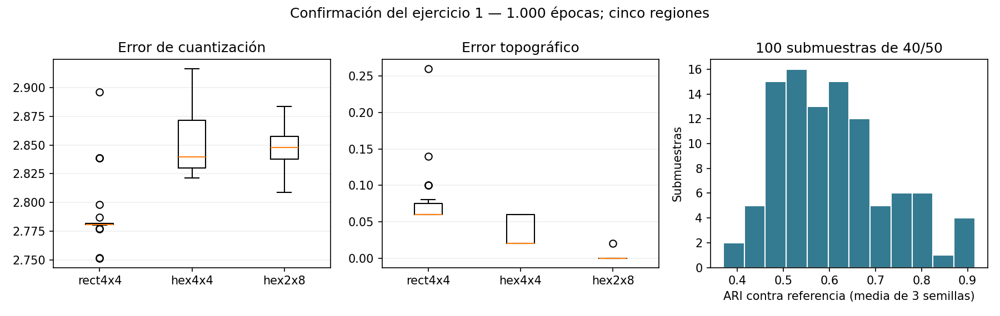

# Confirmación del ejercicio 1 — 22/10/2026

**Se completaron 460/460 corridas sin fallos, más una corrida de referencia.** Las pruebas respaldan mantener el SOM 4×4 rectangular y Oja con tasa inicial 0,001. También muestran un límite concreto: las regiones son más sensibles a cambiar el catálogo que a cambiar la semilla, y la selección para arte requiere especial cuidado.

Las salidas de esta confirmación ocupan menos de 1 MB y no contienen pesos ni modelos. Los resultados históricos se toman de los informes del grupo: la ausencia de sus archivos individuales en esta copia no implica que esas corridas no se hayan hecho. El protocolo completo, las limitaciones y la reproducción están en [PROTOCOLO.md](PROTOCOLO.md).

## Finalistas del SOM: 90 entrenamientos nuevos

30 semillas 100–129 por candidato, 16 neuronas, 27 variables estandarizadas, 1.000 épocas y cinco regiones de Ward contiguo. Mismas tasas y radio numérico 2 → 0,5 en los tres casos.

| Candidato | QE medio ↓ | TE medio ↓ | ARI medio entre semillas ↑ | ARI medio contra referencia rectangular |
| --- | ---: | ---: | ---: | ---: |
| 4×4 rectangular | 2,7890 | 0,0753 | 0,8106 | 0,8853 |
| 4×4 hexagonal | 2,8519 | 0,0353 | 0,8225 | 0,6480 |
| 2×8 hexagonal | 2,8491 | 0,0007 | 0,8421 | 0,6442 |

QE es la distancia media al prototipo ganador. ARI compara quién queda agrupado con quién: 1 indica particiones idénticas y 0 el nivel esperado por azar bajo su ajuste. El ARI entre semillas compara todos los pares de las 30 corridas de cada candidato; el ARI contra referencia usa siempre el modelo rectangular con semilla 0.

El rectangular obtuvo menor QE que el hexagonal 4×4 en **26/30** pares de igual semilla y que el hexagonal 2×8 en **28/30**. Las diferencias medias fueron 0,0629 y 0,0601 a favor del rectangular. Los hexagonales tuvieron algo más de estabilidad interna, pero produjeron particiones distintas de la referencia y un QE mayor. Su menor TE usa otra adyacencia, con más vecinos posibles; no alcanza para afirmar que sean superiores.

**Decisión:** conservar el 4×4 rectangular por su QE y continuidad con la interpretación actual. No es un ganador universal: estas pruebas comparan configuraciones concretas y no optimizan el radio por separado para cada geometría. El ARI de 0,81 entre semillas nuevas respalda el 0,79 informado anteriormente para cinco semillas.

## Remuestreo: 100 submuestras × tres semillas

Cada submuestra contiene 40 creadores y deja diez fuera del entrenamiento. El escalador se ajusta solo con los 40 incluidos; después se proyectan los 50. Se conservan el SOM rectangular y las cinco regiones. Primero se promedian las tres semillas de cada submuestra y luego se resumen esas 100 medias.

| Medida | Media | Percentiles 5–95 de las medias por submuestra |
| --- | ---: | ---: |
| ARI contra las regiones de referencia, sobre los 50 proyectados | 0,6078 | 0,4521–0,8150 |
| ARI entre semillas dentro de una misma submuestra | 0,8206 | 0,6157–1,0000 |
| QE de los 40 de entrenamiento | 2,6963 | 2,5907–2,8131 |
| QE de los diez excluidos | 3,6915 | 3,3107–4,0621 |
| Brecha QE excluidos − entrenamiento, dentro de cada corrida | 0,9952 | 0,6617–1,3439 |

La brecha media de cada submuestra fue positiva en **100/100** casos. Los excluidos quedan, en promedio, más lejos de los prototipos. Esto evidencia una limitación al representar perfiles que no intervinieron en el ajuste; no es una exactitud de clasificación ni una demostración de ventas. Los QE de submuestras diferentes usan escalas diferentes: la comparación más directa es la brecha dentro de la misma corrida.

Las semillas de una misma submuestra producen agrupaciones bastante consistentes (ARI 0,82), mientras cambiar los integrantes del entrenamiento reduce la coincidencia con la referencia a 0,61. **La sensibilidad al catálogo merece más atención que buscar una semilla favorable.** Los percentiles son descriptivos: las submuestras se superponen y no constituyen muestras independientes de una población nueva.

### ¿Cuánto cambian los tres elegidos por campaña?

Se mantienen los temas, regiones objetivo y orden por costo actuales. Para comparar nombres de regiones se alinean las etiquetas por máxima coincidencia con la referencia. Los candidatos siguen siendo los 50 perfiles originales, incluidos los proyectados fuera del entrenamiento. Esta alineación usa información de la referencia y es descriptiva; no demuestra validez comercial ni garantiza que cada región conserve exactamente su significado.

| Campaña | Solapamiento medio de los tres elegidos: 30 semillas con catálogo completo | Solapamiento medio: 300 corridas con submuestras | Submuestras: corridas que conservan los tres | Submuestras: corridas con menos de tres candidatos |
| --- | ---: | ---: | ---: | ---: |
| Fútbol | 93,3 % | 89,8 % | 70,0 % | 0,7 % |
| Maquillaje | 100,0 % | 87,6 % | 63,3 % | 0,0 % |
| Perros | 100,0 % | 95,4 % | 88,3 % | 1,0 % |
| Arte | 85,6 % | 61,6 % | 18,3 % | 11,7 % |

El solapamiento se calcula como cantidad de elegidos compartidos dividida por tres. Una lista corta no obtiene artificialmente un 100 %. Las frecuencias de esta tabla describen corridas, con tres corridas relacionadas por submuestra; no son probabilidades de éxito comercial.

**Arte es el caso más frágil.** Con remuestreo se conserva el trío completo solo en 55/300 corridas y 35/300 dejan menos de tres candidatos. No corresponde presentar las doce recomendaciones como igualmente robustas. Conviene revisar los perfiles y candidatos fronterizos de arte antes de automatizar esa selección; esta confirmación no modifica las regiones objetivo para mejorar retrospectivamente sus números.

## Oja: 30 semillas nuevas y 40 controles de extremos

En el catálogo completo se prueban diez semillas nuevas por tasa, todas con 1.000 épocas, tasa final inicial/100 y normalización al final de cada época.

| Tasa inicial | Corridas finitas | Primera época con alineación ≥ 0,999: rango | Primera época ≥ 0,99999: rango | Alineación final media con PC1 |
| --- | ---: | ---: | ---: | ---: |
| 0,0001 | 10/10 | 80–173 | 143–286 | 0,9999999981 |
| 0,001 | 10/10 | 7–13 | 60–126 | 0,9999999998 |
| 0,01 | 10/10 | 254–299 | 579–633 | 0,9999999376 |

Las tres tasas llegan a PC1. **Se mantiene 0,001:** alcanza los umbrales antes en estas semillas. La tasa mayor no acelera aquí la convergencia. Se mide el primer cruce de cada umbral, no el inicio de una permanencia garantizada por encima de él. No se propone cortar automáticamente en esas épocas sin validar otra regla de parada.

Para separar el desempeño de Oja de la sensibilidad del índice, se retiran los uno o tres perfiles con más seguidores y se entrena con tasa 0,001 y diez semillas por condición. Se prueba conservar el escalador completo y reajustarlo. Las direcciones se convierten a las mismas unidades antes de compararlas; se corrige el signo antes de comparar rankings sobre los 50 perfiles originales.

| Eliminación | Escalador | Coseno de la PC1 de la condición contra la PC1 original | Correlación de rangos Oja contra PC1 original, media |
| --- | --- | ---: | ---: |
| Mayor número de seguidores | Conservado | 0,999216 | 0,999904 |
| Mayor número de seguidores | Reajustado | 0,999347 | 0,999712 |
| Tres mayores | Conservado | 0,996284 | 0,999712 |
| Tres mayores | Reajustado | 0,996439 | 0,999520 |

En las 40 corridas Oja reproduce la PC1 de su propio conjunto: la alineación final media de cada condición supera 0,9999999997. La PC1 y los rankings cambian poco en estos controles. Esto respalda estabilidad frente a quitar perfiles grandes; no cubre todos los posibles atípicos ni convierte PC1 en un indicador de conveniencia para cada campaña. Las diez semillas confirman el aprendizaje sobre cada condición, no multiplican la evidencia sobre catálogos nuevos.

## Qué presentar y qué seguir investigando

- Se confirma la configuración actual del SOM sin cambiarla después de observar los resultados.
- Se confirma Oja como aproximación de PC1 y se mantiene la tasa inicial 0,001.
- Se explicita que las regiones responden a la composición del catálogo y que arte tiene recomendaciones más sensibles.
- Augmentation queda como propuesta secundaria de entrenamiento o sensibilidad ante pequeñas perturbaciones coherentes. No se ejecutó aquí ni puede afirmarse que mejore la red. El detalle y las restricciones están en [el protocolo](PROTOCOLO.md#augmentation-propuesta-secundaria).

## Archivos y verificación

`protocol.json` identifica las 460 tareas y hashes de datos y fuentes. `reference.json` identifica la referencia. `runs.jsonl` contiene todas las corridas. `finalists.csv`, `paired_finalists.csv`, `subsamples.csv`, `campaigns.csv`, `creator_stability.csv`, `oja.csv`, las matrices `coassignment_*.csv` y `summary.json` permiten revisar los cálculos sin conservar redes.

La suite del TP4 pasó **107 tests**, incluidos cuatro controles nuevos de permutación de etiquetas, conversión entre escalas, exclusión de los diez perfiles del ajuste del escalador y composición del plan. El consolidado comprueba que las tareas completadas coincidan exactamente con el manifiesto, sin faltantes ni duplicados. La figura se inspeccionó visualmente. No se hizo push de estos cambios.

Actualización posterior del 22/10: se ejecutó la prueba de interpolaciones locales propuesta como augmentation. [Resultado y protocolo](../augmentation_20261022/README.md): 240 entrenamientos; ninguna intensidad cumplió todos los criterios previos y se conserva el SOM actual. Esta prueba adicional no modifica las 460 corridas documentadas arriba.
