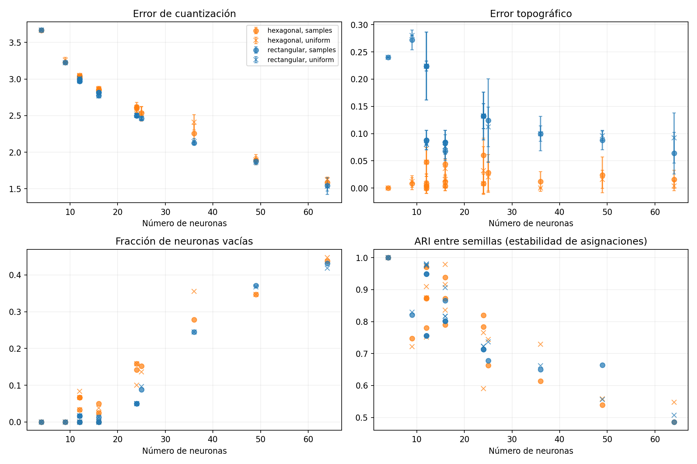

# Kohonen: análisis del barrido de geometría

Análisis del 20/10/2026. Hay **300 corridas terminadas, sin fallas y con sus métricas recalculadas desde los pesos guardados**: 15 formas de grilla × 2 topologías × 2 inicializaciones × 5 semillas. Son 60 configuraciones y todas tienen exactamente cinco semillas (0–4).

Se usaron los mismos 50 creadores y las mismas 27 variables estandarizadas, sin logaritmos ni PCA. El entrenamiento dura 1.000 épocas, con decaimiento exponencial durante las primeras 500 (aprendizaje 0,3→0,01 y radio inicial `max(rows, cols)/2`→0,5); las siguientes 500 mantienen esos valores finales. No es un entrenamiento de 1.000 épocas con decaimiento repartido sobre todo el período. La vecindad es gaussiana y se mezclan muestras por época.

Las 23 corridas de la continuación inicial se reutilizaron; no se cuentan nuevamente como semillas independientes. El checkpoint parcial también se preservó durante la recuperación del plan.

## Patrones transversales del barrido

1. **Más capacidad reduce la distorsión y fragmenta el catálogo.** El QE cae desde aproximadamente 3,66 con cuatro neuronas hasta 1,54–1,62 con 64. Al mismo tiempo aparecen más celdas vacías y creadores aislados. La reducción de QE no demuestra una mejor agrupación comercial: parte corresponde a representar individualmente más observaciones.
2. **El mínimo error y la máxima estabilidad aparecen en extremos distintos.** Las configuraciones 2×2 tienen ARI 1 entre semillas, pero producen un resumen muy grueso y QE alto; las 8×8 ajustan mejor pero su ARI baja aproximadamente a 0,49–0,55. Por lo tanto, estabilidad y resolución deben interpretarse juntas. Ninguna métrica aislada basta.
3. **Topología intercambia ajuste por vecindad bajo este diseño.** La hexagonal reduce TE en las 30 comparaciones de promedios emparejadas por forma e inicialización; la rectangular reduce QE en 28 de ellas. Las dos métricas no son equivalentes ni necesariamente mejoran juntas. Cambiar de topología también cambia distancias y adyacencia; no se atribuye todo a una superioridad intrínseca.
4. **Igual QE no implica igual reproducibilidad de la partición.** En 3×4 rectangular, QE medio es 2,9715 con muestras y 2,9731 con uniforme (aproximadamente 0,05% de diferencia), pero ARI medio entre semillas es 0,756 y 0,980, respectivamente. La inicialización afecta poco al valor del objetivo en muchos casos, aunque puede afectar qué creadores terminan juntos. Esto justifica registrar asignaciones y varias semillas, además de la pérdida.
5. **La forma no se resume en la cantidad de neuronas.** Hay diferencias entre cuadradas y alargadas de igual capacidad. Sin embargo, al variar la forma también cambia el radio inicial automático. Las orientaciones rectangulares transpuestas terminan con métricas idénticas en este catálogo; las hexagonales no siempre. Las conclusiones sobre forma requieren controlar explícitamente el radio en la siguiente etapa.
6. **La duración necesaria aumenta con la resolución del mapa.** La ganancia 500→1.000 es pequeña en 2×2 y mucho mayor en 8×8. Casi todas las curvas se estabilizan a 1.000, pero eso no convierte a 500 en suficiente para cualquier tamaño. El contraste es sobre la misma trayectoria con decaimiento de 500 y valores finales constantes.

Estos patrones describen este catálogo y este protocolo; no establecen leyes generales sobre SOM. El barrido todavía no permite concluir sobre otras representaciones, tasas y radios, ni sobre conversiones comerciales.

## Resultados y candidatos

Las cifras son promedios de cinco semillas; QE muestra además desvío muestral. TE es la proporción de creadores cuyas dos mejores neuronas no son vecinas. ARI es la similitud de asignaciones entre semillas, independiente del nombre o posición de las neuronas. Mayor ARI indica particiones más reproducibles, no necesariamente más útiles para campañas.

| Configuración | QE medio ± desvío | TE | Celdas vacías | Creadores solos en su celda | ARI medio |
| --- | ---: | ---: | ---: | ---: | ---: |
| 2×6 hexagonal, muestras | 3,031 ± 0,015 | 0,0% | 0,0% | 2,0% | 0,970 |
| 2×8 hexagonal, muestras | 2,848 ± 0,025 | 0,4% | 0,0% | 2,4% | 0,939 |
| 4×4 rectangular, uniforme | 2,770 ± 0,029 | 7,6% | 1,2% | 5,2% | 0,906 |
| 4×6 hexagonal, muestras | 2,615 ± 0,064 | 0,8% | 14,2% | 14,4% | 0,820 |
| 5×5 rectangular, uniforme | 2,460 ± 0,019 | 11,2% | 9,6% | 16,0% | 0,736 |
| 8×8 rectangular, uniforme | 1,536 ± 0,114 | 9,2% | 41,9% | 51,6% | 0,507 |

No se elige un ganador universal con una suma arbitraria de métricas. Para la siguiente etapa se proponen:

- **2×8 hexagonal, muestras:** candidato compacto con baja distorsión topológica, ocupación completa y alta estabilidad. Cuesta aproximadamente 2,8% más de QE que 4×4 rectangular uniforme, con la misma cantidad de neuronas.
- **4×4 rectangular, uniforme:** referencia compacta de menor QE y buena estabilidad. Permite contrastar una grilla cuadrada de 16 neuronas con la alargada hexagonal.
- **4×6 hexagonal, muestras:** candidato de mayor resolución, con menor QE que los dos anteriores y TE bajo, a cambio de más celdas vacías, más creadores aislados y menor estabilidad.

2×6 hexagonal es un control más parsimonioso. El 5×5 rectangular obtiene alrededor de 11% menos QE que 4×4 rectangular uniforme, pero empeora TE, estabilidad y aislamiento: no alcanza con mirar el error de cuantización.

## Qué muestran los factores

**Cantidad de neuronas.** QE baja al aumentar la capacidad. En 8×8 quedan aproximadamente 42–45% de celdas vacías y 49–52% de los creadores solos en su celda, según topología e inicialización. Esto puede ser útil para representar detalle, pero resume menos los perfiles y muestra ARI de aproximadamente 0,49–0,55. Con 64 neuronas y 50 creadores ya existe un mínimo inevitable de celdas vacías; las observadas superan ese mínimo. No se recomienda adoptar 8×8 solo porque minimiza QE.

**Topología.** En las 30 comparaciones de medias emparejadas por forma e inicialización, hexagonal tiene TE menor. Sin embargo, tiene QE mayor en 28 de las 30. La definición de adyacencia también cambia (hasta seis vecinos frente a cuatro), por lo que TE no es una escala idéntica de calidad entre topologías. El resultado muestra un compromiso entre ajuste y vecindad bajo este diseño; no prueba que una topología sea comercialmente superior.

**Inicialización.** Uniforme logra menor QE en 13 de las 30 comparaciones; en 27 de las 30 la diferencia de QE medio entre inicializaciones es menor al 1%. No hay una ganadora general. La excepción más marcada es 6×6 hexagonal: uniforme tiene aproximadamente 6,8% más de QE que muestras y mayor dispersión. Conservar ambas en la confirmación de candidatos es más defendible que decidir por una semilla.

**Forma y orientación.** Los pares rectangulares transpuestos terminan con las mismas métricas por semilla en este conjunto, aunque sus trayectorias iniciales y la ubicación de pesos pueden diferir. En hexagonal las filas desplazadas producen diferencias entre orientaciones. Además, **el radio inicial depende del lado mayor**: por ejemplo, 2×8 empieza con radio 4 y 4×4 con radio 2. La comparación de formas también cambia ese hiperparámetro; no debe atribuirse todo el efecto a la forma. El próximo contraste entre candidatos debería controlar el radio explícitamente.



Cada punto es una configuración promediada entre cinco semillas; puntos con el mismo número de neuronas pueden tener formas diferentes. Las barras en QE/TE son desvíos muestrales entre semillas, no intervalos de confianza. Para ARI se promedian los diez pares de semillas; esos pares comparten entrenamientos y no son diez observaciones independientes.

## Duración y convergencia

**299 de 300 corridas cumplen la heurística descriptiva de meseta** al finalizar 1.000 épocas: cambio absoluto entre medias de ventanas consecutivas de 50 épocas menor a 0,5%, amplitud de QE en la última ventana menor a 1% y cambio de TE medio de hasta 0,02.

La excepción es **8×8 rectangular, uniforme, semilla 1** (`run_0126` en la ejecución local): su QE todavía mejora 0,686% entre las dos últimas ventanas y el TE medio cambia −0,0328. Si se desea estudiar 2.000 épocas, esta corrida es el primer candidato; no se justifica duplicar automáticamente las 300.

Las mejoras medias de QE entre 500 y 1.000 aumentan con la capacidad: alrededor de 0,08–0,54% en 2×2, 0,41–0,97% en 3×3, 1,45–1,84% en 4×4, 2,74–3,70% en 5×5 y 13,20–15,71% en 8×8 (promedios sobre ambas inicializaciones por topología). Por eso la conclusión inicial sobre mapas pequeños no podía trasladarse directamente a los grandes.

Meseta no implica óptimo global ni mejor segmentación comercial. Con tasa final constante puede haber fluctuaciones estacionarias; registrar el mínimo justo en la última época tampoco basta para diagnosticar falta de convergencia. El umbral de meseta es una decisión descriptiva explícita, no una prueba estadística ni el early stopping del modelo.

## Alcance de lo que se puede concluir

Esto cubre **el barrido de geometría**. No demuestra cuál es la mejor representación (PCA/logaritmos), tasa de aprendizaje, radio o regla de vecindad: esos factores no se variaron sistemáticamente aquí. Las cinco semillas describen sensibilidad a inicialización/orden; no validan generalización a nuevos creadores ni resultados de ventas/adopciones. Los datos son observaciones de entrenamiento, sin etiquetas de grupos correctos.

La interpretación de regiones y campañas del informe anterior corresponde a 5×5 rectangular, 500 épocas y semilla 0. Sigue siendo un análisis exploratorio de ese modelo; antes de presentarla como explicación del modelo final debe regenerarse usando la corrida finalmente elegida. No cambiar automáticamente ese relato por las métricas nuevas.

Siguiente paso: comparar los tres candidatos controlando radio, evaluar las representaciones seleccionadas y confirmar finalistas con semillas nuevas. Después revisar perfiles, matriz U y recomendaciones de campaña. La interpretación del índice de Oja sigue pendiente en el informe final del ejercicio.

## Qué versionar

Este paquete es pequeño y contiene resultados agregados: informe, [60 configuraciones resumidas](resumen.csv), [30 comparaciones de topologías](topologias.csv) y una figura. No incluye identificadores, nombres de creadores ni rutas personales.

Conviene subirlo junto con el código reproducible, los JSON de experimentos, las pruebas y la documentación de checkpoint/extensión/recuperación. Los 108 MB de `results/kohonen_geometry_1000/` contienen checkpoints, pesos e historiales por corrida; permanecen fuera de Git, igual que los datos crudos y archivos del IDE. Si se necesita conservar el conjunto completo para la entrega, se puede archivar aparte sin agregarlo al historial del código.

Reproducción desde TP4, con los datos y las corridas locales disponibles:

```bash
python3 -m analysis.geometry_summary
```

La ejecución fuente es `results/kohonen_geometry_1000/`. El script recalcula diagnósticos a partir de sus artefactos; no entrena. El resumen permite revisar la evidencia sin copiar las 300 corridas al repositorio. El estado local del barrido es completo: 300/300, cero fallos; las otras etapas de la batería no se consideran ejecutadas por este análisis.
