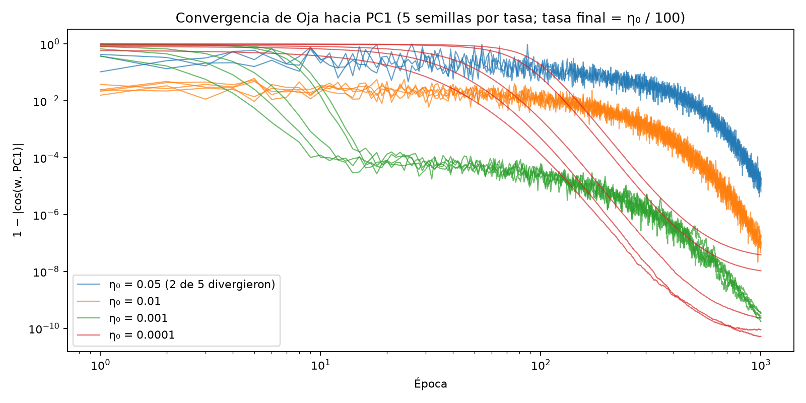
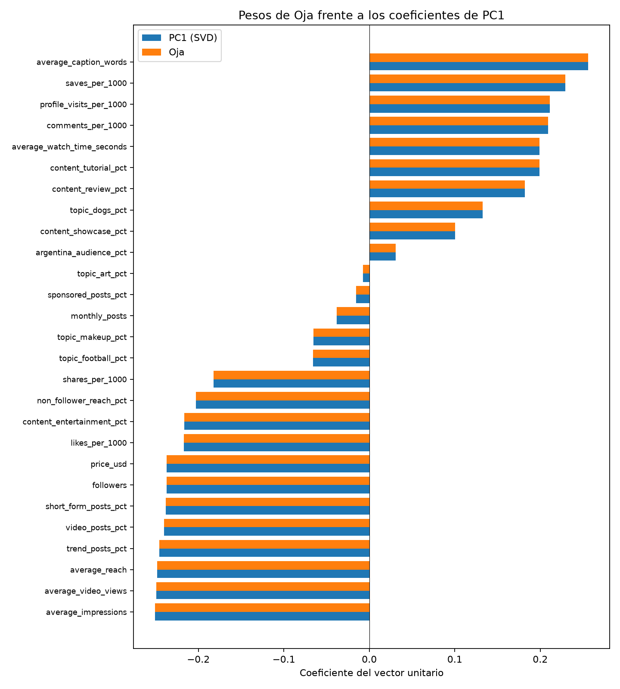
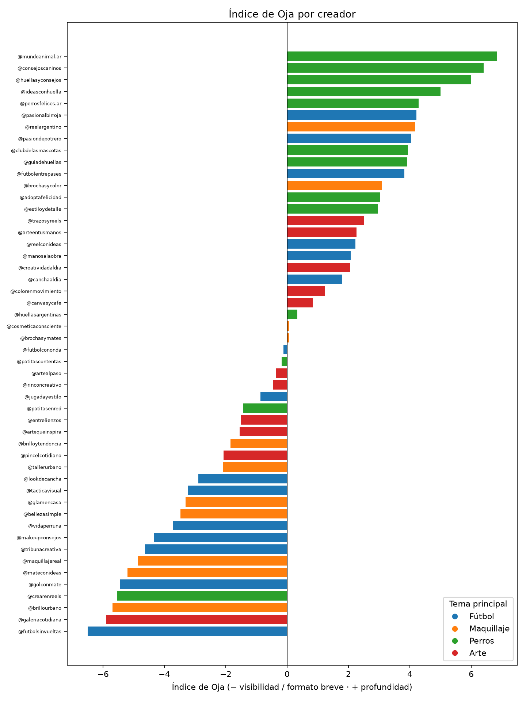
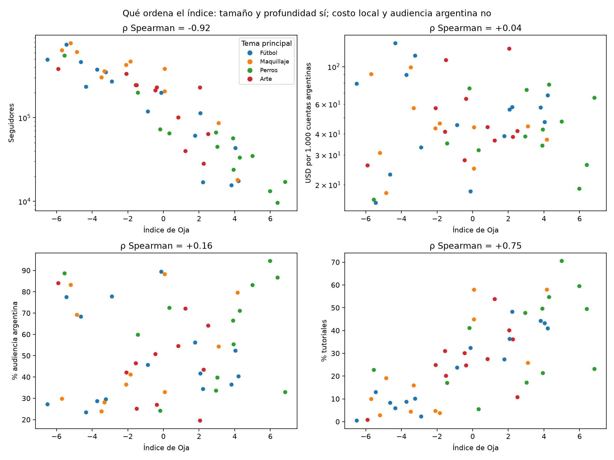

# Índice de Oja

Desde TP4: `python3 -m analysis.oja_indice`. Entrena la regla de Oja sobre las mismas 27 variables estandarizadas que PCA y Kohonen. Usa 4 tasas iniciales y 5 semillas por tasa, y genera las figuras de esta carpeta. Los CSV con nombres de creadores (`indice.csv`, `lideres_por_tema.csv`) se regeneran localmente y no se versionan.

## Entrenamiento

La regla es `w ← w + η·y·(x − y·w)`, con `y = w·x`, una muestra por vez y en orden aleatorio en cada época. La referencia es la de `configs/oja.json`: η de 0,001 a 0,00001 con decaimiento exponencial, durante 1.000 épocas (50.000 actualizaciones). Al final de cada época se renormaliza `w` como protección numérica. La norma antes de renormalizar nunca supera 1,003: la regla ya mantiene `w` unitario por sí sola, y la renormalización no cambia el resultado.

| η inicial | Divergió | Épocas hasta \|cos\| ≥ 0,999 | Hasta ≥ 0,99999 | Error final 1 − \|cos\| |
| ---: | ---: | ---: | ---: | ---: |
| 0,05 | 2 de 5 | 576–639 | 925–967 | 6·10⁻⁶–2·10⁻⁵ |
| 0,01 | 0 | 263–285 | 576–627 | 7·10⁻⁸–2·10⁻⁷ |
| **0,001** | **0** | **7–14** | **89–134** | **2·10⁻¹⁰–4·10⁻¹⁰** |
| 0,0001 | 0 | 75–189 | 138–312 | 5·10⁻¹¹–4·10⁻⁸ |

- **η ≥ 0,05 es inestable**: con `‖x‖² ≈ 27`, cada paso puede pasarse de largo y diverge en dos semillas.
- **Con η = 0,01, el ruido de cada muestra deja a `w` oscilando** alrededor de PC1. El error baja recién cuando la tasa decae.
- **η = 0,0001 es lento y depende de la inicialización**: según la semilla termina mejor o 100 veces peor que 0,001.
- **0,001 es el compromiso**: llega a 0,999 en menos de 15 épocas en todas las semillas y termina a menos de 4·10⁻¹⁰ de PC1, con la menor dispersión entre semillas. Por eso se mantiene la configuración de referencia.

## Comparación con PC1

| Medida | Valor |
| --- | ---: |
| \|cos(w, PC1)\| | 1 − 2·10⁻¹⁰ |
| Máxima diferencia entre coeficientes | 1,1·10⁻⁵ |
| Máxima diferencia entre scores | 6,7·10⁻⁵ |
| Correlación de scores / de rangos (Spearman) | 1,000 / 1,000 |
| Varianza explicada | 49,71 % (igual que PC1) |

**Oja recupera PC1**: el índice ordena a los 50 creadores exactamente igual que la proyección sobre PC1. Es lo esperable, porque la regla converge al autovector de mayor autovalor de la matriz de covarianza. Lo que aporta Oja es llegar a ese resultado sin calcular ni descomponer la matriz, de a una muestra. Eso permite actualizar el índice con datos que llegan de a poco.

**El signo es arbitrario.** Con η = 0,001, las semillas 0, 2 y 4 terminan en −PC1 y las 1 y 3 en +PC1; en todas las tasas pasa lo mismo. Las dos direcciones son igual de válidas. Para comparar, el script orienta `w` como PC1, con positivo su coeficiente de mayor módulo (`average_caption_words`).

## Qué representa el índice

Es un eje **visibilidad / formato breve (−) frente a profundidad (+)**, el mismo contraste de los dos bloques de variables del EDA:

- **Negativo**: impresiones, reproducciones, alcance, tendencias, video, *shorts*, seguidores y precio (coeficientes de −0,24 a −0,25), además de likes, entretenimiento, alcance a no seguidores y compartidos.
- **Positivo**: largo del texto (+0,26), guardados, visitas al perfil, comentarios, tiempo de visualización, tutoriales y reseñas (+0,18 a +0,23).
- **Casi cero**: audiencia argentina (+0,03), publicidad (−0,02), arte (−0,01) y publicaciones por mes (−0,04). Fútbol y maquillaje pesan −0,07 y perros +0,13.

Un creador con índice alto publica contenido elaborado para una audiencia chica que lo guarda y lo comenta. Uno con índice bajo es grande, caro y de formato viral. El valor es una combinación lineal de z-scores: describe la posición del creador en el catálogo, no un puntaje de calidad.

| Variable | ρ Spearman con el índice |
| --- | ---: |
| Seguidores | −0,92 |
| Precio USD | −0,94 |
| Alcance a no seguidores | −0,74 |
| Tutoriales | +0,75 |
| Guardados / 1.000 | +0,84 |
| Audiencia argentina | +0,16 |
| USD por 1.000 cuentas argentinas | +0,04 |

Por tema, la media del índice es +2,7 en perros, −0,3 en arte, −0,9 en fútbol y −1,7 en maquillaje, con desvíos de 2,5 a 3,7 dentro de cada tema: el índice no separa temas. Los cinco valores más altos son todos creadores de perros con 10 mil a 35 mil seguidores.

## ¿Elegir automáticamente al de mayor índice?

**No**, para ninguna campaña:

1. **El extremo "más alto" depende de un signo arbitrario.** Con la otra orientación, igual de válida, el primero sería `@futbolsinvueltas`: 493 mil seguidores, 27 % de audiencia argentina y USD 79 por cada 1.000 cuentas argentinas. El índice está a ρ = −0,92 de los seguidores. Tomado del lado negativo, reproduce la selección por seguidores que la agencia ya sabe que no funciona.
2. **No contiene el tema.** Los cinco primeros son de perros, así que una campaña de fútbol, maquillaje o arte recibiría creadores que no hablan de su producto.
3. **Ignora lo que la agencia necesita medir.** No ordena audiencia argentina (ρ = 0,16) ni costo por cuenta argentina alcanzada (ρ = 0,04). Dentro de cada tema, el líder del índice y el creador más barato por cuenta argentina quedan en extremos opuestos:

| Tema | Líder del índice | USD / 1.000 AR | Audiencia AR | Más barato por cuenta AR | USD / 1.000 AR | Audiencia AR | Su puesto en el índice |
| --- | --- | ---: | ---: | --- | ---: | ---: | ---: |
| Fútbol | `@pasionalbirroja` | 67,6 | 40 % | `@golconmate` | 15,6 | 77 % | 46 |
| Maquillaje | `@reelargentino` | 37,0 | 80 % | `@maquillajereal` | 17,9 | 69 % | 44 |
| Perros | `@mundoanimal.ar` | 65,4 | 33 % | `@crearenreels` | 16,3 | 89 % | 47 |
| Arte | `@trazosyreels` | 41,6 | 64 % | `@galeriacotidiana` | 26,0 | 84 % | 49 |

4. **Resume la mitad de la información.** PC1 explica 49,7 % de la varianza. Tema, geografía y publicidad están en PC2–PC4 y casi no pesan en el índice.

**Uso correcto**: como descriptor del estilo del creador *después* de filtrar por tema y audiencia argentina, cuando el objetivo de la campaña pide uno de los dos extremos. Por ejemplo, un refugio que busca consultas puede preferir índice alto dentro de perros con audiencia argentina alta. `@huellasyconsejos` y `@consejoscaninos` cumplen ambas cosas: índice 6,0 y 6,4, más de 86 % de audiencia argentina y USD 19 y 26 por cada 1.000 cuentas argentinas.
