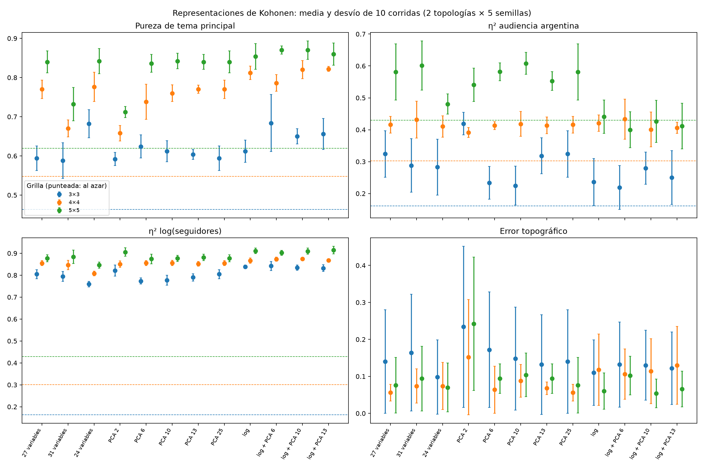

# Kohonen: análisis del barrido de representaciones

Análisis del 20/10/2026. **360 corridas terminadas, sin fallas**: 12 representaciones × 3 grillas (3×3, 4×4, 5×5) × 2 topologías × 5 semillas. El protocolo es el mismo de geometría: 1.000 épocas, con decaimiento exponencial durante las primeras 500 (aprendizaje 0,3→0,01; radio `max(rows, cols)/2`→0,5), vecindad gaussiana, inicialización desde muestras y mezcla por época. Configuración: `configs/kohonen_suite_1000/04_representation.json`.

Desde TP4, con las corridas locales: `python3 -m analysis.representation_summary`. Genera `resumen.csv`, `azar.csv` y `comparacion.png` en esta carpeta.

## Representaciones

| Etiqueta | Variables de entrada |
| --- | --- |
| 27 variables | Las 31 numéricas menos las cuatro derivadas exactas; z-score. Es la selección del EDA. |
| 31 variables | Todas las numéricas, incluidas `price_ars`, `organic_posts_pct`, `total_engagement_per_1000` y `estimated_argentina_reach`. |
| 24 variables | Las 27 sin `followers`, `average_impressions` ni `average_video_views`: deja una sola medida de volumen (`average_reach`) para quitar peso al bloque de visibilidad. |
| PCA k | Las 27, z-score y las primeras k componentes sin whitening. PCA 25 conserva todas las de varianza no nula. |
| log | Las 27 con `log1p` en seguidores, alcance, impresiones, vistas y precio antes del z-score. |
| log + PCA k | La anterior reducida a k componentes. |

## Cómo se comparan

El error de cuantización no se compara entre representaciones: cada una mide distancias en otro espacio. Se mide en cambio **qué separa cada mapa** respecto de variables fijas del catálogo, iguales para todas:

- **Pureza de tema principal**: fracción de creadores que comparten neurona con la mayoría de su tema. Mide si el mapa agrupa por cliente.
- **η²** de una variable: fracción de su varianza explicada por la neurona ganadora (varianza entre neuronas / total). Se usa para log(seguidores) (tamaño), audiencia argentina y tutoriales (profundidad).
- **Error topográfico** y **ARI entre semillas**, como en geometría.

Ambas medidas crecen solas con más neuronas, porque hay grupos más chicos. Por eso se comparan **dentro de cada tamaño de grilla**, contra una **referencia al azar**: las mismas ocupaciones de la representación de 27 variables, con los creadores permutados (200 permutaciones por corrida). Las cifras son medias de 10 corridas (2 topologías × 5 semillas). El desvío entre corridas es de ≈ 0,025 en pureza y 0,03–0,07 en η² de audiencia argentina: diferencias de 0,01–0,02 no son distinguibles.

## Resultados

| Grilla | Representación | Pureza tema | η² audiencia AR | η² tamaño | η² tutoriales | TE | ARI | Vacías |
| --- | --- | ---: | ---: | ---: | ---: | ---: | ---: | ---: |
| 4×4 | Azar | 0,55 | 0,30 | 0,30 | 0,30 | — | — | — |
| 4×4 | **27 variables** | **0,77** | **0,42** | 0,86 | 0,69 | 0,06 | 0,83 | 2% |
| 4×4 | 31 variables | 0,67 | 0,43 | 0,85 | 0,69 | 0,07 | 0,77 | 5% |
| 4×4 | 24 variables | 0,78 | 0,41 | 0,81 | 0,63 | 0,07 | 0,80 | 8% |
| 4×4 | PCA 2 | 0,66 | 0,39 | 0,85 | 0,63 | 0,15 | 0,95 | 7% |
| 4×4 | PCA 10 | 0,76 | 0,42 | 0,86 | 0,73 | 0,09 | 0,79 | 6% |
| 4×4 | log | 0,81 | 0,42 | 0,87 | 0,67 | 0,12 | 0,86 | 9% |
| 5×5 | Azar | 0,62 | 0,43 | 0,43 | 0,43 | — | — | — |
| 5×5 | **27 variables** | **0,84** | **0,58** | 0,88 | 0,71 | 0,08 | 0,67 | 12% |
| 5×5 | 31 variables | 0,73 | 0,60 | 0,88 | 0,72 | 0,09 | 0,68 | 16% |
| 5×5 | 24 variables | 0,84 | 0,48 | 0,85 | 0,71 | 0,07 | 0,76 | 21% |
| 5×5 | PCA 2 | 0,71 | 0,54 | 0,91 | 0,78 | 0,24 | 0,87 | 10% |
| 5×5 | PCA 10 | 0,84 | 0,61 | 0,88 | 0,73 | 0,10 | 0,75 | 12% |
| 5×5 | log | 0,85 | 0,44 | 0,91 | 0,71 | 0,06 | 0,74 | 19% |

El resto de las combinaciones (3×3, PCA 6, 13 y 25, log + PCA) está en `resumen.csv`.

1. **Todos los mapas separan tamaño y profundidad mucho más que el tema o la geografía.** η² de tamaño es 0,85–0,91 en todas las representaciones, el doble de lo esperado al azar. Confirma lo que anticipaba el EDA: el eje dominante del catálogo es el de visibilidad frente a profundidad. Aun así, la pureza de tema y la audiencia argentina quedan claramente por encima del azar con 27 variables (4×4: 0,77 frente a 0,55; 5×5: 0,58 frente a 0,43).
2. **Agregar las cuatro derivadas empeora el mapa.** Con 31 variables la pureza de tema baja 0,10–0,11 en 4×4 y 5×5 (0,67 frente a 0,77; 0,73 frente a 0,84), la cohesión en el espacio común empeora y el ARI no mejora. Las derivadas duplican precio y publicidad y agregan dos combinaciones de variables ya presentes; esas direcciones pesan doble y desplazan al tema. **Confirma la exclusión del EDA.**
3. **Quitar volumen (24 variables) no ayuda.** La pureza de tema queda igual en 4×4 y 5×5 (0,78 y 0,84). Solo mejora en 3×3 (0,68 frente a 0,59), donde casi no hay lugar para separar temas. A cambio, se pierde separación por audiencia argentina en 5×5 (0,48, casi el azar de 0,43, frente a 0,58) y aumentan las celdas vacías (21% frente a 12%). La hipótesis del EDA de que el bloque de visibilidad tapa el tema **no se confirma**: el SOM ya separa temas con 27 variables.
4. **PCA 25 da exactamente los mismos resultados que 27 variables.** Es un control: la rotación conserva todas las distancias, así que el entrenamiento es el mismo. Las dos dimensiones que se pierden tienen varianza nula por las proporciones que suman 100.
5. **Reducir a 10 o 13 componentes no cambia la separación; reducir a 2 sí.** PCA 10 y 13 quedan dentro del ruido de 27 variables en pureza y η². PCA 2 duplica o triplica el error topográfico (0,15 y 0,24) y baja la pureza de tema 0,11–0,13: el plano PC1–PC2 sirve para visualizar, no para agrupar. No hay ganancia que justifique reducir la dimensión antes del SOM.
6. **Los logaritmos cambian qué se separa.** Suben un poco la pureza de tema (0,81 frente a 0,77 en 4×4) y la separación por tamaño, pero en 5×5 bajan la separación por audiencia argentina de 0,58 a 0,44, al nivel del azar, y dejan más celdas vacías. Para campañas locales, la audiencia argentina importa más que una diferencia de pureza de 0,01–0,04.

## Decisión

**Se mantienen las 27 variables estandarizadas, sin logaritmos ni PCA, como representación para Kohonen.** No gana en todas las medidas, pero es la que no pierde ninguna dimensión del caso de uso. Su separación por audiencia argentina está entre las más altas (0,58 en 5×5; PCA 10 y 31 variables quedan dentro del ruido). Su pureza de tema queda a 0,03–0,05 de la mejor, que es log + PCA (0,87 frente a 0,84 en 5×5; 0,82 frente a 0,77 en 4×4). Su error topográfico es bajo (0,06–0,08), aunque log logra 0,05–0,06 en 5×5. La alternativa con más pureza, log, paga esa ganancia con la audiencia argentina. Las 31 variables pierden tema, las 24 pierden geografía y PCA 2 pierde topología. PCA 10 sería equivalente, pero solo agrega un paso de preprocesamiento y una dependencia de las componentes del catálogo.

## Límites

- Son 50 creadores: las semillas cambian la inicialización y el orden, no la muestra. No prueban generalización a creadores nuevos.
- Pureza y η² usan el tema principal y dos variables elegidas por el caso de uso; otra definición de objetivo podría favorecer otra representación. Ninguna mide ventas ni adopciones.
- El ARI y el error topográfico difieren entre topologías; aquí se promedian juntas, por eso las barras de TE son anchas. La comparación entre topologías está en el [análisis de geometría](../geometria_kohonen/README.md).
- Tasa, radio y vecindad quedan en los valores base. Sus barridos (`02_learning`, `03_neighborhood`) siguen sin ejecutar.
