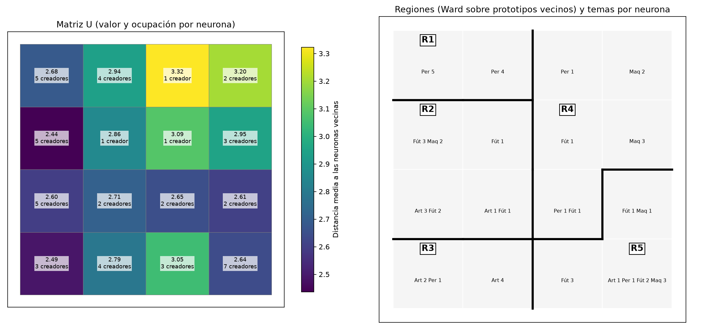
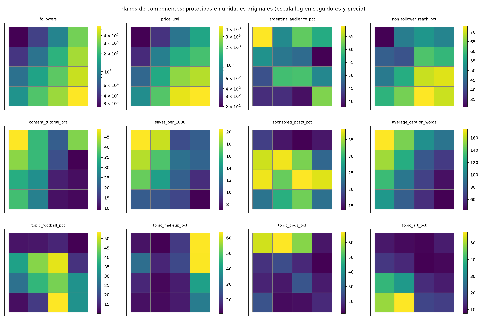
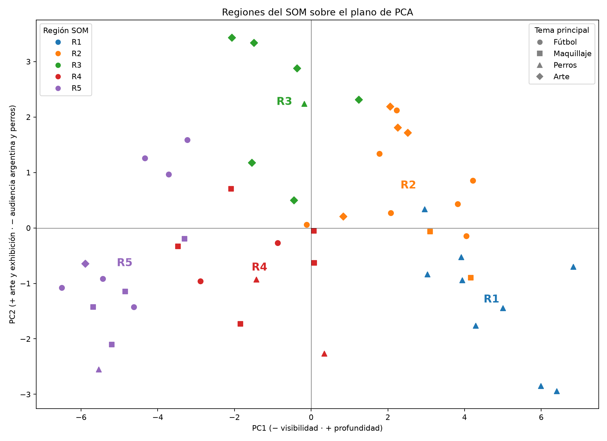
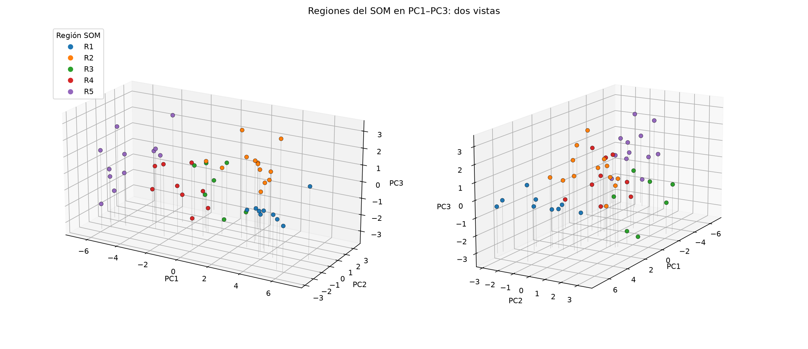

# Kohonen: regiones del mapa y uso para las campañas

Desde TP4: `python3 -m analysis.som_campanas`. Entrena 5 semillas del modelo elegido y agrupa sus neuronas en regiones. Genera las figuras de esta carpeta y CSV con perfiles, selecciones y reemplazos, que se regeneran localmente porque contienen nombres de creadores.

## Modelo

**4×4 rectangular**, 27 variables estandarizadas, inicialización desde muestras, vecindad gaussiana. Usa 1.000 épocas con decaimiento exponencial durante las primeras 500: aprendizaje de 0,3 a 0,01 y radio de 2 a 0,5. QE = 2,78, TE = 0,06 y ninguna neurona vacía.

El informe anterior usaba 5×5 y quedaban 2 creadores por neurona en promedio: 10 neuronas con un solo creador y 2 vacías. Con tan pocos creadores por celda, cada neurona describe casos individuales más que perfiles. Se pasa a 4×4 por la evidencia de los barridos:

- **Geometría** ([análisis](../geometria_kohonen/README.md)): 4×4 es el candidato compacto, con ARI entre semillas de 0,83–0,91. 5×5 baja a 0,67–0,74 y deja 10–12 % de neuronas vacías.
- **Representación** ([análisis](../representacion_kohonen/README.md)): en 4×4, las 27 variables separan tema (pureza 0,77) y audiencia argentina (η² 0,42) por encima del azar (0,55 y 0,30).
- **Regiones**: como se ve abajo, las regiones de 4×4 se reproducen entre semillas (ARI 0,79) y las de 5×5 no (0,53).

- **Tasa y radio** ([análisis](../aprendizaje_vecindad_kohonen/README.md), 840 corridas en 4×4): en rectangular, 0,3 → 0,01 y radio gaussiano 2 → 0,5 tienen TE 0,07. Solo la tasa 0,6 lo iguala (0,06) con QE menor a 3; los demás TE más bajos cuestan un QE de 3,2 o más. Las configuraciones con menor QE pierden la topología o la estabilidad. Una tasa inicial de 0,6 da exactamente las mismas regiones.

## Regiones

Con 16 neuronas y 50 creadores, cada neurona tiene de 1 a 7 creadores. Para leer perfiles se agrupan neuronas vecinas con prototipos parecidos: Ward aglomerativo sobre los prototipos, uniendo solo neuronas adyacentes en la grilla, para que cada región sea un área conexa del mapa. Es el esquema habitual de dos niveles para interpretar un SOM: primero el mapa, después agrupar sus prototipos.

| Regiones | ARI entre semillas | Pureza de tema | Región más chica | Más grande |
| ---: | ---: | ---: | ---: | ---: |
| 3 | 0,76 | 0,45 | 9,8 | 27,6 |
| 4 | 0,82 | 0,54 | 7,0 | 20,6 |
| **5** | **0,79** | **0,66** | **6,6** | **13,4** |
| 6 | 0,77 | 0,69 | 4,2 | 13,0 |
| 7 | 0,79 | 0,70 | 1,8 | 12,4 |

Medias de 5 semillas; el resto en `cantidad_regiones.csv`. **Se usan 5 regiones.** Es la primera cantidad que separa los temas (pureza 0,66; al azar con los mismos tamaños, 0,41) sin regiones de menos de 6–7 creadores. Con 6 o más, la pureza casi no sube y aparecen regiones de 1 a 4 creadores. En promedio por región, cada creador sigue junto a sus compañeros de región en 88–100 % de las semillas; R1 y R3 son idénticas en las 5.

R1–R5 están ordenadas por mediana de seguidores:

| Región | Creadores | Temas | Seguidores | USD | Tutoriales | Alcance a no seguidores | Publicidad | Audiencia AR | USD / 1.000 AR |
| --- | ---: | --- | ---: | ---: | ---: | ---: | ---: | ---: | ---: |
| **R1** Perros, comunidad y tutoriales | 9 | 9 perros | 33 mil | 189 | 49 % | 32 % | 11 % | 66 % | 42 |
| **R2** Nicho: reseñas y tutoriales patrocinados | 13 | 7 fútbol, 4 arte, 2 maquillaje | 61 mil | 330 | 36 % | 41 % | 47 % | 52 % | 44 |
| **R3** Arte: exhibición y tendencias | 7 | 6 arte, 1 perros | 230 mil | 1.264 | 30 % | 57 % | 28 % | 42 % | 57 |
| **R4** Entretenimiento mediano | 9 | 5 maquillaje, 2 fútbol, 2 perros | 270 mil | 1.337 | 5 % | 58 % | 16 % | 46 % | 43 |
| **R5** Entretenimiento masivo | 12 | 6 fútbol, 4 maquillaje, 1 perros, 1 arte | 478 mil | 4.235 | 9 % | 74 % | 33 % | 49 % | 44 |

Medianas por región. Los tutoriales van acompañados de guardados, visitas al perfil y textos largos (R1: 20 guardados por 1.000 y 169 palabras; R5: 8 y 53). R4 y R5 dedican 63–64 % de sus publicaciones al entretenimiento, frente a 3–18 % en el resto. R3 tiene la mayor proporción de exhibición (26 %) y de tendencias (52 %).

**Organización del mapa.** Seguidores y precio crecen en diagonal, desde arriba a la izquierda hasta abajo a la derecha. Tutoriales, guardados y largo del texto decrecen a lo largo de la misma diagonal. Los temas ocupan zonas propias: perros en la fila superior izquierda, maquillaje en la columna derecha, arte abajo a la izquierda y fútbol en el centro y abajo. La audiencia argentina, en cambio, no sigue ningún gradiente: es alta en dos esquinas opuestas (R1 y la neurona 3,3 de R5) y baja en el resto.

**Qué separan las regiones** (η², fracción de la varianza explicada por la región; al azar ≈ 0,08):

| Variable | η² |
| --- | ---: |
| log(seguidores) | 0,71 |
| Alcance a no seguidores | 0,48 |
| Tutoriales | 0,47 |
| Publicidad | 0,18 |
| Audiencia argentina | 0,08 |
| log(USD por 1.000 cuentas argentinas) | 0,02 |

Las regiones separan **tamaño, estilo y tema**, pero **no geografía ni costo**: la audiencia argentina y el costo por cuenta argentina quedan al nivel del azar. Dentro de cada región hay creadores con 25 % y con 90 % de audiencia argentina. El costo por cuenta argentina no es una variable del modelo y depende de precio, alcance y audiencia argentina a la vez; ninguna de ellas lo determina sola.

## Comparación con el biplot

- **PC1 ordena las regiones de izquierda a derecha**: R5 (PC1 medio −4,9), R4 (−1,3), R3 (−0,7), R2 (+2,5) y R1 (+4,7). La diagonal del mapa es el eje visibilidad–profundidad de PC1 y del índice de Oja.
- **PC2 separa R3 (+2,3, arte y exhibición) de R1 (−1,3, perros y audiencia argentina)**, igual que en el biplot.
- **El SOM separa lo que PC1–PC2 superponen.** R4 y R5 están juntas en el biplot, pero el mapa las distingue por tamaño, precio y tema: R4 es entretenimiento mediano, sobre todo de maquillaje, y R5 reúne a los más grandes. R2 y R1 están cerca en PC1, pero el mapa separa a los creadores de perros de los de fútbol y arte, que usan PC3–PC4. El SOM usa las 27 variables, no solo el 58,9 % de varianza del plano.

En 3D se ve la separación que el plano no muestra: R2 (nicho con 47 % de publicidad) queda arriba en PC3, el eje de publicidad y fútbol, y R1 (perros) abajo, aunque ambas están cerca en PC1–PC2.

Entrenar el mapa directamente sobre las componentes no mejora estas regiones. Con 10 componentes se obtienen las mismas regiones y campañas; con 2, 3 o 6 se pierden los temas o cambian los grupos ([comparación](../som_pca/README.md)).

## Matriz U

Cada celda es la distancia media entre el prototipo de una neurona y los de sus vecinas. Un valor alto marca un cambio brusco de perfil, una frontera entre grupos; uno bajo, una zona homogénea. Los valores van de 2,44 a 3,32: hay fronteras, pero no huecos entre grupos separados. Es esperable con 50 creadores y perfiles que varían de forma gradual en PC1.

- **Zonas homogéneas**: el núcleo de R2 (1,0 = 2,44, con 5 creadores) y la esquina de arte de R3 (3,0 = 2,49).
- **Fronteras**: las neuronas 0,2 (3,32) y 0,3 (3,20) separan a los creadores de perros de R1 de los de maquillaje de R4. Las parejas vecinas más distantes coinciden con bordes entre regiones:
  - 1,1 → 1,2 (4,07; R2 → R4): menos reseñas (−1,6) y exhibición, más entretenimiento (+1,5) y video;
  - 3,1 → 3,2 (3,60; R3 → R5): arte −1,8, fútbol +1,4, precio +1,2;
  - 0,2 → 0,3 (3,48; dentro de R4): maquillaje +1,8, perros −1,6.

  Las diferencias están en z-scores (`fronteras.csv`).
- **Una distancia alta entre vecinas** significa que dos creadores asignados a esas neuronas, aunque estén al lado en el mapa, tienen perfiles muy distintos. No conviene usar uno como reemplazo del otro. Dentro de una zona de U baja, en cambio, los creadores son intercambiables en su estilo.

## Uso para las campañas

Como el mapa separa estilo y tema pero no geografía ni costo, la selección se hace en dos pasos:

1. **El SOM elige el tipo de creador**: la región cuyo perfil coincide con el objetivo del cliente.
2. **Dentro de esa región**, entre los creadores del tema del cliente, se ordena por costo por cuenta argentina alcanzada, que ya incorpora la audiencia argentina.

| Cliente | Objetivo | Región | Por qué |
| --- | --- | --- | --- |
| Refugios | Consultas y adopciones locales | R1 | Comunidad chica que comenta, visita el perfil y guarda; tutoriales; 66 % de audiencia argentina y USD 189 por publicación |
| Fútbol | Ventas de ropa de entrenamiento | R4 + R5 | Descubrimiento: 58–74 % del alcance llega a no seguidores. En fútbol, los creadores de tutoriales (R2) tienen 42 % de audiencia argentina y USD 56 por cada 1.000 cuentas argentinas, en la mediana |
| Maquillaje | Ventas | R4 + R5 | Los creadores con alcance y audiencia argentina alta están en estas regiones; R2 tiene solo dos de maquillaje |
| Arte | Ventas de materiales | R3 | La mayor proporción de exhibición de productos y resultados, el contenido que muestra el material en uso, con 30 % de tutoriales |

**Fútbol: ¿alcance masivo, descubrimiento o profundidad?** Se prioriza el **descubrimiento con audiencia argentina**. Profundidad (R2) es barata por publicación, pero su audiencia está en buena parte fuera de Argentina. Alcance masivo (R5) solo conviene filtrando por audiencia argentina: de sus 6 creadores de fútbol, 2 tienen 68–77 % de audiencia argentina y USD 16–23 por cada 1.000 cuentas argentinas, y los otros 4 tienen 23–29 % y USD 79–138.

Top 3 por tema con cada estrategia (medias; `selecciones.csv` y `estrategias.csv`):

| Tema | Estrategia | Creadores | USD / publicación | USD / 1.000 AR | Audiencia AR | Tutoriales | Alcance a no seguidores |
| --- | --- | --- | ---: | ---: | ---: | ---: | ---: |
| Fútbol | Seguidores | `@golconmate`, `@futbolsinvueltas`, `@tribunacreativa` | 3.571 | 39,3 | 58 % | 7 % | 72 % |
| Fútbol | Oja (mayor índice) | `@pasionalbirroja`, `@pasiondepotrero`, `@futbolentrepases` | 247 | 57,3 | 43 % | 43 % | 51 % |
| Fútbol | Solo costo | `@golconmate`, `@futbolcononda`, `@tribunacreativa` | 2.505 | 19,0 | 78 % | 18 % | 73 % |
| Fútbol | **SOM + costo** | `@golconmate`, `@tribunacreativa`, `@lookdecancha` | 2.867 | 24,0 | 75 % | 8 % | 75 % |
| Perros | Seguidores | `@crearenreels`, `@patitasenred`, `@patitascontentas` | 2.331 | 41,9 | 58 % | 27 % | 68 % |
| Perros | Solo costo | `@crearenreels`, `@huellasyconsejos`, `@consejoscaninos` | 1.321 | 20,5 | 90 % | 44 % | 42 % |
| Perros | **SOM + costo** | `@huellasyconsejos`, `@consejoscaninos`, `@guiadehuellas` | 113 | 26,4 | 83 % | 53 % | 39 % |
| Maquillaje | Seguidores | `@mateconideas`, `@brillourbano`, `@maquillajereal` | 5.197 | 46,3 | 61 % | 11 % | 66 % |
| Maquillaje | **SOM + costo** = solo costo | `@maquillajereal`, `@brochasymates`, `@mateconideas` | 3.532 | 24,6 | 80 % | 22 % | 56 % |
| Arte | Seguidores | `@galeriacotidiana`, `@pincelcotidiano`, `@artequeinspira` | 3.239 | 41,3 | 58 % | 19 % | 67 % |
| Arte | Solo costo | `@galeriacotidiana`, `@rinconcreativo`, `@colorenmovimiento` | 2.162 | 30,2 | 69 % | 28 % | 63 % |
| Arte | **SOM + costo** | `@rinconcreativo`, `@colorenmovimiento`, `@artequeinspira` | 1.369 | 35,2 | 56 % | 38 % | 51 % |

- **Frente a seguidores**, la selección con el SOM baja el costo por cuenta argentina en los cuatro temas (24,0 frente a 39,3 en fútbol; 26,4 frente a 41,9 en perros; 24,6 frente a 46,3 en maquillaje; 35,2 frente a 41,3 en arte). También sube la audiencia argentina, salvo en arte, donde queda en 56 % frente a 58 %. Por seguidores siempre aparecen creadores grandes con mucha audiencia extranjera: `@futbolsinvueltas` (27 %), `@brillourbano` (30 %), `@patitascontentas` (24 %).
- **Frente a solo costo**, el SOM no es más barato por cuenta argentina, y no puede serlo: solo costo minimiza esa métrica sin restricciones. Lo que aporta es coherencia con el objetivo:
  - En perros evita a `@crearenreels`, un creador masivo con publicaciones de USD 3.814, y elige tres creadores de comunidad con 53 % de tutoriales y USD 113 por publicación en promedio: un presupuesto 12 veces menor por tanda, razonable para un refugio.
  - En arte elige exhibición y tutoriales (38 % frente a 28 %) a USD 1.369 por publicación, en lugar de USD 2.162.
  - En fútbol cambia a `@futbolcononda` (R2) por `@lookdecancha`, de perfil de descubrimiento.
  - En maquillaje ambas coinciden.
- **El índice de Oja** elige creadores chicos de profundidad, con poca audiencia argentina fuera de perros (43 % en fútbol). Ver el [análisis del índice](../oja/README.md).

**Reemplazos.** Si un elegido no está disponible, el mapa propone a los creadores del mismo tema en su neurona o en las vecinas (`reemplazos.csv`). Por ejemplo, `@consejoscaninos` y `@huellasyconsejos` comparten la neurona 0,0: uno reemplaza al otro. El mapa garantiza parecido de perfil, no de costo: el reemplazo más cercano de `@golconmate` es `@futbolsinvueltas`, con 27 % de audiencia argentina. Por eso el paso 2 se repite sobre los reemplazos.

## Límites

- Son 50 creadores: las regiones de 7 a 13 creadores son perfiles descriptivos del catálogo, no segmentos de mercado validados.
- La elección de región por cliente es un supuesto sobre qué contenido sirve a cada objetivo. Ninguna métrica del catálogo mide ventas, consultas ni adopciones.
- Las etiquetas R1–R5 se ordenan por seguidores, así que no dependen de la semilla. Si cambia el modelo o el catálogo, hay que revisar la asignación de regiones a clientes (`TARGET_REGIONS`).
