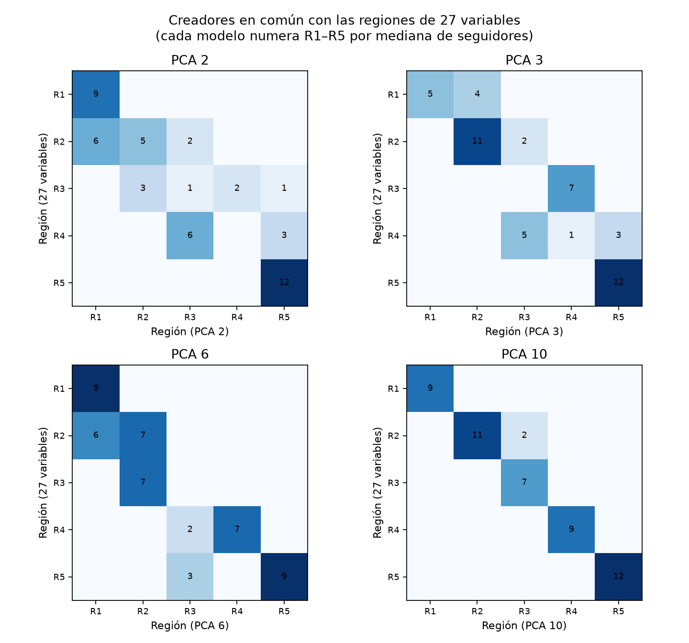

# Kohonen con PCA: comparación con 27 variables

Desde TP4: `python3 -m analysis.som_pca_comparison`. Se entrena el mismo modelo del [análisis de regiones](../som/README.md) cambiando solo la entrada: 4×4 rectangular, 5 semillas y 5 regiones con Ward sobre prototipos vecinos. Se usan las primeras k componentes de las 27 variables estandarizadas, sin whitening. Las k elegidas responden a criterios distintos:

- **2**: el plano del biplot.
- **3**: la [figura 3D](../pca_3d.png).
- **6**: autovalor mayor que 1.
- **10**: 90 % de la varianza.

| Entrada | Varianza retenida | TE | ARI regiones entre semillas | ARI con 27 variables | Pureza de tema | η² tamaño | η² tutoriales | Selecciones iguales a 27 variables |
| --- | ---: | ---: | ---: | ---: | ---: | ---: | ---: | ---: |
| **27 variables** | 100 % | **0,07** | 0,79 | 1 | **0,66** | 0,71 | 0,47 | 12 de 12 |
| PCA 2 | 58,9 % | 0,30 | 1,00 | 0,45 | 0,52 | 0,76 | 0,52 | 8 de 11 |
| PCA 3 | 65,9 % | 0,26 | 0,95 | 0,60 | 0,52 | 0,76 | 0,57 | 9 de 12 |
| PCA 6 | 81,1 % | 0,11 | 0,71 | 0,52 | 0,64 | 0,70 | 0,50 | 9 de 9 |
| PCA 10 | 91,5 % | 0,12 | 0,68 | **0,91** | **0,66** | 0,74 | 0,47 | **12 de 12** |

La pureza al azar es 0,41. La audiencia argentina y el costo por cuenta argentina no se separan con ninguna entrada (η² ≤ 0,15; `resumen.csv`). El error de cuantización no se compara: cada entrada mide distancias en otro espacio, y con menos componentes la distancia es menor solo porque se descartó varianza.

"Selecciones iguales" cuenta cuántos de los creadores elegidos para las cuatro campañas coinciden con los del modelo de 27 variables. Para eso cada región se identifica con la región de 27 variables con la que comparte más creadores. Con PCA 2 y PCA 6 algunas campañas reciben menos de 3 candidatos, porque su región objetivo queda con pocos creadores del tema.

## Qué cambia con cada k

- **2 y 3 componentes: regiones muy estables, pero de otro mapa.** El ARI entre semillas es 0,95–1,00 porque en 2–3 dimensiones hay poco que acomodar, pero el error topográfico se cuadruplica (0,26–0,30). R5 (entretenimiento masivo) se mantiene igual: está bien descrita por PC1. Lo que dependía de PC3–PC4 se pierde. Con PCA 2, R2 se reparte entre los perros de R1 y otras dos regiones, y arte (R3) se dispersa en cuatro. La pureza de tema cae a 0,52. Mirar el plano o la figura 3D sirve para visualizar, pero no para agrupar.
- **6 componentes: los temas vuelven, pero cambian los grupos.** La pureza vuelve a 0,64, aunque con regiones distintas (ARI 0,52 con 27 variables). R2 se divide: sus creadores de nicho de fútbol se unen a los perros de R1, y el resto se une con arte (R3). Cinco componentes más débiles deciden esas separaciones.
- **10 componentes: el mismo mapa.** ARI 0,91 con 27 variables. Solo 2 creadores pasan de R2 a R3, y las 12 selecciones de campaña son idénticas. Lo que se descarta (8,5 % de la varianza) no cambia la segmentación. El error topográfico sube un poco (0,12 frente a 0,07), y las regiones son algo menos estables entre semillas (0,68 frente a 0,79).

## Decisión

**Se mantienen las 27 variables.** PCA 10 da los mismos segmentos y las mismas campañas, así que reducir es válido, pero no aporta: con 50 creadores el costo de entrenar no es un problema, y entrenar sobre las variables originales permite leer los prototipos en unidades originales (planos de componentes). Además tiene menor error topográfico y regiones más estables. Por debajo de 10 componentes la segmentación cambia; por debajo de 6 se pierde el tema. Coincide con el [barrido de representaciones](../representacion_kohonen/README.md), que medía neuronas en lugar de regiones.
