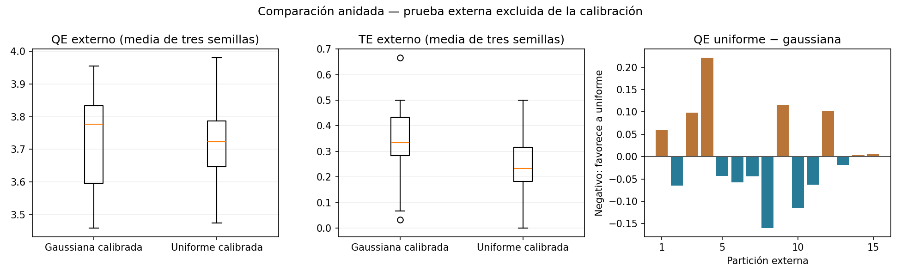
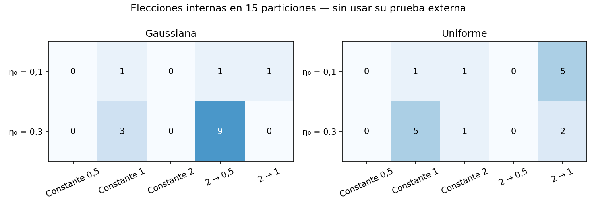

# Versus uniforme–gaussiana con calibración anidada — 26/10/2026

**El QE externo quedó prácticamente igual en promedio; uniforme tuvo menor error topográfico y gaussiana mayor estabilidad regional entre semillas.** No hay una familia que domine todos los criterios. La diferencia de QE es pequeña y cambia de signo entre particiones: no se presenta como superioridad concluyente ni como una prueba formal de equivalencia.

Se completaron **1.800 modelos de calibración y 90 de confirmación**, sin fallos. La presentación permaneció idéntica según los hashes de todos sus archivos. No se guardaron redes, pesos ni checkpoints. Los entrenamientos del versus tardaron **25.6 minutos** con seis procesos en esta máquina; ese tiempo no incluye preparación del código, pruebas iniciales, revisión y redacción posteriores.

## Qué hace justa esta comparación

Se mantuvieron catálogo, 27 variables, grilla rectangular 4×4, inicialización con muestras, presupuesto de actualizaciones y calendario de 1.000 épocas. Cada función recibió diez candidatos: cinco radios/calendarios × dos tasas iniciales, 0,1 y 0,3. En ambas, tasa final 0,01 y decaimiento durante las primeras 500 épocas.

Se hicieron tres repeticiones de cinco particiones externas: en cada una se reservaron diez creadores y se usaron otros cuarenta. Dentro de esos cuarenta se calibraron los candidatos con tres holdouts 32/8 y dos semillas. **Los diez externos no se usaron para escalar, entrenar o elegir parámetros.** Las elecciones se congelaron antes de la confirmación. Después cada elección se reentrenó con cuarenta y tres semillas nuevas y se evaluó sobre los diez excluidos.

No fue comparar una gaussiana ya ajustada con una uniforme de un solo radio. La validación interna también contiene parejas con exactamente los mismos parámetros para estudiar el efecto controlado. El [protocolo completo](PROTOCOLO.md) detalla candidatos, umbrales, semillas y separación de datos.

## Resultado de la confirmación externa

Son 45 modelos por familia: 15 bloques externos × tres semillas. Las métricas se promedian primero por bloque. Cada creador tiene nueve evaluaciones por familia, con datos de entrenamiento que lo excluyen en esas evaluaciones.

| Medida externa o de entrenamiento | Gaussiana calibrada | Uniforme calibrada |
| --- | --- | --- |
| QE entrenamiento | 2.8773 | 3.1702 |
| QE de prueba ↓ | 3.7281 | 3.7307 |
| TE de prueba ↓ | 34.67% | 24.89% |
| Fracción de neuronas vacías en entrenamiento ↓ | 10.14% | 5.69% |
| ARI entre semillas sobre los 50 proyectados ↑ | 0.760 | 0.681 |
| Bloques sin candidato interno apto (fallback) | 1 | 1 |

El QE usa distancia euclídea en 27 variables estandarizadas con estadísticas de entrenamiento. No es un porcentaje de clasificación. TE es la fracción cuyos dos mejores prototipos no son adyacentes; aquí ambas familias usan la misma geometría, por lo que su contraste es directo. ARI compara las regiones entre semillas de un mismo bloque; no es exactitud comercial.

### Diferencias emparejadas

La diferencia media de QE **uniforme − gaussiana** fue **0.00265**, un cambio relativo de **0.071%** respecto de gaussiana. Uniforme tuvo menor QE en **8/15 bloques**. Los percentiles 5–95 de esas diferencias fueron **-0.1286 a 0.1472**, incluyendo ventajas para ambas.

Uniforme redujo el TE medio en **9.78 puntos porcentuales** y ganó ese criterio en **10/15 bloques**. La gaussiana tuvo mayor ARI medio entre semillas, 0,760 frente a 0,681: su agrupamiento fue más reproducible bajo este análisis.

Promediando las nueve exposiciones de cada creador, uniforme tuvo menor distancia al prototipo en **31/50** creadores. Esto ayuda a ver que una media casi igual puede ocultar personas favorecidas de forma distinta, pero no convierte a esas nueve exposiciones en observaciones independientes.

### Casos sin candidato interno apto

Cada familia tuvo un bloque sin candidato que cumpliera simultáneamente TE ≤0,30, fracción vacía ≤0,20 y ARI ≥0,60. Se aplicó el fallback declarado, sin relajar criterios: menor TE, después QE, vacías e identificador. Los bloques fueron distintos, por lo que ambas encontraron candidatos aptos en **13/15** bloques.

La comparación principal mantiene los quince, incluidos los fallbacks. En el subconjunto diagnóstico donde ambas fueron aptas, la diferencia media de QE fue **-0.02287**, favorable a uniforme, que ganó en **8/13**. No se usa ese subconjunto para ocultar resultados ni proclamar una ganadora: muestra sensibilidad a casos difíciles y a la regla de selección.

## Radios constantes: sí se habían probado y también se incluyeron aquí

El resumen histórico publicado contiene **20 configuraciones de radio constante, cinco semillas cada una**: radios 0,5/1/2/4/8, uniforme/gaussiana y rectangular/hexagonal. La copia `historical_constant.csv` conserva esos resúmenes y `historical_source.json` identifica su fuente. Son evidencia histórica separada, no las nuevas confirmaciones externas.

El nuevo diseño incluyó constantes 0,5/1/2 y decaimientos 2 → 0,5 y 2 → 1. Las frecuencias de elección interna fueron:

| Radio elegido dentro de cada bloque | Gaussiana (de 15) | Uniforme (de 15) |
| --- | --- | --- |
| Constante 0,5 | 0 | 0 |
| Constante 1 | 4 | 6 |
| Constante 2 | 0 | 2 |
| 2 → 0,5 | 10 | 0 |
| 2 → 1 | 1 | 7 |

Las cuentas incluyen un fallback constante en cada familia. Uniforme eligió radio constante en 8/15 bloques, gaussiana en 4/15. Por eso no corresponde decir que un radio constante es siempre malo. Tampoco hay un calendario universal: la selección cambió con los datos disponibles. Los valores 4 y 8 no se repitieron en este rango acotado; sus antecedentes permanecen disponibles.

Para uniforme, radio menor que uno elimina vecinas; con constante 0,5 eso ocurre desde el inicio. Terminar en 0,5 después de empezar en dos es otra trayectoria: primero se organiza una vecindad y después queda aprendizaje de ganadora. En gaussiana, 0,5 es un ancho y todavía hay influencia sobre las vecinas. Los mismos números no significan la misma suavidad.

## Contraste controlado, separado de la confirmación

`matched_calibration.csv` compara las diez parejas con iguales radios, tasas y datos internos. Por ejemplo, con tasa inicial 0,3:

- **Constante 1:** QE interno de validación 3,7778 para gaussiana y 3,7410 para uniforme; TE 19,7 % y 27,5 %, respectivamente.
- **Decaimiento 2 → 0,5:** QE 3,7252 frente a 3,8527; TE 28,2 % frente a 41,1 %.
- **Decaimiento 2 → 1:** QE 3,7806 frente a 3,7553; TE 31,0 % frente a 26,4 %.

Son medias de validación interna, usadas para estudiar parámetros y seleccionar, **no resultados externos adicionales**. Muestran por qué la respuesta depende del radio y de su calendario. No se mezclan con la tabla externa para mejorar cifras.

## Qué conclusión usar

Una conclusión respaldada es: «Con igual presupuesto de calibración, las dos funciones tuvieron cuantización externa media casi igual. La uniforme conservó mejor la topología; la gaussiana produjo regiones más estables entre semillas. Los radios constantes fueron útiles en parte de las selecciones y el resultado dependió del calendario».

Si se prioriza la actualización uniforme del apunte y conservar vecinas, los resultados dan motivos para considerar radio 1 o decaimiento hacia 1. Si se prioriza reproducibilidad de regiones entre semillas, la gaussiana tuvo ventaja. No se reemplazó automáticamente el modelo actual, no se eligió una única configuración global y no se cambió la presentación.

## Límites

- Se compara un procedimiento calibrado por familia; cada bloque puede elegir una configuración distinta. No se confirma una única gaussiana contra una única uniforme fija.
- Los umbrales de calidad son prácticos y predeclarados. Los fallbacks y el subconjunto apto se muestran explícitamente.
- El catálogo contiene cincuenta creadores ya explorados. Las repeticiones se superponen; los percentiles no son intervalos de confianza ni una prueba de significación. No se afirma generalización a una población independiente.
- La prueba externa permanece fuera de la elección de parámetros de su bloque. La elección de representación y el rango de búsqueda forman parte del contexto previo del TP.
- Mejor topología o distancia no prueban mejores ventas ni adopciones. No se usó la coincidencia con regiones gaussianas anteriores como criterio de calibración.
- Es una comparación dentro de diez candidatos por familia, con grilla, tasa final y presupuesto fijados. No demuestra óptimos globales de cada familia ni estudia augmentation en este versus.

## Reproducción y archivos

[PROTOCOLO.md](PROTOCOLO.md) contiene comandos y reglas. `protocol.json` identifica candidatos, índices, semillas y hashes previos. `calibration.jsonl` guarda 1.800 métricas de modelos internos; `selections.json` congela las elecciones con hash de calibración; `confirmation.jsonl` conserva los 90 modelos externos como métricas y asignaciones, sin pesos.

Las tablas `summary.csv`, `paired_differences.csv`, `paired_creators.csv`, `selection_frequency.csv`, `candidate_averages.csv` y `matched_calibration.csv` permiten revisar resultados. `creator_evaluations.csv` contiene distancias y TE por índice de fila, sin nombres. Se verificaron cobertura balanceada, semillas, presupuestos, métricas individuales y correspondencia con las elecciones congeladas. Pasaron **124 tests**; las figuras se inspeccionaron visualmente.

La [tanda uniforme previa](../uniforme_20261026/README.md) conserva las 1.260 repeticiones de finalistas, submuestras y augmentation. Este versus se documenta por separado. Todos los cambios y resultados permanecen locales, sin push.
