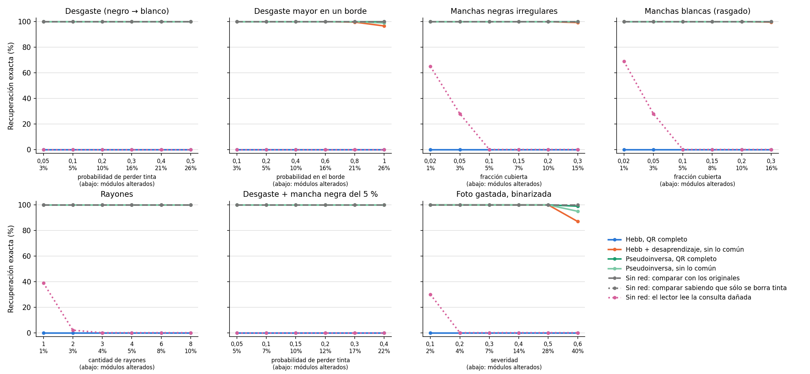
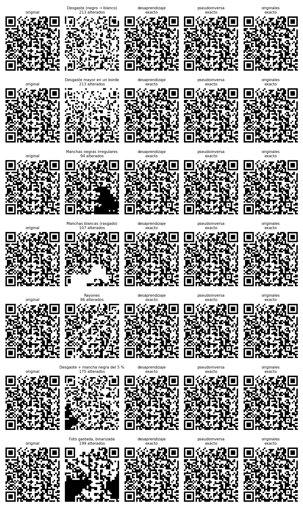

# Daño realista sobre los QR — 26/10/2026

**Con daños que imitan cómo se arruina un QR impreso, el desaprendizaje y la pseudoinversa recuperan el QR exacto mucho después de que el lector deja de leer.** El lector solo, sobre la consulta dañada, no lee nada desde un 5 % de módulos alterados (una mancha del 5 % o dos rayones), y con desgaste no lee ni el nivel más leve. El desaprendizaje recupera el 97 % o más con hasta un cuarto de los módulos alterados, en los siete tipos de daño. Hebb, como siempre, 0 %.

Son dos corridas: esta, con niveles moderados (4.200 consultas), y una [de niveles extremos](../dano_realista_extremo_20261026/README.md) (3.600), agregada después de ver que aquí casi todo daba 100 %. No se guardaron redes.

## Qué se probó

Los daños están en `src/tp4/damage.py` y sus tests en `tests/test_realistic_damage.py`. Negro = +1, blanco = −1.

| Daño | Cómo se genera | Niveles |
| --- | --- | --- |
| Desgaste | Cada módulo negro pasa a blanco con probabilidad p; nunca al revés | p = 0,05 a 0,5 |
| Desgaste en un borde | Igual, con probabilidad p en un borde al azar que baja a cero en el opuesto | p = 0,1 a 1 |
| Manchas negras | 1 a 3 manchas irregulares (discos que crecen alrededor de un centro que se mueve) | 2 a 30 % cubierto |
| Manchas blancas | Igual, en blanco: rasgado o papel decolorado | 2 a 30 % cubierto |
| Rayones | Líneas de un módulo de ancho en ángulo al azar; borran tinta | 1 a 8 rayones |
| Desgaste + mancha | Desgaste p más una mancha negra del 5 % | p = 0,05 a 0,4 |
| Foto gastada | Se dibuja el QR en grises con 8 píxeles por módulo; tinta descolorida, mancha semitransparente, desenfoque y ruido del sensor según la severidad; cada módulo se vuelve a leer como el promedio de sus píxeles con umbral adaptado al contraste | severidad 0,1 a 0,6 |

Cinco QR × 7 tipos × 6 niveles × 20 semillas **nuevas** (200–219) = 4.200 consultas por método. Los niveles se eligieron mirando solo cuánto dañan (fracción de módulos alterados), antes de pasar consultas por las redes.

## Métodos, sin reajustar nada

- Hebb con los cinco QR completos.
- **Desaprendizaje** sin módulos compartidos: el candidato congelado (sueños, tasa 0,1, 50 intentos, semillas de entrenamiento 0/1/2). Se reprodujo con 20/22/20 actualizaciones y los cinco QR estables, igual que en la confirmación.
- **Pseudoinversa**, con QR completo y sin módulos compartidos.
- Sin red: el original a menor distancia de Hamming, y una variante que sabe que el daño solo borra tinta: descarta los originales con blanco donde la consulta tiene negro y elige el de menos tinta perdida. Para desgaste, manchas blancas y rayones es la decisión de máxima verosimilitud; para los demás daños no.
- El lector de OpenCV sobre la consulta dañada y sobre cada salida.

## Resultados

Recuperación exacta en el nivel más alto de cada tipo, con la fracción media de módulos alterados:

| Daño (nivel más alto) | Alterados | Lector solo | Desaprendizaje | Pseudoinversa completa | Pseudoinversa sin lo común | Originales | Originales, sabiendo que solo se borra |
| --- | ---: | ---: | ---: | ---: | ---: | ---: | ---: |
| Desgaste p = 0,5 | 26 % | 0 % | 100 % | 100 % | 100 % | 100 % | 100 % |
| Desgaste en un borde p = 1 | 26 % | 0 % | 96,7 % | 100 % | 99 % | 100 % | 100 % |
| Manchas negras 30 % | 15 % | 0 % | 99,3 % | 100 % | 100 % | 100 % | 100 % |
| Manchas blancas 30 % | 16 % | 0 % | 99,7 % | 100 % | 100 % | 100 % | 100 % |
| Rayones 8 | 10 % | 0 % | 100 % | 100 % | 100 % | 100 % | 100 % |
| Desgaste 0,4 + mancha | 22 % | 0 % | 100 % | 100 % | 100 % | 100 % | 100 % |
| Foto 0,6 | 40 % | 0 % | 87,0 % | 99 % | 95 % | 100 % | 99 % |

Con el nivel más leve, el lector solo lee el 65–69 % de las manchas del 2 %, el 39 % con un rayón y el 30 % de la foto menos gastada; con desgaste no lee ninguna, ni con 2,6 % de módulos perdidos, porque el desgaste se reparte por todo el QR. Con una mancha del 5 % lee el 28 % y desde 5 % de módulos alterados, nada. Las salidas exactas de cualquier método se leen siempre, y las que no son exactas, nunca. El desaprendizaje terminó en 0,9 a 1,1 iteraciones de media; Hebb, en la mezcla, con 143 módulos mal.





## Cómo leerlo

- **El daño realista no es más difícil que el ruido al azar a igual cantidad de módulos alterados**, salvo la foto. Con desgaste, el desaprendizaje recupera el 99 % con 36 % de módulos alterados (corrida extrema); con ruido al azar, el 98,7 % con 35 %. La foto se rompe antes porque el desenfoque y la mancha alteran módulos en las dos direcciones y concentrados en una zona.
- **El problema práctico es el lector, no la red**: un daño chico ya impide leer el QR, y cualquiera de las dos memorias que guardan los cinco QR lo devuelve exacto.
- Comparar con los originales sigue siendo la mejor referencia con estos niveles. Con daño de un solo lado deja de ser el techo: la variante que sabe que solo se borra tinta le gana en los niveles extremos (ver la otra corrida).

## Límites

- Son simulaciones: el generador de manchas y la foto son modelos simples, no fotos reales. Una foto real además necesita ubicar y enderezar el QR, que acá se supone resuelto.
- Las 20 semillas cambian el daño, no los QR: siguen siendo los mismos cinco.
- Los niveles de la corrida extrema se eligieron después de ver esta. Es una prueba de estrés descriptiva: no se cambió ningún parámetro de los métodos.

## Reproducción

Desde TP4:

```bash
OPENBLAS_NUM_THREADS=1 python3 analysis/hopfield_qr_dano_realista.py --output /tmp/dano_realista
```

`config.json` guarda niveles, semillas, actualizaciones del desaprendizaje y hashes de los QR y del código. `resultados.csv.gz` tiene una fila por consulta y método; `resumen.csv`, las medias por tipo, nivel y método. Se corrió con OpenCV 4.10; si el lector lanza una excepción con un contorno degenerado se cuenta como no leído.
