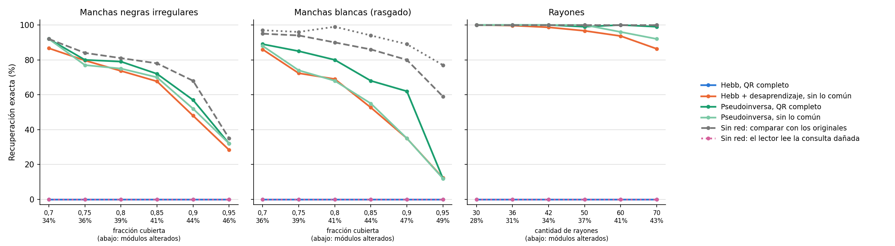

# Daño realista hasta 40–50 % en manchas y rayones — 27/10/2026

Tercera corrida del [daño realista](../dano_realista_20261026/README.md). En las dos anteriores el desgaste, el desgaste con mancha y la foto llegaron a 47–50 % de módulos alterados, pero las manchas negras se quedaron en 29 %, las blancas en 31 % y los rayones en 24 % ([niveles extremos](../dano_realista_extremo_20261026/README.md)). Esta corrida completa esos tres tipos con niveles más altos, con los mismos métodos congelados y las mismas semillas 200–219, para que todos lleguen al mismo rango del gráfico de la presentación. Es una prueba de estrés descriptiva: no se cambió ningún parámetro. El desgaste en un borde no se repite, porque con probabilidad 1 ya borra todo su borde y no puede pasar de 26 %. Son 1.800 consultas y la corrida tardó unos 3 minutos.

| Daño (nivel) | Alterados | Desaprendizaje | Pseudoinversa completa | Pseudoinversa sin lo común | Originales | Originales, sabiendo que solo se borra |
| --- | ---: | ---: | ---: | ---: | ---: | ---: |
| Manchas negras 70 % | 34 % | 86,7 % | 92 % | 92 % | 92 % | 90 % |
| Manchas negras 75 % | 36 % | 79,7 % | 80 % | 77 % | 84 % | 77 % |
| Manchas negras 80 % | 39 % | 73,7 % | 79 % | 75 % | 81 % | 70 % |
| Manchas negras 85 % | 41 % | 67,7 % | 72 % | 70 % | 78 % | 65 % |
| Manchas negras 90 % | 44 % | 48 % | 57 % | 52 % | 68 % | 47 % |
| Manchas negras 95 % | 46 % | 28,3 % | 32 % | 32 % | 35 % | 24 % |
| Manchas blancas 70 % | 36 % | 86 % | 89 % | 88 % | 95 % | 97 % |
| Manchas blancas 75 % | 39 % | 72,3 % | 85 % | 74 % | 94 % | 96 % |
| Manchas blancas 80 % | 41 % | 69 % | 80 % | 68 % | 90 % | 99 % |
| Manchas blancas 85 % | 44 % | 52,7 % | 68 % | 55 % | 86 % | 94 % |
| Manchas blancas 90 % | 47 % | 35 % | 62 % | 35 % | 80 % | 89 % |
| Manchas blancas 95 % | 49 % | 12,3 % | 12 % | 12 % | 59 % | 77 % |
| Rayones 30 | 28 % | 100 % | 100 % | 100 % | 100 % | 100 % |
| Rayones 36 | 31 % | 99,7 % | 100 % | 100 % | 100 % | 100 % |
| Rayones 42 | 34 % | 98,7 % | 100 % | 100 % | 100 % | 100 % |
| Rayones 50 | 37 % | 96,7 % | 99 % | 100 % | 100 % | 100 % |
| Rayones 60 | 41 % | 93,7 % | 100 % | 96 % | 100 % | 100 % |
| Rayones 70 | 43 % | 86,3 % | 99 % | 92 % | 100 % | 100 % |

El lector solo no lee ninguna consulta en esta corrida. Hebb: 0 %. Con manchas negras la última columna no corresponde: esas manchas agregan tinta, no la borran, y por eso esa regla queda por debajo de Hamming.

**Lectura.** Las manchas son el daño más difícil: desde 34 % de módulos alterados ninguna red supera el 92 % y con 44 a 47 % caen a 35–62 %. Con manchas blancas, que solo borran tinta, comparar sabiendo eso sigue arriba (89 % con 47 %). Los rayones casi no les cuestan a la pseudoinversa completa ni a Hamming (99 a 100 % hasta 43 %); el desaprendizaje baja a 86 %. Como en las corridas anteriores, la pseudoinversa completa aguanta más que la de sin lo común y que el desaprendizaje.

`curvas.png` dibuja los tres tipos en una fila; las otras corridas usan la grilla de siete tipos. Reproducción desde TP4: `OPENBLAS_NUM_THREADS=1 python3 analysis/hopfield_qr_dano_realista_extremo_40.py --output /tmp/dano_40`.
