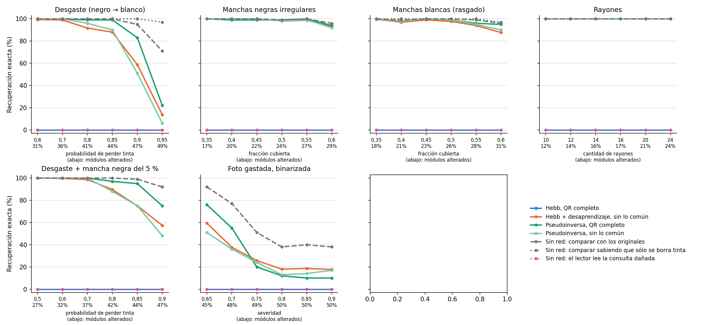

# Daño realista con niveles extremos — 26/10/2026

Segunda corrida del [daño realista](../dano_realista_20261026/README.md): mismos daños, métodos congelados y semillas 200–219, con niveles más altos para ver dónde se rompe cada método. Se agregó después de ver la primera, donde casi todo daba 100 %; no se cambió ningún parámetro. El desgaste en un borde ya llegaba a probabilidad 1 y no se repite. Son 3.600 consultas.

| Daño (nivel) | Alterados | Desaprendizaje | Pseudoinversa completa | Pseudoinversa sin lo común | Originales | Originales, sabiendo que solo se borra |
| --- | ---: | ---: | ---: | ---: | ---: | ---: |
| Desgaste 0,7 | 36 % | 99,0 % | 100 % | 100 % | 100 % | 100 % |
| Desgaste 0,85 | 44 % | 88,0 % | 99 % | 90 % | 100 % | 100 % |
| Desgaste 0,9 | 47 % | 58,7 % | 83 % | 51 % | 95 % | 100 % |
| Desgaste 0,95 | 49 % | 13,7 % | 22 % | 6 % | 71 % | 97 % |
| Manchas negras 60 % | 29 % | 93,3 % | 94 % | 92 % | 96 % | 92 % |
| Manchas blancas 60 % | 31 % | 87,7 % | 95 % | 90 % | 96 % | 97 % |
| Rayones 24 | 24 % | 100 % | 100 % | 100 % | 100 % | 100 % |
| Desgaste 0,9 + mancha | 47 % | 57,3 % | 75 % | 48 % | 92 % | 98 % |
| Foto 0,65 | 45 % | 59,3 % | 76 % | 51 % | 92 % | 86 % |
| Foto 0,8 | 50 % | 18,0 % | 12 % | 13 % | 38 % | 48 % |

El lector solo no lee ninguna consulta en esta corrida. Hebb: 0 %.

**Lectura.** Las dos memorias que guardan los cinco QR se rompen recién cuando se altera entre 40 y 47 % de los módulos; la pseudoinversa completa aguanta más que el desaprendizaje. Con daño que solo borra tinta, comparar con los originales deja de ser el techo: si se usa que un negro en la consulta no puede venir de un blanco del original, con 49 % alterado se acierta el 97 %, contra 71 % de Hamming. Con manchas negras esa regla no vale, y por eso queda por debajo.

Reproducción desde TP4: `OPENBLAS_NUM_THREADS=1 python3 analysis/hopfield_qr_dano_realista_extremo.py --output /tmp/dano_extremo`.
