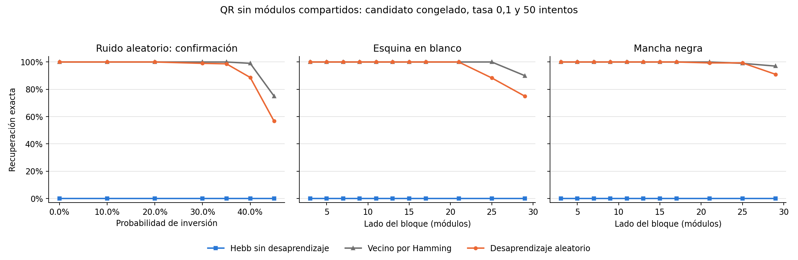

# Desaprendizaje: pruebas completas del 22 de octubre de 2026

**La combinación de quitar módulos compartidos y desaprender estados espurios
confirmó una mejora frente a Hebb. El candidato seleccionado mantuvo los cinco
originales estables y recuperó el 90.5% de las consultas con ruido nuevo. El vecino
por Hamming siguió siendo mejor en promedio: 95.7%.**

La red completa tuvo algunas corridas prometedoras, pero ninguna combinación
preservó los cinco originales en todas sus semillas de entrenamiento. De acuerdo
con el protocolo, no se eligió ni confirmó un candidato de esa versión.

## Qué se ejecutó

| Etapa | Predicciones evaluadas | Estado |
| --- | ---: | --- |
| Exploración con 1369 neuronas | 6650 | Completa |
| Exploración con 414 neuronas, sin 955 módulos comunes | 6650 | Completa |
| Confirmación del candidato reducido, ruido nuevo | 3500 | Completa |
| Validación adicional de esquinas y manchas | 6600 | Completa |
| **Total de esta tanda** | **23400** | **Completa** |

Estas cantidades incluyen controles y repeticiones sobre los mismos cinco QR.
No representan 23400 objetos independientes. Las pruebas cortas anteriores no
se incluyen en este total. No se utilizó pseudoinversa ni se dividieron los
recuerdos entre varias redes.

## Exploración y selección, sin cambiar el protocolo después

En cada representación se evaluaron dos modos, tasas 0.01/0.05/0.1 y presupuestos
10/50/100 intentos. Sueños utilizó semillas de entrenamiento 0/1/2; dirigido se
ejecutó una vez por combinación porque es determinista. Los checkpoints de una
corrida son acumulativos. El control cero es Hebb sin modificar.

Consultas por modelo: cinco QR, siete niveles de ruido
0/0.1/0.2/0.3/0.35/0.4/0.45 y semillas 10–14. Ambos experimentos utilizaron los
mismos QR, niveles, semillas y consultas completas. La variante reducida genera
el ruido antes del recorte y restaura los módulos conocidos al devolver la salida.

Se aplicó el criterio ya documentado:

1. Exigir cinco originales estables en TODAS las semillas de entrenamiento.
2. Entre los viables, maximizar la recuperación media en niveles de ruido positivos,
   con igual peso por nivel, QR y semilla de entrenamiento.
3. Desempatar por menos intentos y menor tasa.
4. Congelar los parámetros antes de observar la confirmación.

Cada representación tiene 18 combinaciones modo/tasa/presupuesto; las repeticiones
de sueños producen 36 checkpoints evaluados en total. La selección está registrada
en `seleccion.json` junto a cada exploración; incluye hash del JSON de confirmación.

## Resultado de la red completa

**Cero de 18 combinaciones fueron elegibles bajo el criterio de estabilidad en
todas las semillas.** Esto no significa que ninguna corrida individual mejorara.

La mejor media exploratoria fue sueños, tasa 0.05 y 50 intentos: 80.0% con ruido.
Pero conservó 4/5 originales en la semilla 0 y 5/5 en las semillas 1 y 2. Su
rendimiento varió entre 61.3% y 90.0% según la semilla. Se rechazó como
candidato por la pérdida de estabilidad en una de las semillas.

El mejor dirigido fue tasa 0.1 y 50 intentos, con 50.7% de recuperación media y
sólo tres originales estables. Aumentar presupuesto no garantizó mejora: sueños
con tasa 0.1 y 100 intentos produjo ciclos en el 67.1% de las consultas con ruido,
promediando sus tres semillas, y sólo 7.6% de recuperación.

No se ejecutó una confirmación de esta representación porque no superó el filtro
prefijado. No se sustituyó ese criterio por la mejor semilla individual.

## Resultado de la exploración sin compartidos

Diez de 18 combinaciones fueron elegibles. Algunas de las mejores fueron:

| Modo | Tasa | Intentos | Recuperación media con ruido | Originales estables en todas las semillas |
| --- | ---: | ---: | ---: | --- |
| Sueños | 0.1 | 50 | **88.4%** | Sí |
| Sueños | 0.05 | 50 | 88.0% | Sí |
| Sueños | 0.05 | 100 | 87.8% | Sí |
| Sueños | 0.1 | 100 | 86.0% | Sí |
| Dirigido | 0.1 | 50 | 76.7% | Sí |

Se eligió **sueños, tasa 0.1 y 50 intentos**, con las semillas de entrenamiento
0/1/2. El archivo `configs/hopfield_unlearning_stripped_confirmation.json` quedó
congelado antes de ejecutar sus consultas nuevas.

El dirigido con tasa 0.1 dejó de actualizar tras 12 penalizaciones porque, desde
la mezcla original, las recuperaciones siguientes ya terminaban en estados
protegidos. Por eso 50 y 100 intentos dieron el mismo resultado. El aleatorio
pudo explorar otras regiones; esta observación explica la diferencia en esta
prueba y no demuestra superioridad universal de un modo.

## Confirmación con ruido nuevo

Se conservaron los niveles de ruido y las tres semillas de entrenamiento; sólo
se cambiaron las semillas de consulta a **100–119**, disjuntas de exploración.
Cada red recibió 700 consultas: 100 por nivel. El candidato tiene tres redes
entrenadas por separado, una por semilla; NO se combinan sus salidas ni se votan.
Los porcentajes del candidato promedian sus tres repeticiones.

| Probabilidad de inversión por módulo | Hebb sin desaprendizaje | Candidato reducido | Vecino por Hamming |
| --- | ---: | ---: | ---: |
| 0 | 0% | **100%** | 100% |
| 0.1 | 0% | **100%** | 100% |
| 0.2 | 0% | **100%** | 100% |
| 0.3 | 0% | **99.0%** | 100% |
| 0.35 | 0% | **98.7%** | 100% |
| 0.4 | 0% | **88.7%** | 99.0% |
| 0.45 | 0% | **56.7%** | 75.0% |
| **Media de los seis niveles positivos** | **0%** | **90.5%** | **95.7%** |

Los cinco originales permanecieron estables en las tres semillas. Hubo 20, 22 y
20 actualizaciones efectivas dentro de los 50 intentos, respectivamente. No se
observaron ciclos ni topes en las consultas de confirmación. Para Hopfield, éxito
exige salida exacta y estable; Hamming es una referencia sin dinámica.

La recuperación media por semilla de entrenamiento fue 91.2%, 91.3% y 89.0%.
Con 45% de ruido hubo diferencias claras por QR: postres 83.3%, especiales 61.7%,
cócteles/bebidas 56.7%, menú principal 43.3% y vinos 38.3%.

### Incertidumbre condicionada a estos cinco QR

Se realizaron 20000 remuestreos bootstrap, semilla 20261022. La unidad de
remuestreo es la semilla de consulta como bloque, conservando juntos métodos,
QR, niveles y repeticiones de entrenamiento. No se remuestrean como independientes
las 1800 predicciones del candidato con ruido positivo.

- Recuperación del candidato: **90.5%, intervalo percentil 95%: 88.4–92.6%**.
- Diferencia frente a Hebb: +90.5 puntos porcentuales, intervalo 88.4–92.6.
- Diferencia frente a Hamming: **−5.2 puntos**, intervalo **−7.2 a −3.3**.

Estos intervalos describen variación del ruido sobre el conjunto fijo y las tres
redes entrenadas. No prueban generalización a otras colecciones de QR.

## Validación adicional: manchas y esquinas

Después de confirmar el candidato, se evaluó sin reajustes sobre:

- Cuatro esquinas en blanco por QR y tamaño.
- Manchas negras con semillas de ubicación 100–119, independientes de las semillas
  de ubicación usadas anteriormente. Las cuatro esquinas son casos deterministas,
  no nuevas ubicaciones aleatorias.
- Lados de bloque 3/5/7/9/11/13/15/17/21/25/29.

El plan espacial quedó registrado antes de leer las métricas de confirmación.
Son 1320 consultas por modelo: 220 de esquinas y 1100 de manchas. Se evaluaron
Hebb, Hamming y las tres repeticiones del candidato: 6600 predicciones.

| Daño | Lado | Hebb | Desaprendizaje | Hamming |
| --- | ---: | ---: | ---: | ---: |
| Esquina en blanco | 3 a 21, tamaños ensayados | 0% | **100%** | 100% |
| Esquina en blanco | 25 | 0% | 88.3% | 100% |
| Esquina en blanco | 29 | 0% | 75.0% | 90.0% |
| Mancha negra | 3 a 17, tamaños ensayados | 0% | **100%** | 100% |
| Mancha negra | 21 | 0% | 99.3% | 100% |
| Mancha negra | 25 | 0% | 99.3% | 99.0% |
| Mancha negra | 29 | 0% | 91.0% | 97.0% |

No se observaron ciclos ni topes en esta validación. Un bloque de lado s cubre
s² módulos, pero no necesariamente invierte s²: algunos ya tenían el color del
relleno. Los CSV distinguen área cubierta de módulos realmente alterados.
Además, restaurar los comunes corrige automáticamente el daño en esas posiciones;
esto forma parte del método reducido y no debe confundirse con corrección inferida
por las 414 neuronas activas. No se ejecutó un lector de QR en esta tanda: se midió
recuperación exacta de los módulos, no lectura óptica de imágenes dañadas.

## Conclusión experimental

Quitar los módulos compartidos y aplicar desaprendizaje aleatorio permitió obtener
una memoria estable de las cinco identidades y recuperar ruido nuevo con una
mejora grande frente a Hebb. La condición de estabilidad importa: la red completa
puede dar buenas medias en algunas corridas y fallar ese requisito.

El resultado no justifica sustituir Hamming por esta red para maximizar exactitud:
la referencia simple sigue siendo mejor en promedio. Tampoco justifica seguir
penalizando indefinidamente; se observaron rendimientos menores con presupuestos
mayores y ciclos en configuraciones agresivas de la red completa.

## Evidencia, reproducción y controles

- [Exploración completa](evidencia/pilot_completo_20261022/).
- [Exploración reducida](evidencia/pilot_sin_compartidos_20261022/).
- [Confirmación reducida](evidencia/confirmacion_sin_compartidos_20261022/).
- [Daño espacial](evidencia/dano_espacial_confirmado_20261022/).
- [Protocolo](../../../docs/experimentos_desaprendizaje.md).
- [Reproducción de figura e intervalos](reproducir_analisis.py).

Cada ejecución contiene `COMPLETED`, configuración y resultados individuales.
Se verificó el hash común de los QR, presupuestos, semillas disjuntas, ausencia
de consultas duplicadas por modelo y coincidencia entre configuración congelada
y confirmación. Las ejecuciones locales permanecen en `results/`, fuera de Git.
Se publica una [copia liviana de las métricas](evidencia/README.md), con registros
comprimidos y hashes, sin pesos ni checkpoints.

Pasaron **99 tests**, incluidos los que verifican selección por estabilidad,
congelación de parámetros, semillas nuevas, generación reproducible del daño,
restauración de compartidos y propiedades de la actualización antihebbiana.
La suite general utilizó SciPy instalado en una carpeta temporal aislada, sin
modificar el entorno del proyecto.

## Comparación posterior con pseudoinversa

Se añadieron 1400 recuperaciones para comparar ambas pseudoinversas con el candidato congelado sobre las mismas consultas. Ver [comparación directa](PSEUDOINVERSA_VS_DESAPRENDIZAJE.md). Esta tanda adicional no está incluida en las 23400 predicciones originales.
