# Repartir los QR en varias redes de Hebb

Con una sola red de Hebb, los 5 QR se parecen tanto que la red no recupera ninguno ([informe principal](../README.md)). La idea de este análisis es **no ponerlos todos juntos**: repartirlos en varias redes chicas, cada una con pocos QR y poco parecidos entre sí. Todo usa sólo la regla de Hebb del apunte.

En los gráficos, cada QR aparece con la palabra en inglés que trae su URL:

| En los gráficos | Menú |
|---|---|
| food | menú principal |
| wine | vinos |
| beverages | cócteles y otras bebidas |
| dessert | postres |
| specials | especiales del día |

## Reproducción

Desde `TP4/`:

```
python3 analysis/hopfield_qr_dos_redes.py
```

Tarda alrededor de 1 minuto y deja los CSV y PNG en esta carpeta (fuera de git). Las varias redes están en `src/tp4/split_hopfield.py`.

---

## Cómo funciona y cómo se elige la red

**Reparto elegido (dos redes, cada una sin los módulos compartidos):**

```
Red A: food + beverages + dessert
Red B: wine + specials
```

Separa a food y wine, el par más parecido, y deja en cada red los QR que menos se parecen entre sí.

**Cuando llega un QR dañado:**

1. **Se pasa por las dos redes.** Cada una hace su recuperación normal de Hopfield y devuelve algo.
2. **Se mira si lo que devolvió cada red es "un QR válido"**, es decir, exactamente uno de los QR que esa red tiene guardados. Si no, es un estado espurio.
3. **Se elige:**
   - si **una sola red** devolvió un QR válido, se toma ese;
   - si **las dos** devolvieron un QR válido, se toma el **más parecido al QR dañado** (el que tiene menos módulos distintos);
   - si **ninguna** devolvió un QR válido, se toma la salida más parecida al QR dañado, que va a estar mal.

**¿Por qué hace falta la regla del "más parecido"?** Porque a veces las dos redes devuelven un QR válido, y una de ellas se equivoca. Pasa siempre con **food**:
- la red A (que tiene food) devuelve food, que es lo correcto;
- la red B (que no lo tiene) devuelve **wine**, porque food y wine son el par más parecido.

Las dos salidas son QR válidos, pero food está mucho más cerca de la consulta, así que se elige bien. Con ruido de hasta 30 %, esto pasa en 140 consultas de 700, **todas de food**, y en todas se elige bien.

---

## Experimento 1: cuántas redes y cómo repartir

**Qué hice.** Comparé cinco esquemas con el mismo ruido aleatorio (1100 consultas) y la misma esquina rota (de 3×3 a 29×29 módulos en las 4 esquinas):

| Esquema | Redes | Qué guarda cada una |
|---|---|---|
| Una red | 1 | Los 5 QR completos (el informe principal) |
| 3 + 2, mejor reparto | 2 | food · beverages · dessert \| wine · specials, sin compartidos |
| 3 + 2, peor reparto | 2 | food · wine · dessert \| beverages · specials, sin compartidos |
| 2 + 2 + 1, QR completos | 3 | food · dessert \| wine · beverages \| specials, **sin sacar nada** |
| 5 redes de 1 | 5 | Un QR cada una |

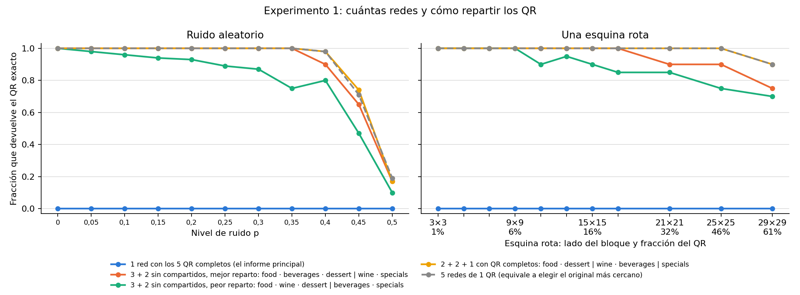

**Resultado** (`resumen_esquemas.csv`), fracción que devuelve el QR exacto:

| | Una red | 3 + 2 mejor | 3 + 2 peor | 2 + 2 + 1 completos | 5 redes de 1 |
|---|---|---|---|---|---|
| Ruido p de 0 a 0,35 | 0 | **1,00** | 1,00 a 0,75 | **1,00** | 1,00 |
| Ruido p = 0,4 | 0 | 0,90 | 0,80 | 0,98 | 0,98 |
| Ruido p = 0,45 | 0 | 0,65 | 0,47 | 0,74 | 0,71 |
| Esquina hasta 17×17 (21 %) | 0 | **1,00** | 0,85 a 1,00 | **1,00** | 1,00 |
| Esquina 25×25 (46 %) | 0 | 0,90 | 0,75 | **1,00** | 1,00 |

**Qué significa.**
- **Repartir arregla el problema.** Cualquier esquema con varias redes recupera los 5 QR; una sola red, ninguno.
- **Si hay una terna, el reparto importa.** Juntar food y wine en la misma terna baja la recuperación desde poco ruido (98 % con p = 0,05).
- **El esquema 2 + 2 + 1 con los QR completos es el más simple y el mejor:** no hace falta sacar los módulos compartidos. Funciona porque un par de QR siempre queda estable con Hebb (el umbral del [control 2](../controles/README.md) para 2 patrones es 100 %).
- **5 redes de 1 QR equivale a comparar con los originales:** cada red sólo puede devolver su QR (o el inverso), y la regla se queda con el más parecido. Es el extremo del reparto, y deja de ser una memoria asociativa.

## Experimento 2: todos los repartos posibles

**Qué hice.** Probé **todos** los repartos: los 10 posibles de terna + par (sin compartidos) y los 15 de dos pares + uno (QR completos). Para cada uno medí la fracción correcta con poco ruido (p ≤ 0,3) y con mucho (p = 0,35; 0,4 y 0,45).

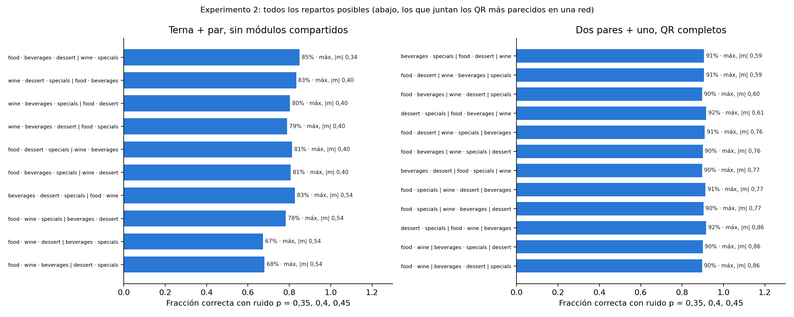

**Resultado** (`repartos.csv`):

| | Correctas con p ≤ 0,3 | Correctas con p de 0,35 a 0,45 |
|---|---|---|
| Terna + par, mejor (food · beverages · dessert \| wine · specials) | 100 % | 85 % |
| Terna + par, peor (food · wine · dessert \| beverages · specials) | 93,9 % | 67 % |
| Dos pares + uno, **los 15** | **100 %** | **90 % a 92 %** |

**Qué significa.** Con terna + par, los repartos que ponen food y wine en la terna son los peores. Con dos pares + uno, **cualquier reparto funciona igual de bien**, aunque deje juntos a food y wine (solapamiento 0,86): con dos patrones, Hebb siempre los guarda.

## Experimento 3: qué devuelven las redes y cómo se elige

**Qué hice.** Para el reparto elegido (3 + 2, el mejor), clasifiqué cada consulta según qué devolvieron las dos redes.

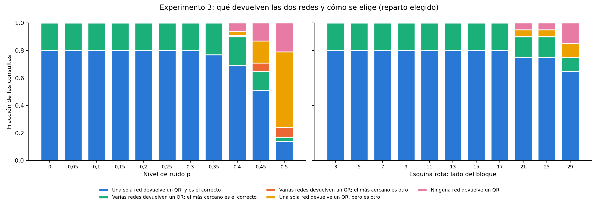

**Resultado** (`diagnostico.csv`), cantidad de consultas (de 100 por nivel de ruido):

| p | Una sola red devuelve un QR, el correcto | Las dos; el más cercano es el correcto | Las dos; el más cercano es otro | Una sola, pero es otro | Ninguna |
|---|---|---|---|---|---|
| 0 a 0,3 | 80 | 20 | 0 | 0 | 0 |
| 0,35 | 77 | 23 | 0 | 0 | 0 |
| 0,4 | 69 | 21 | 1 | 3 | 6 |
| 0,45 | 51 | 14 | 6 | 16 | 13 |
| 0,5 | 14 | 3 | 7 | 55 | 21 |

**Qué significa.**
- **Hasta p = 0,35 nunca se equivoca.** En el 80 % de los casos sólo una red devuelve un QR válido, así que no hay nada que elegir. En el otro 20 % (las consultas de food) las dos devuelven uno, y la regla del "más parecido" elige bien.
- **Con mucho ruido aparecen los errores:** la red correcta cae en un espurio y sólo la otra devuelve un QR válido (amarillo), o ninguna devuelve uno (rosa). Con p = 0,5 la consulta ya es ruido puro.

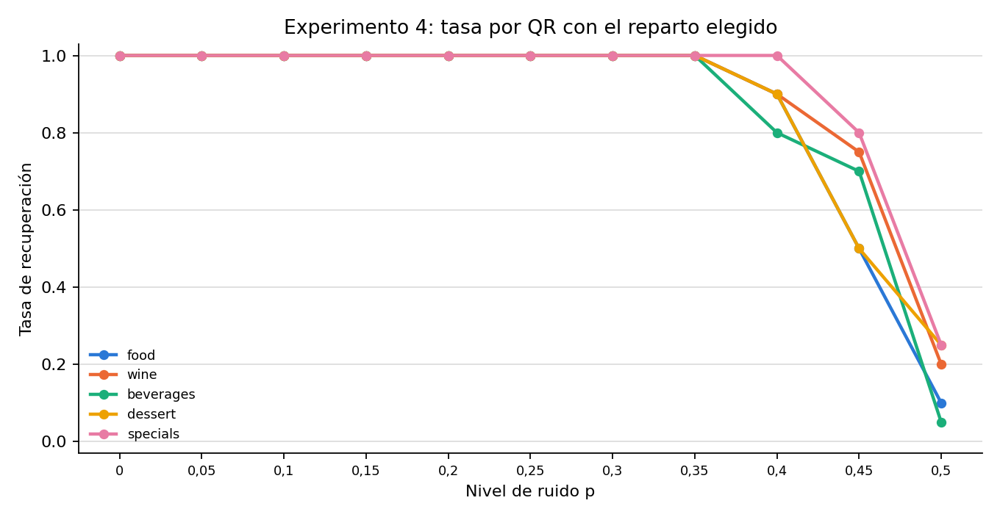

## Experimento 5: ¿quién hace el trabajo, la red o la regla que elige?

**Por qué.** En el experimento 3, el 20 % de las consultas (todas las de food) se resuelven con la regla del "más parecido a la consulta". Esa regla es comparar con los originales, que sin ninguna red ya recupera el 100 % hasta p = 0,35. Hacía falta separar lo que aporta la red de lo que aporta la regla.

**Qué hice.** Con el reparto elegido y las mismas 1100 consultas de ruido, comparé cinco formas de elegir la salida:

| Regla | Qué usa |
|---|---|
| Sin red: el original más parecido a la consulta | Los originales, sin red |
| Oráculo: la red que tiene el QR de la consulta | Sabe la respuesta; mide a cada red sola |
| Desempate comparando con los originales | La regla de arriba (la de `SplitHopfield` por defecto) |
| Menor energía de la consulta | Sólo los pesos de cada red (`selection='energy'`) |
| Sin desempate: vale sólo si una sola red devuelve un QR guardado | Que la salida sea un QR guardado |

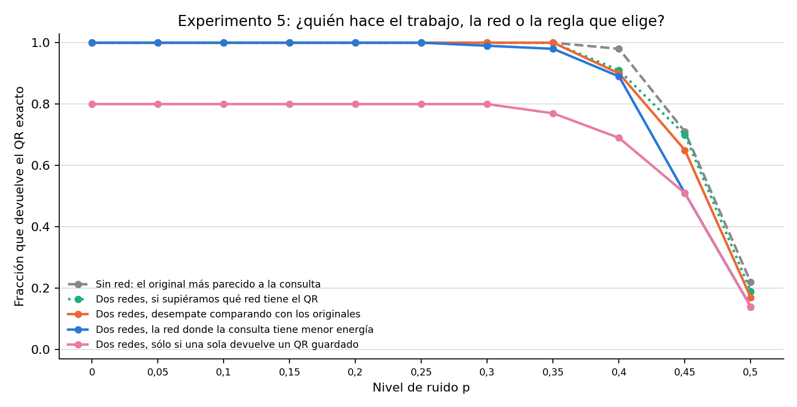

**Resultado** (`eleccion_resumen.csv`), fracción correcta:

| p | Sin red | Oráculo | Desempate con originales | Energía | Sin desempate |
|---|---|---|---|---|---|
| 0 a 0,25 | 1,00 | 1,00 | 1,00 | 1,00 | 0,80 |
| 0,3 | 1,00 | 1,00 | 1,00 | 0,99 | 0,80 |
| 0,35 | 1,00 | 1,00 | 1,00 | 0,98 | 0,77 |
| 0,4 | 0,98 | 0,91 | 0,90 | 0,89 | 0,69 |
| 0,45 | 0,71 | 0,70 | 0,65 | 0,51 | 0,51 |
| 0,5 | 0,22 | 0,19 | 0,17 | 0,14 | 0,14 |

**Qué significa.**
- **Cada red guarda bien sus QR:** si la consulta va a la red que tiene su QR, vuelve el 100 % hasta p = 0,35.
- **Elegir la red es el par food–wine otra vez:** la red de wine le devuelve wine a las 140 consultas de food con p ≤ 0,3. Sin desempate, food da 0 % y el total 80 %. El desempate que lo arregla compara con los originales: en food, lo resuelve Hamming, no la red.
- **Nunca le gana a comparar con los originales:** de 1100 consultas, el desempate acierta 6 que Hamming falla y falla 25 que Hamming acierta (todas con p ≥ 0,4).
- **Elegir por energía no usa los originales** y da 100 % hasta p = 0,25 (acierta 3 que Hamming falla, falla 43). Pero con Hebb la energía de la consulta es −N/2 · Σ (solapamiento con cada QR de la red)²: sigue midiendo parecido con los QR guardados, sólo que a través de los pesos.

## Comparación con una red: los mismos gráficos del informe principal

**Qué hice.** Repetí los gráficos del [informe principal](../README.md) con las mismas 1100 consultas, comparando una red (Hebb con los 5 QR) contra las dos redes del reparto elegido.

### c1: solapamiento dentro de cada red

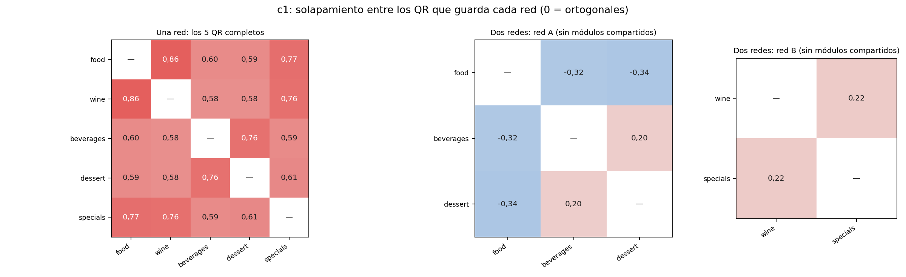

- **Una red** guarda 5 QR con solapamientos de 0,58 a 0,86.
- **Dos redes:** en la red A van de −0,34 a 0,20, y en la red B el único par está en 0,22.

Cada red tiene QR mucho más cerca de ser ortogonales.

### c2: neuronas que se dan vuelta sobre un QR perfecto

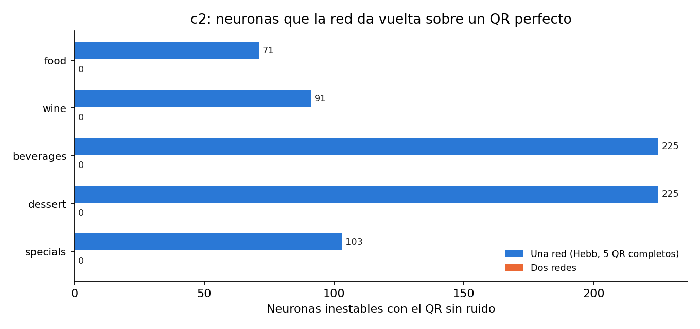

| QR | Una red | Dos redes |
|---|---|---|
| food | 71 | **0** |
| wine | 91 | **0** |
| beverages | 225 | **0** |
| dessert | 225 | **0** |
| specials | 103 | **0** |

Con dos redes, **todos los QR son estables**: la red ya no los "rompe" solos.

### c3: categoría de resultado según el ruido

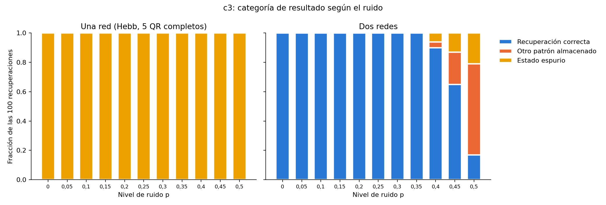

- **Una red:** 100 % estado espurio en todos los niveles.
- **Dos redes:** 100 % recuperación correcta hasta p = 0,35. Con p = 0,4 son 90 correctas, 4 en otro QR y 6 espurias; con p = 0,5, 17, 62 y 21.

### c4: ejemplos

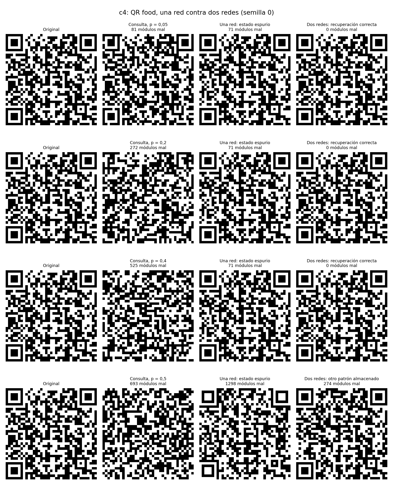

Food con 5 %, 20 % y 40 % de ruido:
- **una red** devuelve siempre la mezcla, a 71 módulos del original;
- **dos redes** devuelven el QR exacto (0 módulos mal).

Con p = 0,5, una red devuelve el inverso de la mezcla y dos redes otro QR guardado.

### c5: iteraciones

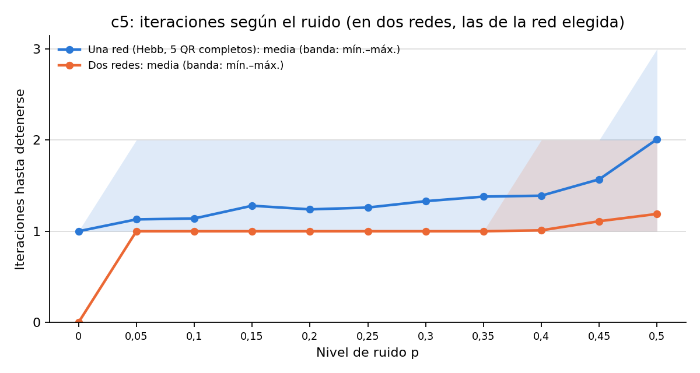

- **Con dos redes, un QR sin ruido no se mueve (0 iteraciones)**, porque ya es estable. Con una red se mueve en 1 iteración hacia la mezcla.
- Con ruido, dos redes tardan 1 iteración hasta p = 0,35 (1,19 en promedio con p = 0,5); una red, de 1,13 a 2,01.

### c6: energía

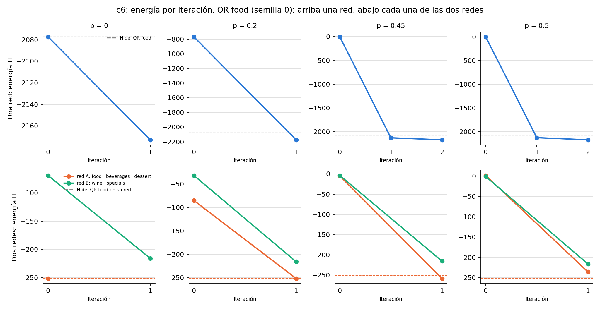

- **Arriba, una red:** la energía baja por debajo de la del QR food (línea punteada) y termina en la mezcla.
- **Abajo, las dos redes:** la red A (naranja), que tiene a food, termina **justo en la energía de food** (−251,54). Con p = 0 ni se mueve.

En las dos redes, los QR son los pozos más hondos (`comparacion_energia.csv`):

| Red | Energía de sus QR | Energía de la mezcla del grupo | ¿La mezcla es estable? |
|---|---|---|---|
| A | food −251,54; beverages −235,31; dessert −237,97 | −148,05 | sí, pero menos honda que los QR |
| B | wine −215,78; specials −215,78 | −152,40 | no |

Con una red, en cambio, la mezcla (−2172,88) era más honda que cualquier QR.

### c7: lector de QR

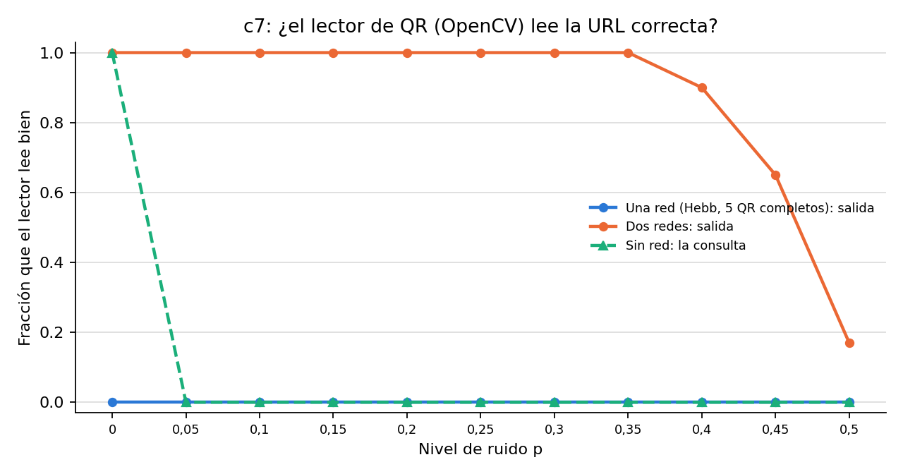

- **Una red:** el lector no lee ninguna salida.
- **Dos redes:** lee el 100 % hasta p = 0,35, y después 90 %, 65 % y 17 %.
- **Sin red:** el lector sólo lee la consulta cuando no tiene ruido.

---

## Conclusión

1. **Cada red guarda bien sus QR:** con la consulta en la red correcta, se recuperan hasta con 35 % de ruido, y el lector los lee.
2. **Pero elegir la red no lo hace la red:** con food, las dos redes devuelven un QR guardado y el desempate compara con los originales. Sin desempate, 80 %; con él, igual que comparar con los originales y nunca mejor (experimento 5). Elegir por la energía de la consulta evita mirar los originales y da 100 % hasta p = 0,25.
3. **Funciona porque cada red guarda pocos QR y poco parecidos:** ninguna neurona inestable, y los QR son los pozos más hondos de energía.
4. **El esquema más robusto es 2 + 2 + 1 con los QR completos:** no necesita sacar los módulos compartidos y cualquier reparto anda.
5. **Límite:** cuantas más redes, más se parece a "comparar con los originales". Con 5 redes de un QR cada una, ya es exactamente eso.

## Archivos

| Archivo | Contenido |
|---|---|
| `repartos.csv` | Cada reparto posible: solapamiento máximo dentro de una red y fracción correcta con poco y con mucho ruido |
| `resultados.csv`, `resumen_esquemas.csv` | Una fila por consulta y esquema; fracción correcta por esquema, daño y nivel |
| `diagnostico.csv` | Qué devolvieron las dos redes, por daño y nivel |
| `eleccion.csv`, `eleccion_resumen.csv` | Experimento 5: si cada regla de elección acierta, por consulta y por nivel |
| `comparacion_resultados.csv` | Una red contra dos redes: categoría, Hamming, iteraciones y lector, por consulta |
| `comparacion_inestables.csv`, `comparacion_energia.csv` | Neuronas inestables por QR; energía de cada QR y de la mezcla en cada red |
