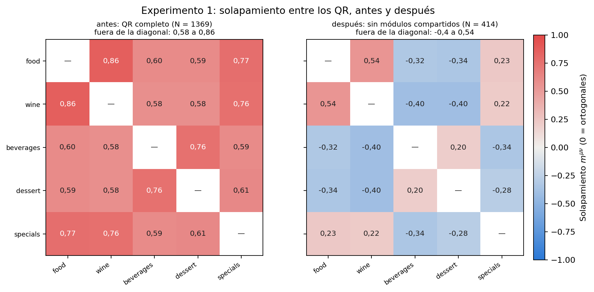
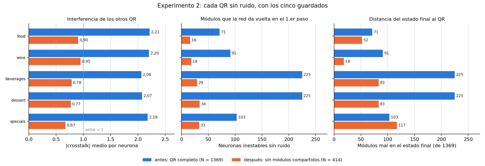
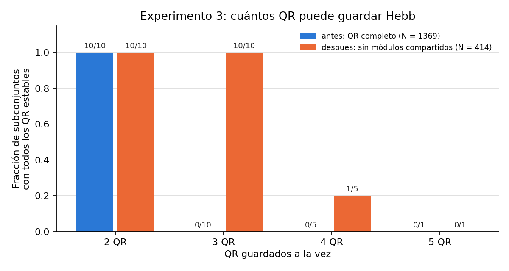
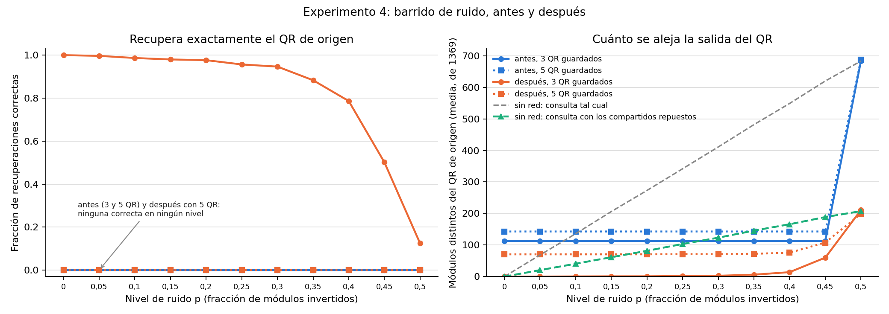
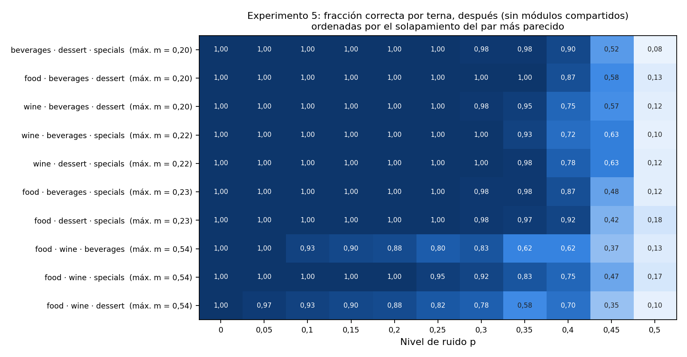
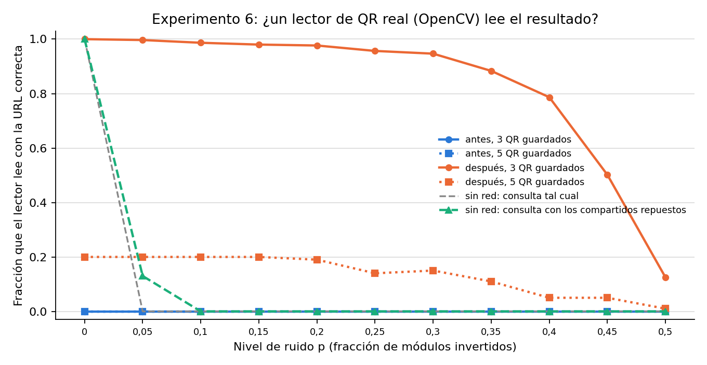
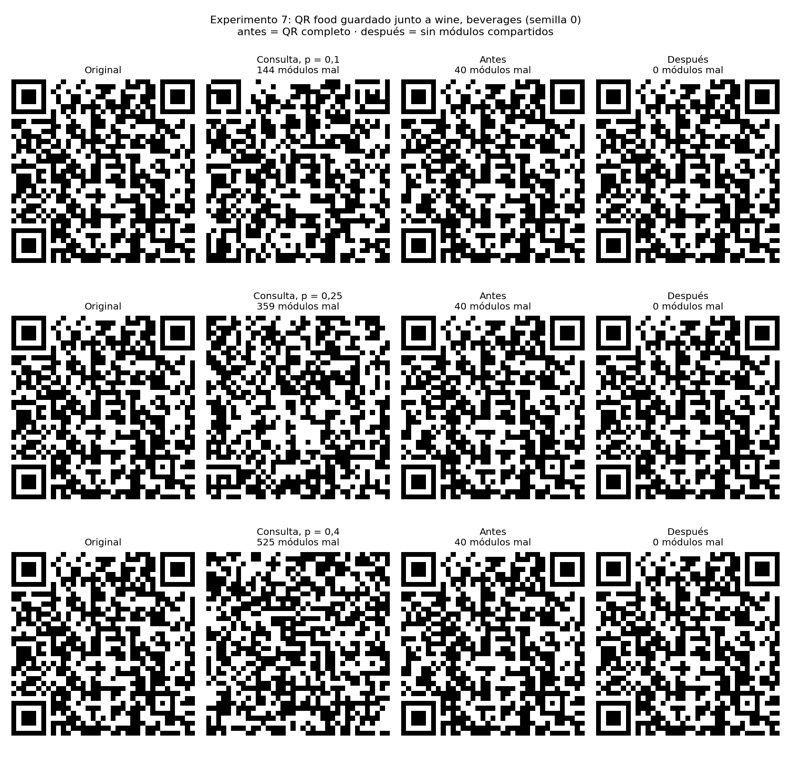

# Variante: guardar sólo los módulos que difieren

Experimentos del ejercicio 2 que comparan **antes** y **después**:

- **Antes:** la red de Hopfield guarda los QR completos, 37×37 = 1369 módulos (lo que mide el [informe principal](../README.md)).
- **Después:** se sacan los **955 módulos que valen lo mismo en los cinco QR** y la red guarda sólo los **414 que difieren**. Al terminar, los 955 se reponen con su valor conocido (`src/tp4/shared_modules.py`).

La regla de aprendizaje es la misma en los dos casos: Hebb, `W = (1/N)·Σ ξξᵀ` con diagonal cero. Lo único que cambia es qué módulos ve la red.

**Por qué se probó:** en el informe principal la red no recupera ningún QR, porque los cinco se parecen demasiado (solapamiento de 0,58 a 0,86). Casi el 70 % de ese parecido viene de módulos idénticos en los cinco, que no sirven para distinguir uno de otro. La idea es sacarlos y ver si alcanza.

**Resultado en una línea:** sacar los módulos compartidos **no alcanza para guardar los cinco QR**, pero **sí para guardar tres**. Con tres, la red recupera el QR exacto en el 95,7 % de los casos con un 25 % de módulos dañados, y el lector de QR lo decodifica.

## Reproducción

Desde `TP4/`:

```
python3 analysis/hopfield_qr_variante.py
```

Tarda unos 15 s y deja los CSV y PNG en esta carpeta (fuera de git). Usa los mismos patrones de consulta que el barrido principal: 11 niveles de ruido p (0 a 0,5) × 20 semillas por QR. Actualización sincrónica, como en el informe principal.

---

## Experimento 1: ¿qué tan parecidos son los QR?

**Qué hice.** Calculé el solapamiento `m^μν = (1/N)·Σ ξ^μ ξ^ν` entre cada par de QR: 1 si son iguales, 0 si no tienen relación (ortogonales), −1 si son opuestos. Lo calculé sobre los 1369 módulos (antes) y sobre los 414 que difieren (después). Hebb funciona bien cuando los patrones se acercan a 0.



**Resultado** (`solapamientos.csv`):

| | Mínimo | Máximo | Par más parecido |
|---|---|---|---|
| Antes (N = 1369) | 0,576 | 0,860 | menú principal – vinos |
| Después (N = 414) | −0,401 | 0,536 | menú principal – vinos |

**Qué significa.** Al sacar los módulos compartidos, los solapamientos bajan mucho y la mayoría queda entre −0,4 y +0,23. Pero no llegan a 0. Menú principal y vinos siguen pareciéndose bastante (0,54), y cócteles y postres también se parecen entre sí (0,20). Los valores negativos también cuentan: un par que se parece "al revés" interfiere igual en Hebb.

## Experimento 2: con los cinco guardados, ¿cuánto interfieren?

**Qué hice.** Guardé los cinco QR y le pasé a la red cada uno **sin ruido**. Medí tres cosas:

1. **Crosstalk medio:** cuánto empujan los otros cuatro QR a cada neurona. La "señal" del QR propio vale 1; si el crosstalk es mayor que 1, puede ganar.
2. **Neuronas inestables:** cuántos módulos da vuelta la red en el primer paso, sobre un QR que ya estaba perfecto.
3. **Distancia final:** cuántos módulos (de 1369, con los compartidos repuestos) quedan mal cuando la red se detiene.



**Resultado** (`estabilidad.csv`):

| QR | Crosstalk antes → después | Inestables antes → después | Módulos mal al final, antes → después |
|---|---|---|---|
| menú principal | 2,21 → 0,90 | 71 → 16 | 71 → 52 |
| vinos | 2,20 → 0,95 | 91 → 18 | 91 → 18 |
| cócteles y otras bebidas | 2,06 → 0,78 | 225 → 29 | 225 → 83 |
| postres | 2,07 → 0,77 | 225 → 34 | 225 → 83 |
| especiales del día | 2,18 → 0,67 | 103 → 33 | 103 → 117 |

**Qué significa.** La interferencia baja a menos de la mitad, y queda por debajo de la señal (1) en promedio. Pero un promedio menor que 1 no alcanza: en algunas neuronas el crosstalk sigue siendo más grande que la señal, y basta con eso para que el QR no sea estable. Los cinco siguen cambiando. Para "especiales" el estado final queda incluso más lejos que antes (117 contra 103): una vez que el QR empieza a moverse, la red lo lleva a otro estado espurio.

## Experimento 3: ¿cuántos QR entran a la vez?

**Qué hice.** Para cada tamaño k de 2 a 5, probé **todos** los subconjuntos posibles de k QR: guardé sólo esos y me fijé si todos quedan estables sin ruido, es decir, si la red no cambia ningún módulo.



**Resultado** (`subconjuntos.csv`):

| QR guardados | Antes | Después |
|---|---|---|
| 2 | 10 de 10 | 10 de 10 |
| 3 | **0 de 10** | **10 de 10** |
| 4 | 0 de 5 | 1 de 5 |
| 5 | 0 de 1 | 0 de 1 |

**Qué significa.** Es la mejora más clara: la red pasa de guardar **2 QR a guardar 3** en cualquier combinación. Con 4 sólo funciona una de las cinco combinaciones, y con los 5 ninguna. El límite no es el tamaño de la red: con N = 414 la cota del apunte (0,15·N) da unos 62 patrones. El límite sigue siendo el parecido entre los QR.

## Experimento 4: barrido de ruido

**Qué hice.** Dañé cada QR invirtiendo cada módulo con probabilidad p, de 0 a 0,5, con 20 semillas por nivel. Le pasé la consulta dañada a la red en cuatro configuraciones: antes y después, cada una guardando los 5 QR o cada una de las 10 ternas posibles (en las ternas, cada QR se prueba en las 6 ternas que lo incluyen). Medí:

- **Izquierda:** la fracción de casos en que la red devuelve **exactamente** el QR original.
- **Derecha:** cuántos módulos quedan mal en promedio.

Para no atribuirle a la red mérito que no tiene, agregué dos referencias **sin red**:
- **Consulta tal cual:** cuántos módulos llegan dañados.
- **Consulta con los compartidos repuestos:** reponer los 955 módulos conocidos ya arregla el ruido que cayó en ellos, sin que la red haga nada. Lo que la red agrega es la distancia entre esta línea verde y la naranja.



**Resultado** (`resumen_ruido.csv`, `categorias.csv`). Fracción de recuperaciones correctas:

| p | Antes, 5 QR | Antes, 3 QR | Después, 5 QR | Después, 3 QR |
|---|---|---|---|---|
| 0 | 0 | 0 | 0 | **1,000** |
| 0,10 | 0 | 0 | 0 | **0,987** |
| 0,25 | 0 | 0 | 0 | **0,957** |
| 0,35 | 0 | 0 | 0 | **0,883** |
| 0,40 | 0 | 0 | 0 | **0,787** |
| 0,45 | 0 | 0 | 0 | 0,502 |
| 0,50 | 0 | 0 | 0 | 0,125 |

Módulos mal en promedio (de 1369), después con 3 QR, contra las referencias sin red:

| p | Consulta tal cual | Consulta con compartidos repuestos | Salida de la red |
|---|---|---|---|
| 0,05 | 68,5 | 20,6 | **0,14** |
| 0,25 | 341,9 | 103,5 | **2,1** |
| 0,40 | 548,8 | 166,0 | **14,1** |

**Qué significa.**
- Con 3 QR guardados, la red **sí recupera**: casi siempre hasta p = 0,3, y la mayoría de las veces hasta p = 0,4.
- **La mejora no es sólo reponer los compartidos.** A p = 0,25, reponerlos deja unos 103 módulos mal; la red los baja a 2.
- **Antes**, la salida no depende del ruido. Es siempre el estado mezcla, a 113 módulos del QR con 3 guardados y a 143 con 5, hasta p = 0,5, donde cae en su inverso.
- **Después con 5** pasa lo mismo, a unos 71 módulos. Más cerca, pero nunca exacto.
- En p = 0,5 la consulta ya no tiene información (es ruido puro), así que ahí nada funciona.

## Experimento 5: ¿qué ternas funcionan mejor?

**Qué hice.** Separé el barrido "después, 3 QR" por terna y ordené las ternas según el solapamiento de su par más parecido (calculado sobre los 414 módulos). Antes no se muestra, porque da 0 en todas las ternas y todos los niveles.



**Resultado** (`resultados.csv`):
- Las 7 ternas **sin** el par menú principal + vinos recuperan el 100 % hasta p = 0,25, y casi todo hasta p = 0,35.
- Las 3 ternas **con** ese par (solapamiento 0,54) son las peores. La de menú principal, vinos y postres ya falla en p = 0,05 (97 % correctas) y baja a 82 % en p = 0,25.

**Qué significa.** Confirma la explicación: cuanto más se parecen dos QR guardados juntos, peor recupera la red. Es la misma causa que en el informe principal, pero ahora en escala.

## Experimento 6: ¿un lector real puede leer el resultado?

**Qué hice.** Pasé cada salida de la red por el lector de QR de OpenCV, el mismo del [experimento secundario del informe](../README.md#experimento-secundario-lector-de-qr), y conté cuántas veces devuelve la URL correcta. Agregué las dos referencias sin red del experimento 4.



**Resultado** (`resumen_ruido.csv`, columnas `*_read`):

| p | Sin red, consulta tal cual | Sin red, con compartidos repuestos | Antes (3 o 5 QR) | Después, 5 QR | Después, 3 QR |
|---|---|---|---|---|---|
| 0 | 1,00 | 1,00 | 0 | 0,20 | 1,00 |
| 0,05 | 0 | 0,13 | 0 | 0,20 | **0,997** |
| 0,25 | 0 | 0 | 0 | 0,14 | **0,957** |
| 0,40 | 0 | 0 | 0 | 0,05 | **0,787** |

**Qué significa.**
- **Antes,** la red empeora al lector: un QR que se leía bien deja de leerse, y no lee ninguna salida en ningún nivel.
- **Después con 3 QR,** pasa lo contrario. El lector solo deja de leer con un 5 % de daño, y con la red lee hasta con un 40 %.
- **Después con 5 QR,** lee sólo vinos (150 de sus 220 salidas): su estado final queda a 18 módulos del original y la corrección de errores del QR (nivel L) los absorbe. Los otros cuatro quedan a 52 módulos o más y no se leen.

## Experimento 7: ejemplos

**Qué hice.** Tomé el QR del menú principal, lo guardé junto a vinos y cócteles (la terna que incluye el par más parecido, es decir, un caso difícil) y comparé la salida antes y después para tres niveles de ruido, con la semilla 0.



**Qué significa.** Antes, la salida es siempre la misma imagen, a 40 módulos del original, sin importar cuánto ruido tenga la consulta: es el estado mezcla de la terna. Después, la red devuelve el QR exacto incluso con 525 módulos dañados (p = 0,4).

---

## Conclusión

- **Funciona parcialmente.** Sacar los módulos compartidos lleva la capacidad de 2 QR a 3. Con 3, la recuperación es muy buena y el lector lee el resultado.
- **No resuelve el caso del enunciado.** La trattoria tiene cinco QR, y con los cinco la red sigue sin recuperar ninguno: los módulos que difieren también están correlacionados entre sí.
- **Supone algo que el caso real no garantiza.** Hay que conocer de antemano cuáles son los módulos compartidos y su valor, y suponer que ahí no hay daño que importe. Con estos cinco QR se cumple, porque todos son conocidos; con un QR nuevo habría que recalcularlo.
- **Refuerza la conclusión del informe:** el problema de Hebb con estos QR es la correlación entre patrones, no la cantidad.

## Archivos

| Archivo | Contenido |
|---|---|
| `solapamientos.csv` | Matriz de solapamientos por variante |
| `estabilidad.csv` | Crosstalk, neuronas inestables y distancia final por QR y variante (5 guardados, sin ruido) |
| `subconjuntos.csv` | Subconjuntos con todos los QR estables, por tamaño y variante |
| `resultados.csv` | Una fila por recuperación del barrido (variante, QR guardados, terna, QR, p, semilla, categoría, distancias, lector) |
| `resumen_ruido.csv` | Medias por variante, QR guardados y nivel de ruido |
| `categorias.csv` | Recuperaciones por categoría (correcta / otro patrón / inverso / espurio) |
