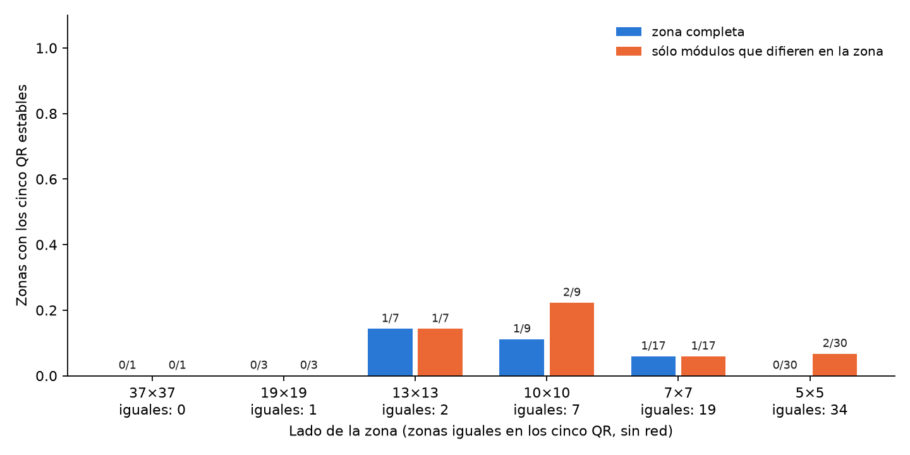
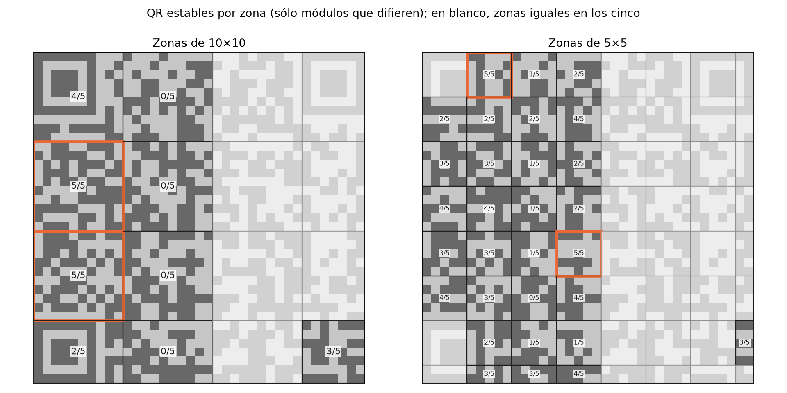
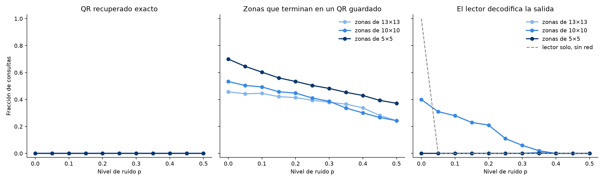

# Una red de Hopfield por zona del QR

Con una sola red de Hebb, los cinco QR se parecen tanto que la red no recupera ninguno ([informe principal](../README.md)). [`dos_redes/`](../dos_redes/README.md) reparte **los QR** en varias redes. Acá se reparte **la imagen**: se corta el QR en cuadrados y cada cuadrado tiene su propia red, que guarda los cinco QR recortados a esa zona. La pregunta es si en zonas chicas los QR se parecen menos y la red los puede guardar.

Todo usa la regla de Hebb del apunte y actualización sincrónica. La red por zona está en `src/tp4/zoned_hopfield.py`:

- Una zona igual en los cinco QR no necesita red: se devuelve su valor conocido.
- En las demás, la red usa la zona completa o, como en la [variante](../variante/README.md), sólo los módulos que difieren dentro de la zona.
- La salida es la unión de las zonas. Cada zona puede terminar en un QR distinto, así que la salida completa sólo es un QR guardado si todas las zonas coinciden en el mismo.

## Reproducción

Desde `TP4/`:

```
python3 analysis/hopfield_qr_zonas.py
```

Tarda alrededor de 1 minuto y medio y deja los CSV (fuera de git) y los PNG en esta carpeta. El barrido usa las mismas consultas que el informe principal: 11 niveles de ruido × 20 semillas por QR.

---

## Experimento 1: ¿en cuántas zonas entran los cinco QR?

**Qué hice.** Corté el QR en zonas de 37×37 (una sola red, como en el informe principal), 19×19, 13×13, 10×10, 7×7 y 5×5; las del borde quedan más chicas. En cada zona con red guardé los cinco QR y me fijé si los cinco son estados estables: la red no cambia ningún módulo al recibirlos sin ruido.



**Resultado** (`estabilidad.csv`):

| Zona | Zonas | Iguales en los cinco | Con red | Los cinco estables (zona completa) | Los cinco estables (sólo los que difieren) |
| --- | ---: | ---: | ---: | ---: | ---: |
| 37×37 | 1 | 0 | 1 | 0 | 0 |
| 19×19 | 4 | 1 | 3 | 0 | 0 |
| 13×13 | 9 | 2 | 7 | 1 | 1 |
| 10×10 | 16 | 7 | 9 | 1 | 2 |
| 7×7 | 36 | 19 | 17 | 1 | 1 |
| 5×5 | 64 | 34 | 30 | 0 | 2 |

**Qué significa.** Achicar la zona no achica el parecido. En las zonas que importan, las que tienen red, a lo sumo 1 o 2 guardan los cinco QR, con cualquier tamaño. Las zonas más chicas suman sobre todo zonas iguales en los cinco, que no necesitan red, y zonas con pocos módulos distintos, que es justo donde Hebb falla.



El mapa muestra dónde está el problema. La mitad derecha del QR es igual en los cinco (en blanco), salvo la esquina inferior derecha. En la columna izquierda, dos zonas de 10×10 guardan los cinco QR. En la franja de las columnas 10 a 19, donde se concentran las diferencias, ninguna zona de 10×10 deja estable a ningún QR (0/5): los cinco caen en la mezcla.

## Experimento 2: barrido de ruido y lector

**Qué hice.** Pasé cada consulta del barrido principal por las redes por zona de 13×13, 10×10 y 5×5, con sólo los módulos que difieren (la versión que mejor resultó en el experimento 1). Medí si la salida es exactamente el QR original, qué fracción de las zonas termina en algún QR guardado, y si el lector de QR (OpenCV) decodifica la salida con la URL correcta.



**Resultado** (`resumen.csv`):

- **Ninguna salida es el QR original**, con ningún tamaño de zona ni nivel de ruido, y en ninguna consulta coinciden todas las zonas en el mismo QR.
- **Entre el 24 % y el 70 % de las zonas termina en algún QR guardado**, menos cuanto más ruido. El resto cae en estados espurios dentro de la zona.
- **Con zonas de 10×10, el lector decodifica parte de las salidas**: 40 % sin ruido, 28 % con p = 0,1 y 21 % con p = 0,2. Con 13×13 y 5×5, casi ninguna. El lector solo, sin red, no lee ninguna consulta desde p = 0,05.

Decodificaciones con zonas de 10×10, por QR (fracción de 20 consultas) y módulos mal en la salida (media):

| QR | p = 0 | p = 0,1 | p = 0,2 | p = 0,3 | Módulos mal con p = 0 |
| --- | ---: | ---: | ---: | ---: | ---: |
| menú principal | 1,00 | 1,00 | 0,85 | 0,20 | 15 |
| vinos | 1,00 | 0,40 | 0,20 | 0,10 | 15 |
| postres | 0 | 0 | 0 | 0 | 27 |
| cócteles y otras bebidas | 0 | 0 | 0 | 0 | 39 |
| especiales del día | 0 | 0 | 0 | 0 | 55 |

**Qué significa.** Las lecturas no son una recuperación de la red: la salida queda con unos 15 módulos mal en menú principal y vinos, y es la corrección de errores del propio QR la que hace el resto. Con una sola red esos dos QR quedan con 71 y 91 módulos mal, demasiados para el lector. Repartir la imagen en zonas acerca la salida al original lo suficiente para dos de los cinco menús, pero no recupera ninguno.

## Conclusión

1. **Una red por zona no resuelve el parecido entre los QR.** En las zonas donde los QR difieren, los cinco siguen sin ser estables; achicar las zonas no cambia eso.
2. **Las zonas no tienen por qué coincidir.** Cada una termina en el QR que le queda más cerca, o en un estado espurio, y la unión no es ningún QR. Para elegir un QR habría que votar entre zonas, y eso ya es comparar con los originales.
3. **Mejora algo la salida, no la recuperación.** Con zonas de 10×10 la salida queda cerca del original en dos menús y el lector la decodifica gracias a su corrección de errores; en los otros tres, no.
4. **Lo que funciona es repartir los QR, no la imagen**: [`dos_redes/`](../dos_redes/README.md) recupera los cinco con redes que guardan pocos QR completos y poco parecidos.

## Archivos

| Archivo | Contenido |
| --- | --- |
| `estabilidad.csv` | Por tamaño de zona y variante: zonas, zonas iguales en los cinco, zonas con los cinco QR estables y QR estables por zona en promedio |
| `resultados.csv` | Una fila por consulta y tamaño de zona: correcta, zonas coherentes, fracción de zonas en un QR guardado, módulos mal y lecturas de consulta y salida |
| `resumen.csv` | Medias de `resultados.csv` por tamaño de zona y nivel de ruido |
