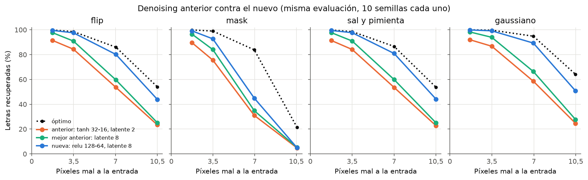
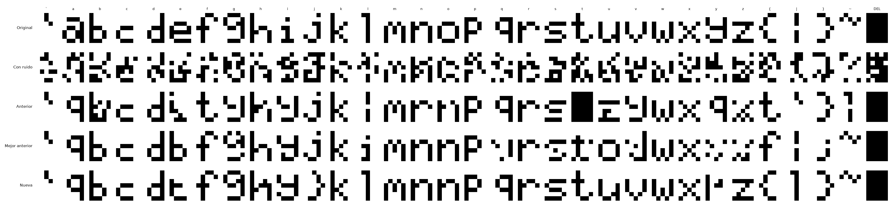

# Ejercicio 1b: bitácora de la búsqueda del denoising autoencoder

## 1. Punto de partida

Las configs anteriores (`ej1b_denoising*`, `ej1b_noise_types`) usaban tanh 32-16, elegida antes de
la búsqueda del 1a, con 3 a 5 semillas y entrenamiento solo con flip 0,1. El mejor DAE de esas
pruebas dejaba 0,47 píxeles mal por letra con flip 0,1, contra 0,09 del óptimo (sección 2): había
margen, así que valía la pena buscar en serio.

## 2. Referencia: el óptimo

Conociendo las 32 letras (equiprobables) y cómo actúa el ruido, se calcula la probabilidad de
cada letra dada la entrada ruidosa (`Noise.log_likelihood`). Con eso hay dos decodificadores que
ningún método puede superar en promedio (`optimal_errors` en `src/evaluation/denoising.py`):

- **Menos píxeles mal:** cada píxel toma su valor más probable.
- **Más letras recuperadas (≤ 1 píxel mal):** se elige, entre las letras y sus vecinos a un
  píxel, el patrón con más probabilidad acumulada a esa distancia. Un punto medio entre dos
  letras que difieren en 2 píxeles cuenta para ambas, así que mejora un poco a "la letra más
  probable".

El óptimo separa el error inevitable (entradas a mitad de camino entre letras) del error de la
red. Los tests verifican la verosimilitud contra las frecuencias del ruido aplicado.

## 3. Niveles comparables entre tipos

Un mismo nivel nominal no corrompe lo mismo en cada tipo (mask solo toca el 33 % de píxeles
prendidos; sal y pimienta cambia la mitad de lo que reemplaza; el gaussiano depende de cuánto
cruza el umbral de 0,5). Se eligieron niveles con los mismos píxeles mal a la entrada:

| Píxeles mal a la entrada | flip | mask | sal y pimienta | gaussiano (σ) |
|---|---|---|---|---|
| 1,75 | 0,05 | 0,15 | 0,10 | 0,30 |
| 3,5 | 0,1 | 0,30 | 0,20 | 0,39 |
| 7 | 0,2 | 0,60 | 0,40 | 0,59 |
| 10,5 | 0,3 | 0,91 | 0,60 | 0,95 |

Con igual cantidad de píxeles mal, el gaussiano es más fácil: la red ve valores continuos (0,55
es dudoso, 0,97 casi seguro). Por eso cada tipo se compara contra su propio óptimo.

## 4. Diseño (definido antes de correr)

Grilla completa, sin suponer que el ranking de arquitecturas no depende del ruido:

- Red: las candidatas del 1a (relu 32, tanh 64, tanh 64-32, tanh 128-64), con su inicializador
  emparejado, Adam η 0,01, BCE, batch 32 (elegidos en el 1a; no se volvieron a buscar).
- Latente: 2, 4, 8, 16 (el 1b no exige 2).
- Ruido al entrenar: los 4 tipos × 4 niveles de la tabla, más sin ruido (control: el
  autoencoder común). Nuevo ruido en cada época.
- 10 semillas, 5000 épocas: 2720 corridas (`configs/ej1b_busqueda/`).
- Cada red se evalúa con los 4 tipos y los 4 niveles (más entrada limpia), 50 repeticiones del
  font por nivel.

Criterios de orden, para cada tipo de ruido de prueba y para el promedio de los cuatro:

1. **Letras recuperadas** (≤ 1 píxel mal), promedio de los niveles 1,75, 3,5 y 7 y de las
   semillas. El nivel 10,5 se informa pero no ordena: ahí ni el óptimo recupera bien
   (22 a 64 % según el tipo).
2. **Píxeles mal** promedio en esos niveles.

Se informa también la brecha con el óptimo y el desvío entre semillas, para no tomar como
diferencia lo que está dentro de la variación entre semillas.

Las épocas se controlan después: las mejores configuraciones se repiten con 10000 épocas; si no
mejoran, 5000 alcanzaban.

## 5. Resultados de la etapa 1 (2720 corridas, ninguna divergió)

Tablas: `tabla_<tipo>.md` y `tabla_promedio.md`. Números: letras recuperadas, promedio de los
cuatro tipos de prueba (óptimo 95,5 %).

- **Entrenar con ruido es lo que más importa.** relu 32 con latente 16: 43 % sin ruido, 86 % con
  flip 0,2.
- **El mejor nivel de entrenamiento es el de 7 píxeles mal**, más que el promedio de las pruebas
  (1,75 a 7). Con 10,5 empeora y deja de reconstruir las letras limpias (86 a 92 %).
- **flip, sal y pimienta y gaussiano son intercambiables para entrenar**: al mismo nivel, 86,2,
  86,2 y 86,0 %, dentro del desvío entre semillas (≈ 1 punto). Cada uno limpia los otros dos.
- **mask es la excepción**: entrenada con mask, la red limpia mask (89 %) pero no los demás
  (gaussiano 5 a 36 %), porque solo aprende a prender píxeles. Entrenada con flip, limpia mask
  peor (74 %) que entrenada con mask.
- **Arquitectura, no concluyente.** La mejor fue la más chica (relu 32, latente 16: 86,2 %); las
  tanh empeoran con más capacidad (mejor de tanh 128-64: 80,1 %) y su mejor latente es 8.

No es sobreajuste: el ruido es nuevo en cada época y las redes grandes tienen *mayor* pérdida de
entrenamiento. Optimizan peor. Tres explicaciones, cada una con un dato a favor:

1. **Faltan épocas**: entre las épocas 2000–3000 y 4000–5000 la pérdida de relu 32 y tanh 64
   todavía baja 7 a 12 %.
2. **η 0,01 es alto con ruido**: el gradiente es mucho más ruidoso que en el 1a (de donde viene
   ese η); tanh 128-64 se estanca (−0,9 % y +1,5 %) en una pérdida más alta.
3. **Activación y no tamaño**: la única relu es la más chica, así que no se pueden separar.

## 6. Etapa 2 (960 corridas, `configs/ej1b_etapa2/`)

relu y tanh × ocultas 32, 64, 64-32 y 128-64 × latente 8 y 16 × η 0,01, 0,003 y 0,001 × 10000 y
20000 épocas, 10 semillas. Entrenamiento fijo en flip 0,2: en las cuatro redes de la etapa 1 el
mejor ruido fue uno de 7 píxeles mal, y los tres tipos no-mask empatan. Mismos criterios y
evaluación que la etapa 1; tablas en `etapa2_<tipo>.md`, con las filas de la etapa 1 de las mismas
redes como referencia.

## 7. Resultados de la etapa 2 (960 corridas, ninguna divergió)

Letras recuperadas, promedio de los cuatro tipos de prueba, latente 8 (con 16 da lo mismo para
relu de ancho ≥ 64), η 0,003, 20000 épocas:

| ocultas | relu | tanh |
|---|---|---|
| 32 | 86,7 % | 82,4 % |
| 64 | 88,6 % | 86,1 % |
| 64-32 | 89,6 % | 86,8 % |
| 128-64 | 89,9 % | 87,1 % |

Las tres explicaciones de la sección 5 resultaron ciertas en parte:

1. **Épocas**: de 10000 a 20000 se ganan entre 0,2 y 1,5 puntos. Con 20000 la pérdida de las
   mejores ya no baja (entre las épocas 14000–16000 y 18000–20000 cambia −1 a +3 %, ruido): el
   entrenamiento está completo.
2. **η**: con 0,01, las tanh grandes empeoran cuanto más se entrenan (tanh 128-64, latente 16:
   74,8 → 71,2 → 61,9 % con 5000, 10000 y 20000 épocas). Con η ≤ 0,003, en cambio, más capacidad
   ayuda en las dos activaciones. relu tolera 0,01 pero rinde un poco menos.
3. **Activación**: relu supera a tanh con todos los tamaños, por 2,5 a 4,3 puntos.

La conclusión de la etapa 1 ("la red chica es mejor") era un artefacto de η 0,01 y 5000 épocas.

**Elegida: relu 128-64, latente 8, η 0,001, 20000 épocas**: 90,0 % (± 0,3 entre semillas),
empatada con latente 16 (90,0 %) y con η 0,003 (89,9 %); gana el desempate por píxeles mal
(0,84). relu 64-32 (89,6 %) y relu 64 (89,5 % con latente 16) quedan a 0,4–0,5 puntos, unas
cuatro veces el error estándar entre semillas (≈ 0,1): diferencia real pero chica.

Brecha con el óptimo: 5,5 puntos en promedio, casi toda en mask (78,9 contra 94,2 %), con el que
no se entrenó. En flip la brecha es 2,3 puntos (92,4 contra 94,8 %) y en gaussiano 2,1.

## 8. Tipos de ruido con la red elegida (170 corridas, `configs/ej1b_tipos.json`)

Tabla completa en `tipos.md`. Confirma con la red elegida lo visto en la etapa 1:

- flip 0,2, sal y pimienta 0,4 y gaussiano 0,59 empatan (90,0, 89,9 y 89,9 %).
- Entrenada con mask, la red limpia mask (91,6 % con mask 0,3, contra 78,9 % entrenada con flip)
  pero no los demás. Entrenada con mask 0,6 empeora la entrada gaussiana (de 1,7 a 21 píxeles
  mal), probablemente porque el gaussiano deja valores intermedios en los píxeles apagados y la
  red, que solo vio apagados en 0 exacto, los prende.

Análisis de los fallos (`ej1b_final`, 6400 letras ruidosas por nivel). Al principio afirmé, por
mirar una figura, que la red "casi siempre" devolvía otra letra al fallar; medido, es el 56 a 66 %.

| prueba | letras que fallan | salen como otra letra | el óptimo también falla |
|---|---|---|---|
| flip 0,2 | 18,7 % | 58 % | 66 % |
| flip 0,3 | 55,0 % | 56 % | 79 % |
| mask 0,6 | 53,5 % | 66 % | 31 % |
| gaussiano 0,59 | 10,3 % | 60 % | 52 % |

Con flip, la mayoría de los fallos son inevitables. Con mask, la mayoría son de la red (no se
entrenó con mask).

## 9. Comparación con el denoising anterior (`configs/ej1b_anterior_comparable.json`, 20 corridas)

Para responder si el nuevo es mejor, se reentrenó la config anterior tal cual (tanh 32-16,
flip 0,1, η 0,01, 5000 épocas) con latente 2 (la que el README asignaba al 1.b) y 8 (la mejor de
las pruebas anteriores), con 10 semillas y la evaluación nueva. Antes tenían 3 a 5 semillas y se
medían solo con flip, así que sus números no eran comparables.

Letras recuperadas, promedio de los cuatro tipos: 74,3 % y 80,9 % contra 90,0 % (óptimo 95,5 %).
La brecha con el óptimo baja de 21,2 y 14,6 puntos a 5,5. En el ejemplo con flip 0,2 (semilla 1,
mismas entradas) fallan 18, 15 y 8 letras; la anterior devuelve formas que no son letras y la
nueva, cuando falla, en general otra letra (en el ejemplo, la mayoría; medido, ~60 %, sección 8).

