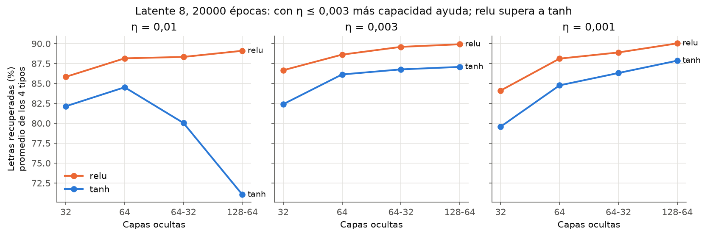
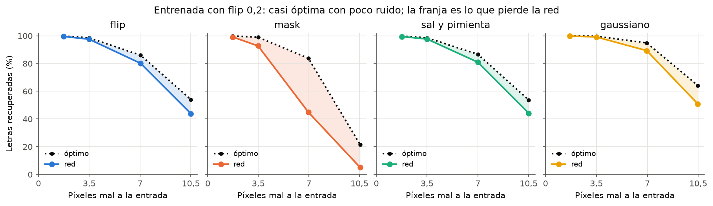
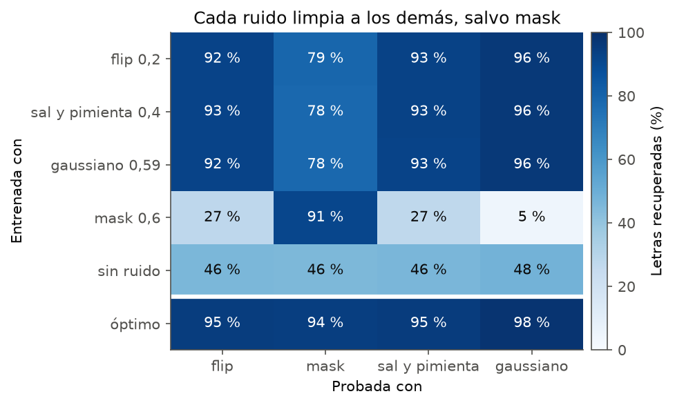
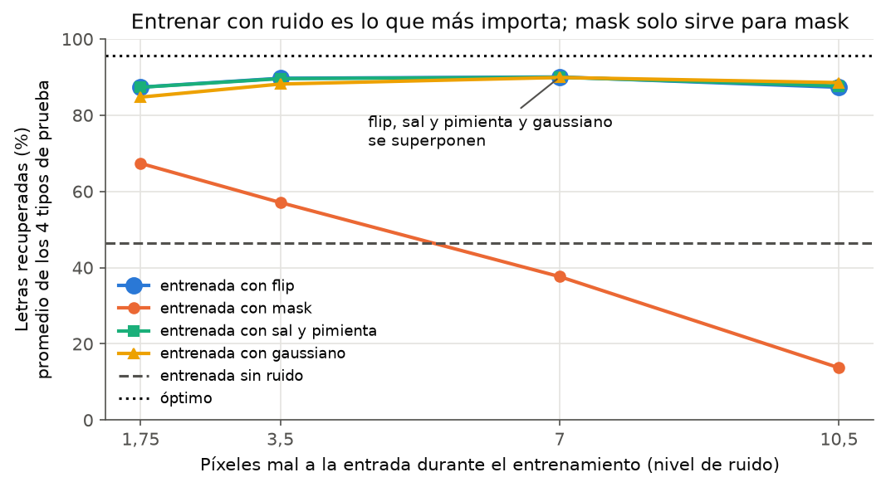
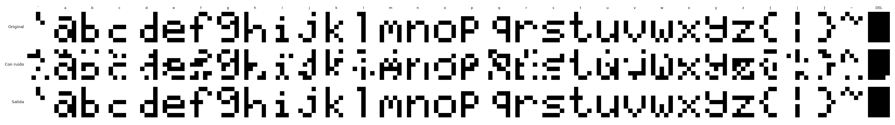
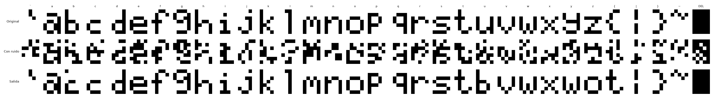
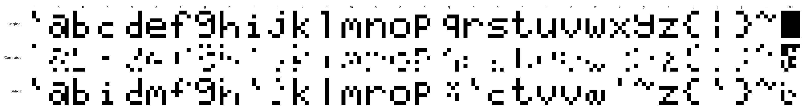

# Ejercicio 1b: búsqueda del denoising autoencoder

**Objetivo (consigna):** plantear una arquitectura conveniente para eliminar ruido de las 32
letras de 5×7, justificarla, y estudiar cuánto ruido de distintos niveles puede limpiar.
Tablas: `tabla_<tipo>.md` (etapa 1), `etapa2_<tipo>.md` y `tipos.md`. Razonamiento detallado en
`bitacora.md`.

## Método

- **Ruido:** cuatro tipos (flip, mask, sal y pimienta, gaussiano), en niveles que dejan los mismos
  píxeles mal a la entrada (1,75, 3,5, 7 y 10,5 de 35) para que los tipos sean comparables.
- **Medida:** letras recuperadas (≤ 1 píxel mal) promediando los niveles 1,75, 3,5 y 7, con 50
  repeticiones del font y 10 semillas. Desempate: píxeles mal.
- **Referencia, el óptimo:** conociendo las 32 letras y cómo actúa el ruido, se calcula la letra
  más probable dada la entrada. Ningún método puede superarlo, así que separa el error
  inevitable (la entrada quedó más parecida a otra letra) del error de la red.

## Resultados

**Etapa 1 (2720 corridas):** relu 32, tanh 64, tanh 64-32 y tanh 128-64 (las candidatas del 1a) ×
latente 2, 4, 8 y 16 × 4 tipos × 4 niveles de entrenamiento + sin ruido. 5000 épocas, η 0,01.
- **Entrenar con ruido es lo que más importa:** 43 % de letras recuperadas sin ruido, 86 % con él.
- **Conviene entrenar con el nivel de 7 píxeles mal**, más que el de las pruebas en promedio. Con
  10,5 la red deja de reconstruir bien las letras limpias.
- **flip, sal y pimienta y gaussiano son intercambiables para entrenar** (empatan dentro del
  desvío entre semillas). **mask no**: solo enseña a prender píxeles.
- La arquitectura no quedó clara: la pérdida seguía bajando y las tanh grandes optimizaban peor.

**Etapa 2 (960 corridas):** relu y tanh × 32, 64, 64-32 y 128-64 × latente 8 y 16 × η 0,01,
0,003 y 0,001 × 10000 y 20000 épocas, entrenando con flip 0,2.

| ocultas (latente 8, η 0,003, 20000 épocas) | relu | tanh |
|---|---|---|
| 32 | 86,7 % | 82,4 % |
| 64 | 88,6 % | 86,1 % |
| 64-32 | 89,6 % | 86,8 % |
| 128-64 | **89,9 %** | 87,1 % |

- **η 0,01 es demasiado alto con ruido:** las tanh grandes empeoraban cuanto más se las entrenaba.
  Con η ≤ 0,003, más capacidad ayuda.
- **relu supera a tanh** con todos los tamaños (2,5 a 4,3 puntos).
- **20000 épocas alcanzan:** la pérdida ya no baja.
- El "la red chica es mejor" de la etapa 1 era un artefacto de η 0,01 y pocas épocas.



## Arquitectura elegida

**relu 128-64, latente 8, Adam η 0,001, BCE, batch 32, 20000 épocas, entrenada con flip 0,2.**

- **Capas ocultas anchas:** con η adecuado, más capacidad recupera más letras (tabla de la
  etapa 2). Una explicación posible: la red tiene que llevar muchas entradas distintas a la misma
  letra, que es más que memorizar 32 patrones (el 1a se resolvía con relu 32).
- **Latente 8 y no 2:** en la etapa 1, con latente 2 las redes rindieron entre 3 y 19 puntos
  menos que con su mejor latente. Con 8 o 16 da lo mismo, y el 1b no exige 2 para graficar.
- **Empates:** latente 16 y η 0,003 empatan (90,0 y 89,9 %). relu 64-32 queda 0,4 puntos abajo:
  la diferencia es real (≈ 4 errores estándar), pero chica.

## Capacidad de eliminar ruido (`tipos.md`)

Red elegida, entrenada con flip 0,2. Letras recuperadas por nivel de prueba, contra el óptimo:

| píxeles mal a la entrada | flip | óptimo | gaussiano | óptimo | mask | óptimo |
|---|---|---|---|---|---|---|
| 1,75 | 99,5 % | 99,8 % | 99,9 % | 100 % | 99,1 % | 99,9 % |
| 3,5 | 97,6 % | 98,6 % | 99,2 % | 99,7 % | 92,7 % | 99,0 % |
| 7 | 80,1 % | 86,0 % | 89,3 % | 94,8 % | 44,9 % | 83,8 % |
| 10,5 | 43,9 % | 54,0 % | 50,8 % | 64,1 % | 5,0 % | 21,5 % |

(Sal y pimienta da casi igual que flip.)



- **Con poco ruido es casi perfecta:** con flip, sal y pimienta y gaussiano, hasta 3,5 píxeles
  mal (10 % de la letra) recupera más del 97 % de las letras, a 1 punto del óptimo.
- **Con mucho ruido falla, pero en buena parte porque es imposible:** con flip 0,2, en 2 de cada 3
  letras que la red no recupera, el óptimo tampoco. Al fallar, el 58 % de las veces devuelve otra
  letra limpia (por ejemplo, una "u" muy ruidosa sale como "b").
- **El gaussiano es el más fácil a igual cantidad de píxeles mal:** la red ve valores continuos,
  y un 0,55 le indica que ese píxel es dudoso.
- **mask necesita su propio entrenamiento:** entrenada con flip, recupera 45 % con 7 píxeles mal
  (óptimo 84 %); en 7 de cada 10 de sus fallos el óptimo sí acierta. Entrenada con mask 0,3,
  recupera 92 % en mask pero menos del 55 % en los otros tipos. Entrenada con mask 0,6, empeora
  la entrada gaussiana (de 1,7 a 21 píxeles mal): solo aprendió a prender píxeles.





**Ejemplos (`ej1b_final`, una semilla).** Fila de arriba, original; del medio, con ruido; de
abajo, salida de la red.

Flip 0,1 (3,5 píxeles mal): limpia casi todo.



Flip 0,2 (7 píxeles mal): las que fallan suelen salir como otra letra ("u" → "b", "y" → "w").



Mask 0,6 (7 píxeles mal, solo apagados): recupera cerca de la mitad. Las que fallan salen sobre
todo como una letra con menos píxeles ("c" → "i", "n" → "r", "s" → "c", "u" → "v") o como
fragmentos: entrenada con flip, la red cree en lo que ve prendido y no supone que lo apagado pueda
faltar.



## Limitaciones

- El η, el batch, la pérdida y el inicializador vienen del 1a. η se volvió a buscar porque la
  etapa 1 mostró que no servía; los demás no.
- No se probó entrenar con una mezcla de ruidos (por ejemplo flip + mask), que podría servir para
  todos los tipos a la vez.
- Se evalúa con las mismas 32 letras con ruido nuevo, no con letras nuevas.

## Reproducir (desde `TP5`)

```bash
python main.py configs/ej1b_busqueda/*.json --jobs 10   # etapa 1
python main.py configs/ej1b_etapa2/*.json --jobs 10     # etapa 2
python main.py configs/ej1b_tipos.json --jobs 10        # tipos de ruido con la red elegida
python main.py configs/ej1b_final.json                  # figuras de ejemplo (una semilla)
python scripts/busqueda_figuras.py                      # figuras
python scripts/ej1b_search_table.py [--stage 2|3]       # tablas
```
