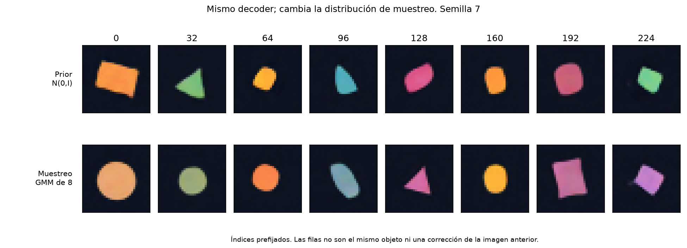

# Cierre del estudio generativo

**Cerrado el 15 de noviembre de 2026 por pedido del usuario.** No quedan
entrenamientos ni búsquedas pendientes de esta etapa. Los comandos se conservan
para reproducibilidad, no como instrucciones de continuar automáticamente.

## Resultado y alcance

Se obtuvo una mejora de reconstrucción y limpieza, pero no un generador estándar
de figuras inequívocas en todos los casos. El VAE RGB superó los criterios
automáticos de validación y no superó la revisión visual conservadora predefinida.
La prueba final reservada no se abrió. Los muestreos ajustados son variantes
exploratorias, no reemplazos silenciosos del prior usado al entrenar.

## Última prueba terminada: mezclas pequeñas de gaussianas

Se conservaron los tres VAE RGB (semillas 7,17,27) y se ajustaron densidades
de 1,4 y 8 componentes sobre una muestra posterior por imagen de entrenamiento.
No se usaron etiquetas. Tres reinicios por ajuste, elegidos por verosimilitud
de entrenamiento; 256 generaciones por método y modelo. No hubo reentrenamiento
de las redes ni cambios en MSE/KL. Son nueve ajustes de densidad, no nueve VAE nuevos.

| Muestreo RGB | Limpias | Tasa | MSE al entrenamiento más próximo |
|---|---:|---:|---:|
| Prior N(0,I) | 718/768 | 93.5 % | 0.005439 |
| GMM 1 | 738/768 | 96.1 % | 0.004877 |
| GMM 4 | 756/768 | 98.4 % | 0.004127 |
| GMM 8 | 759/768 | 98.8 % | 0.003987 |

El ajuste de ocho componentes de la semilla 17 alcanzó el límite de 100 iteraciones.
Se conserva el presupuesto fijado y no se afirma convergencia al óptimo global.
La diferencia entre cuatro y ocho componentes es de tres casos sobre 768;
no establece una ventaja general de usar más componentes.

La mezcla de ocho componentes gana 5,34 puntos de limpieza frente al prior en
este conjunto. Su distancia MSE al entrenamiento baja aproximadamente un 26,7 %,
y la diversidad MSE media cambia de 0,03399 a 0,03301. Son diagnósticos
descriptivos, no calidad perceptual, ausencia de memorización o novedad probada.
Las coordenadas se comparten entre modelos; no se considera que los 768 casos
sean 768 modelos independientes. No se hizo un contraste de superioridad universal.

Se inspeccionaron las tres comparaciones completas de ocho índices prefijados
por método (96 imágenes). La GMM produce más salidas limpias y conserva ejemplos
reconocibles, pero todavía aparecen híbridos, cuadrados redondeados y lados
cóncavos. Una puntuación de 98,8 % de limpieza no significa 98,8 % de figuras
geométricamente correctas. Las filas no son el mismo objeto: comparten ruido
normal base, pero la distribución y las componentes cambian sus coordenadas.

Una GMM de ocho centros no guarda una componente por imagen como la mezcla
empírica de 4.096 posteriores. Eso reduce la dependencia directa de centros
individuales; no prueba que el decoder o las muestras estén libres de memorización.
La red sigue siendo un VAE entrenado con prior N(0,I), pero al generar con la
GMM se forma una variante de dos etapas: VAE más densidad ajustada posteriormente.
No es un VAE condicional ni un prior aprendido dentro de su objetivo original.

## Qué aprendimos de las etapas anteriores

### Arquitectura espacial

El control pareado de tres semillas compara los mismos padres, datos, beta,
tasa y 50 épocas adicionales: un bloque de refinamiento frente a dos.
La limpieza principal pasa de **91,1 a 94,8 %**, y la auditoría de **90,4 a
93,2 %**. La IoU media pasa de 0,93359 a 0,93374: casi igual. La mejora es
modesta y consistente en limpieza, sin resolver las formas ambiguas.

La capa adicional es una convolución 3×3 dentro del decoder, inicializada
como identidad. Aprende por el mismo error y suma 2.320 parámetros; no recibe
nombres de figuras ni reglas de lados, ni aplica un filtro correctivo posterior.

La revisión del asistente, conservadora y no ciega, encontró 3,5 y 4 círculos
limpios inequívocos por semilla, frente al mínimo previo de cinco. Ese criterio
es del estudio y debe distinguirse de la consigna del ejercicio 2.

### Muestreo y cercanía a códigos conocidos

El diagnóstico anterior, con otro tratamiento de densidad, obtuvo 93,5 % de
limpieza desde el prior, 96,6 % con momentos globales y 99,9 % con mezcla de
posteriores. La reconstrucción desde medias también dio 99,9 %. Los últimos
dos métodos dependen de imágenes de entrenamiento y quedan mucho más cerca
de ellas: muestran capacidad de representación alrededor de códigos conocidos,
no novedad. Las cifras de 96,6 % y 96,1 % provienen de ajustes distintos:
momentos analíticos del agregado frente a EM sobre una muestra por entrada.

### Beta mayor, sin mejora en estos pilotos

Dos afinaciones pareadas de 20 épocas, semilla 7, beta 0,02 o 0,1, terminaron
ambas con **62/64** imágenes limpias y **235/256** en auditoría. La KL bajó
de 28,92 a 22,32, pero no mejoró la limpieza y la IoU fue casi igual. Este
piloto no respalda esa afinación como solución; no prueba que beta mayor nunca ayude.

### Control de audio

En reproducciones nuevas de NSynth, con una semilla y 200 épocas, ajustar una
gaussiana a los códigos del AE redujo su distancia MSE al entrenamiento un
45,3 %: 0,03213 a 0,01757. El VAE desde normal estándar obtuvo 0,01709.
Esto separa el efecto del entrenamiento del efecto de dónde muestreamos.
No es una evaluación auditiva ni de generalización: las referencias son de
entrenamiento y no se hizo escucha humana controlada. Las reproducciones
no se identifican como los pesos originales que generaron el deck.

## Cómo explicar los cambios

El decoder aprendió a representar imágenes alrededor de muchos códigos conocidos.
Muestrear desde una distribución que los cubra mejor puede evitar regiones que
producen salidas degradadas. La KL favorece compatibilidad con un prior, pero
un modelo finito y un peso elegido no garantizan coincidencia exacta de densidades.
Coincidir en media, varianza o una proyección 2D tampoco garantiza ese ajuste.

La MSE penaliza diferencias de píxeles; no impone tres lados o cuatro ángulos.
Cuando hay incertidumbre, promediar salidas puede suavizar contornos. La baja
resolución y la continuidad entre familias también pueden contribuir. Son
explicaciones compatibles con lo observado, no causas aisladas y demostradas.
La [nota de regularización](../ej2_search/interpretacion_regularizacion.md)
explica por qué KL por entrada y ajuste del agregado no son la misma cosa.

En imágenes y sonidos se comparte el mecanismo encoder, posterior, muestreo y
decoder, con modelos independientes. Cambian representación, arquitectura y
beta. No se comparan numéricamente el MSE RGB y el mel ni se postula un latente
común. Interpolar timbres tampoco demuestra descubrir notas omitidas.

## Presentación y cierre

La presentación existente permanece intacta. Solamente se propone agregar
material con rutas nuevas y conservar el contenido y orden relativo previos.
El guion aditivo final está en [guion_solo_agregados.md](guion_solo_agregados.md).
La recomendación es tres páginas principales adicionales y dos de respaldo,
sin exponer toda la búsqueda de hiperparámetros.

El estudio se cierra con evidencia de mejoras parciales y límites explícitos.
No se declara satisfactorio el criterio completo ni se abre la prueba final
para este cierre. Código, configuraciones y resultados anteriores se conservan.

## Evidencia y reproducción

`evidencia/` conserva parámetros de las pequeñas densidades, metadatos, CSV
de todos los casos y las comparaciones completas por semilla. Las matrices
grandes y galerías sin filtrar están en `results/art_latent_mixture/`.
Los resultados anteriores están en `reports/ej2_search/` y sus directorios
locales de `results/`. Los pesos pesados siguen fuera de Git.

Última ejecución: `OPENBLAS_NUM_THREADS=1 python -m src.analysis.art_latent_mixture`.
Pasaron 22 pruebas específicas del ajuste y muestreo, además de la ejecución
integral. Se verificaron hashes de modelos y las tres pérdidas protegidas.
