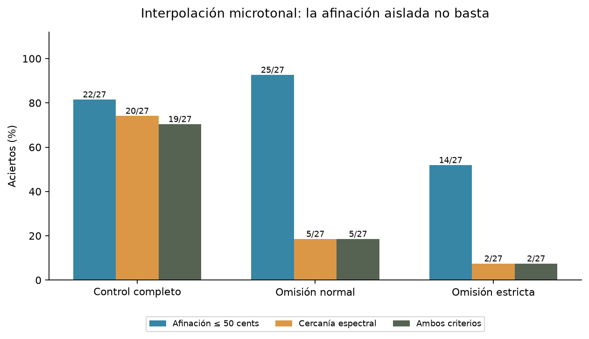
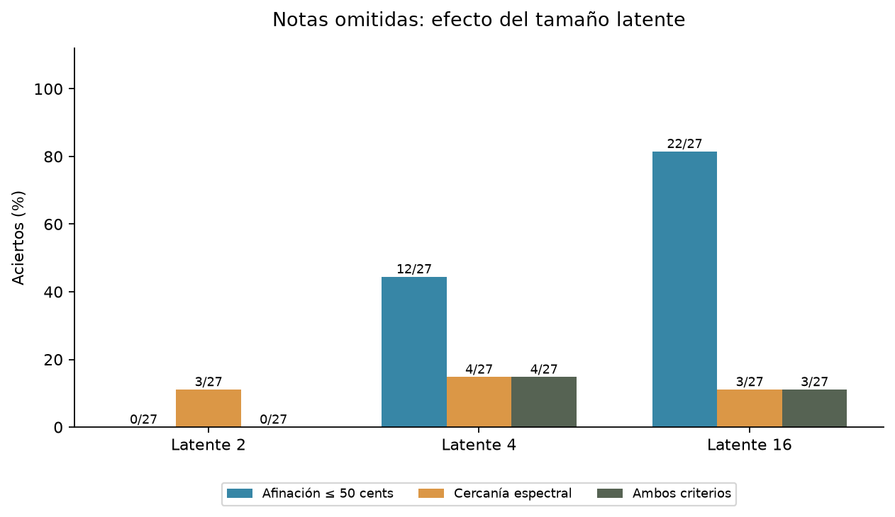
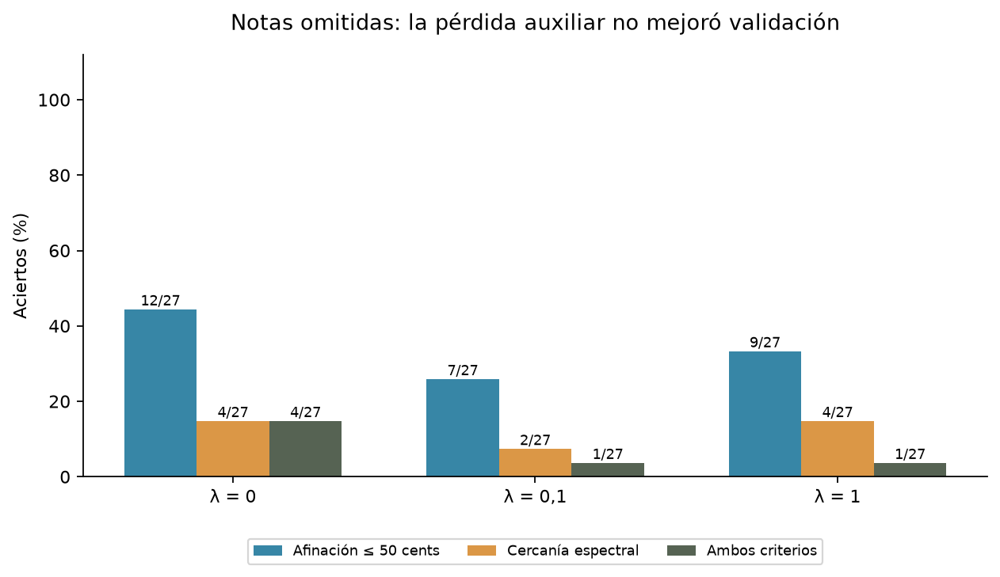

# Cierre del estudio: VAE de audio y notas omitidas

**Estado: cerrado el 13 de noviembre de 2026.** Se conservan código, configuraciones
y evidencia para reproducir el estudio. No se continúan las búsquedas de notas
omitidas ni se completan las pruebas finales preparadas.

## Pregunta y alcance

¿Puede un VAE generar una altura musical ausente del entrenamiento al decodificar
el punto medio entre las medias posteriores de sus dos notas vecinas?

El estudio usa espectrogramas mel de sonidos sintéticos de un segundo a 16 kHz,
con un solo timbre de seis armónicos y distintas envolventes. El modelo produce
espectrogramas libres; la inversión a audio usa el códec mel/Griffin-Lim existente.
El sintetizador armónico se utiliza para crear los datos, no como decoder del VAE.

Esta pregunta excede la consigna del ejercicio 2: generar una muestra nueva
plausible no exige reconstruir una altura reservada ni aprender explícitamente
una regla de armonicidad. Se cierra este experimento exploratorio; esto no invalida
el VAE del ejercicio 2 ni prueba que la generación de audio sea imposible.

## Qué se ejecutó

**57 corridas completas, todas con 200 épocas.**

| Etapa | Comparación | Corridas |
|---|---|---:|
| Escala pequeña | 25 notas completas / 22 tras omitir tres | 6 |
| Envolventes | 1.000 sonidos completos / 880 con omisiones | 6 |
| Microtonos | Completo, omisión normal y omisión estricta | 9 |
| Tamaño latente | 2, 4 y 16 dimensiones; completos y omitidos | 18 |
| Pérdida auxiliar | lambda 0, 0,1 y 1; completos y omitidos, latente 4 | 18 |

Cada configuración usa tres semillas (7,17,27). Las dos primeras etapas son
controles exploratorios; sus evaluaciones originales no incluían la comparación
espectral posterior. Se guarda la ausencia de esas métricas como dato faltante,
no como un cero ni como prueba de éxito.

Las configuraciones de notas omitidas con NSynth quedaron preparadas, sin
resultados completos guardados en este checkout. No forman parte de estos 57
entrenamientos. Tampoco se incluyen como ejecutados los experimentos de evaluación
final: hay cuatro JSON preparados, pero ninguna de sus 12 corridas terminó y se
guardó. Un apagado pudo haber interrumpido trabajo en memoria; no hay checkpoints
intermedios que permitan reconstruir ese avance.

## Qué significan las métricas

- **Afinación:** frecuencia estimada por autocorrelación a no más de 50 cents
  del objetivo. Un semitono equivale a 100 cents. No se corrigen errores de octava.
- **Cercanía espectral:** el espectrograma generado está más cerca, por MSE, del
  objetivo real que de cualquiera de sus dos vecinos, con la misma envolvente.
- **Acierto conjunto:** se cumplen ambos criterios en el mismo ejemplo.
- **Calibración:** se procesa el original por el códec para separar sus problemas
  de los del modelo. Las referencias se reservan para medir, no para entrenar.

La cercanía espectral es una comparación relativa entre tres referencias: no
certifica calidad perceptual ni demuestra que una salida sea monofónica. El
porcentaje de afinación aislado tampoco basta: una mezcla de vecinos puede
producir un período aparente intermedio y pasar el estimador.

## Microtonos: una mejora aparente que no se sostuvo

Se usaron alturas MIDI 48–72, con microtonos cada 25 cents y envolventes variadas.
Los objetivos fueron 54,60,66. En omisión normal, las notas de entrenamiento más
cercanas quedaron a 75 cents; en la estricta, a 100 cents. Se excluyeron todas
las variantes de las alturas dentro de cada ventana, antes de entrenar.

Cada fila reúne 27 puntos medios: tres notas, tres envolventes y tres semillas.

| Método / condición | Afinación | Cercanía espectral | Ambas |
|---|---:|---:|---:|
| Reconstrucción de objetivos conocidos | 27/27 | 27/27 | 27/27 |
| Interpolación, conjunto completo | 22/27 | 20/27 | 19/27 |
| Interpolación, omisión normal | 25/27 | 5/27 | 5/27 |
| Interpolación, omisión estricta | 14/27 | 2/27 | 2/27 |
| Mezcla simple de espectrogramas vecinos | 27/27 | 6/27 | 6/27 |



El 25/27 de afinación no demuestra recuperación fiable de una nota nueva. La
mezcla simple lo supera en afinación y tiene un resultado espectral igualmente
bajo. La prueba estricta también pierde rendimiento. El control demuestra que
el modelo reconstruye las notas conocidas según las métricas, no que sus ondas
sean copias perfectas ni que aprendió una regla general de altura musical.

## Reducir la dimensión latente

Se compararon 2,4,16 dimensiones, con KL=0,5 y los demás parámetros fijos.
La validación usa 51,57,63; las alturas 55,61,67 y sus ventanas se reservan de la
matriz de entrenamiento y de la calibración de esta etapa. Son objetivos distintos
de la tanda anterior: no se comparan directamente sus porcentajes como si fuera
el mismo conjunto de prueba.

| Latente | Interpolación conocida, ambos criterios | Omisión: afinación | Omisión: espectro | Omisión: ambos |
|---|---:|---:|---:|---:|
| 2 | 27/27 | 0/27 | 3/27 | 0/27 |
| 4 | 27/27 | 12/27 | 4/27 | 4/27 |
| 16 | 8/27 | 22/27 | 3/27 | 3/27 |



El latente pequeño organiza mejor las interpolaciones de notas conocidas. Esa
ventaja no se trasladó a los huecos de entrenamiento. El criterio prefijado
eligió 4 dimensiones por sus cuatro aciertos conjuntos, pero una ventaja de
4/27 frente a 3/27 no es evidencia sólida de una mejora general.

## Enseñar interpolación mediante ternas conocidas

Se agregó una pérdida auxiliar: reconstruir un centro conocido desde el promedio
de las medias latentes de dos vecinos conocidos. Las tres muestras de cada terna
comparten instrumento, velocidad y envolvente, y pertenecen al entrenamiento.
No se sintetiza el centro de una terna ausente. Se guardan sus etiquetas para
auditar el procedimiento: 280 ternas en omisión y 560 en el control.

```text
L_total = L_reconstruccion + beta * KL + lambda * L_interpolacion
```

Se probaron `lambda=0`, `lambda=0,1` y `lambda=1`, con latente 4. Esta etapa incorpora supervisión
musical para formar ternas; no se presenta como aprendizaje no supervisado de
reglas musicales. Con lambda 0 el entrenamiento conserva exactamente la trayectoria
sin la ayuda auxiliar, usando la misma configuración y semilla.

| Lambda | Omisión: afinación | Omisión: espectro | Omisión: ambos | MSE espectral en omisión |
|---|---:|---:|---:|---:|
| 0 | 12/27 | 4/27 | 4/27 | 0,029564 |
| 0,1 | 7/27 | 2/27 | 1/27 | 0,033946 |
| 1 | 9/27 | 4/27 | 1/27 | 0,030441 |



En el control conocido, las tres variantes consiguieron 27/27 aciertos conjuntos.
La MSE espectral de sus interpolaciones bajó de 0,005258 (lambda 0) a 0,000642
(0,1) y 0,000310 (1). La ayuda aprendió mejor esa tarea con ejemplos conocidos,
pero no mejoró la generalización a notas omitidas. La selección eligió lambda 0.

## Conclusión y decisión de cierre

La reconstrucción y la interpolación de notas conocidas sí funcionaron. No se
obtuvo generación fiable de alturas omitidas con las arquitecturas, pérdidas y
presupuestos evaluados. Algunas cifras de afinación eran favorables por una
limitación del estimador, no por evidencia suficiente de recuperación musical.

Se deja de invertir en esta línea para el TP y no se consumen las notas finales
en otra evaluación del candidato débil. Se conserva todo para trazabilidad.
Un resultado negativo con controles forma parte del análisis, no se elimina.

No se implementaron un decoder armónico ni una pérdida multirresolución. Son
alternativas discutidas, no resultados de este estudio.

## Evidencia y límites

- `estado.json`: estado del cierre y corridas terminadas por etapa.
- `corridas.csv`: métricas de las 57 corridas, incluidos tiempos y tamaños.
- `puntos_medios.csv`: los 1.656 registros centrales y baselines disponibles,
  incluidos fallos y campos ausentes de las primeras etapas.
- `configuraciones_ejecutadas.json`: configuraciones exactas por corrida.
- `evidencia_sha256.json`: tamaño y hash de 478 archivos originales en `results/`.
- Copias de las tablas y selecciones de las comparaciones de latentes y lambda.

`results/`, pesos y audios completos permanecen locales y fuera de Git. El
repositorio conserva la evidencia liviana y el código. La primera versión del
código del TP ya incluía el VAE; el cierre incorpora los experimentos de notas
omitidas, sus evaluaciones y la pérdida auxiliar, además del soporte paralelo.

Se trabajó con un timbre sintético, tres semillas y pocas notas objetivo. Los
27 casos de cada tabla comparten notas y envolventes: no son 27 datasets
independientes. Los porcentajes no se extrapolan a música real ni a NSynth. La
evaluación automática no reemplaza una prueba de escucha. No se ofrece una
probabilidad de éxito para arquitecturas futuras.
