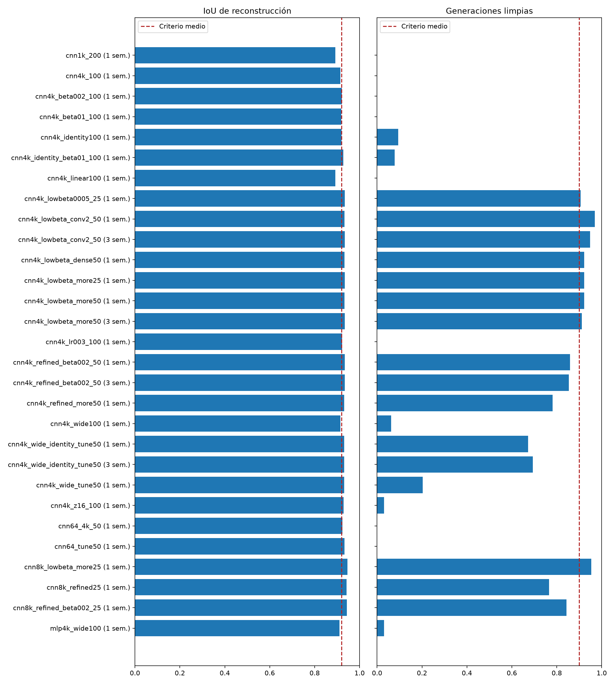
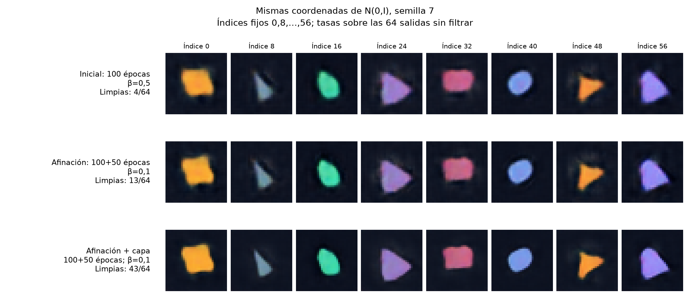

# Búsqueda de calidad del VAE geométrico

Estado de los candidatos con evaluación de validación terminada. Una sola semilla es un piloto, no una confirmación. Las corridas en curso no se incluyen hasta que tienen pesos y evaluación completos.

Se conserva la fórmula MSE + beta·KL. El calentamiento inicial es de 50 épocas; las fases de afinación posteriores no lo repiten. La fase inicial usa beta=0,5; la ampliación prueba los hiperparámetros beta=0,1 y 0,02, ambos positivos. No se agregan pérdidas geométricas, etiquetas al modelo ni filtros de salida. La prueba reservada solo se abre después de congelar la selección.

| Candidato | Semillas | Lado | Datos | Épocas por fase | Beta final | IoU macro | Triángulo | Rectángulo | Limpias | Pasa automático |
|---|---|---:|---:|---:|---:|---:|---:|---:|---:|---|
| cnn1k_200 | 7 | 32 | 1024 | 200 | 0.5 | 0.8918 | 0.8235 | 0.8629 | 0.0% | No |
| cnn4k_100 | 7 | 32 | 4096 | 100 | 0.5 | 0.9150 | 0.8766 | 0.8795 | 0.0% | No |
| cnn4k_beta002_100 | 7 | 32 | 4096 | 100 | 0.02 | 0.9213 | 0.8948 | 0.8826 | 0.0% | No |
| cnn4k_beta01_100 | 7 | 32 | 4096 | 100 | 0.1 | 0.9184 | 0.8889 | 0.8800 | 0.0% | No |
| cnn4k_identity100 | 7 | 32 | 4096 | 100 | 0.5 | 0.9201 | 0.8820 | 0.8885 | 9.4% | No |
| cnn4k_identity_beta01_100 | 7 | 32 | 4096 | 100 | 0.1 | 0.9272 | 0.9046 | 0.8924 | 7.8% | No |
| cnn4k_linear100 | 7 | 32 | 4096 | 100 | 0.5 | 0.8916 | 0.8375 | 0.8636 | 0.0% | No |
| cnn4k_lowbeta0005_25 | 7 | 32 | 4096 | 100+50+50+25 | 0.005 | 0.9337 | 0.9163 | 0.8966 | 90.6% | Sí |
| cnn4k_lowbeta_conv2_50 | 7 | 32 | 4096 | 100+50+50+50 | 0.02 | 0.9331 | 0.9164 | 0.8963 | 96.9% | Sí |
| cnn4k_lowbeta_conv2_50 | 7,17,27 | 32 | 4096 | 100+50+50+50 | 0.02 | 0.9337 | 0.9166 | 0.8991 | 94.8% | Sí |
| cnn4k_lowbeta_dense50 | 7 | 32 | 4096 | 100+50+50+50 | 0.02 | 0.9334 | 0.9157 | 0.8976 | 92.2% | Sí |
| cnn4k_lowbeta_more25 | 7 | 32 | 4096 | 100+50+50+25 | 0.02 | 0.9336 | 0.9162 | 0.8970 | 92.2% | Sí |
| cnn4k_lowbeta_more50 | 7 | 32 | 4096 | 100+50+50+50 | 0.02 | 0.9329 | 0.9160 | 0.8963 | 92.2% | Sí |
| cnn4k_lowbeta_more50 | 7,17,27 | 32 | 4096 | 100+50+50+50 | 0.02 | 0.9336 | 0.9161 | 0.8990 | 91.1% | Sí |
| cnn4k_lr003_100 | 7 | 32 | 4096 | 100 | 0.5 | 0.9226 | 0.8858 | 0.8972 | 0.0% | No |
| cnn4k_refined_beta002_50 | 7 | 32 | 4096 | 100+50+50 | 0.02 | 0.9335 | 0.9175 | 0.8945 | 85.9% | No |
| cnn4k_refined_beta002_50 | 7,17,27 | 32 | 4096 | 100+50+50 | 0.02 | 0.9335 | 0.9164 | 0.8980 | 85.4% | No |
| cnn4k_refined_more50 | 7 | 32 | 4096 | 100+50+50 | 0.1 | 0.9319 | 0.9117 | 0.8947 | 78.1% | No |
| cnn4k_wide100 | 7 | 32 | 4096 | 100 | 0.5 | 0.9142 | 0.8832 | 0.8813 | 6.2% | No |
| cnn4k_wide_identity_tune50 | 7 | 32 | 4096 | 100+50 | 0.1 | 0.9312 | 0.9114 | 0.8928 | 67.2% | No |
| cnn4k_wide_identity_tune50 | 7,17,27 | 32 | 4096 | 100+50 | 0.1 | 0.9316 | 0.9124 | 0.8951 | 69.3% | No |
| cnn4k_wide_tune50 | 7 | 32 | 4096 | 100+50 | 0.1 | 0.9309 | 0.9098 | 0.8914 | 20.3% | No |
| cnn4k_z16_100 | 7 | 32 | 4096 | 100 | 0.5 | 0.9287 | 0.8833 | 0.9240 | 3.1% | No |
| cnn64_4k_50 | 7 | 64 | 4096 | 50 | 0.5 | 0.9231 | 0.8815 | 0.8944 | 0.0% | No |
| cnn64_tune50 | 7 | 64 | 4096 | 50+50 | 0.5 | 0.9330 | 0.8986 | 0.9022 | 0.0% | No |
| cnn8k_lowbeta_more25 | 7 | 32 | 8192 | 100+50+25+25 | 0.02 | 0.9461 | 0.9385 | 0.9130 | 95.3% | Sí |
| cnn8k_refined25 | 7 | 32 | 8192 | 100+50+25 | 0.1 | 0.9414 | 0.9302 | 0.9088 | 76.6% | No |
| cnn8k_refined_beta002_25 | 7 | 32 | 8192 | 100+50+25 | 0.02 | 0.9426 | 0.9326 | 0.9106 | 84.4% | No |
| mlp4k_wide100 | 7 | 32 | 4096 | 100 | 0.5 | 0.9110 | 0.8711 | 0.8757 | 3.1% | No |

Las sumas de épocas indican fases sucesivas, con pesos heredados y Adam reiniciado. Cada configuración y `training.json` conservan los hiperparámetros y el origen exacto; no se interpretan como una reanudación exacta.

## Control de refinamiento

Se muestran índices fijos, no los mejores casos. Los dos modelos afinados comparten datos, pesos iniciales, beta, tasa, cantidad de pasos y ruido base. La capa nueva empieza como identidad y luego aprende por el mismo error.

## Causas de fallo de limpieza

Los recuentos se solapan: una imagen puede fallar por varios motivos. Un 0 % de limpieza estricta no equivale a 0 figuras reconocibles.

| Candidato / semillas | Muestras | Borde | Fondo | Color | Interior |
|---|---:|---:|---:|---:|---:|
| cnn1k_200 / [7] | 64 | 64 | 28 | 26 | 27 |
| cnn4k_100 / [7] | 64 | 64 | 1 | 3 | 15 |
| cnn4k_beta002_100 / [7] | 64 | 64 | 42 | 47 | 46 |
| cnn4k_beta01_100 / [7] | 64 | 64 | 27 | 23 | 30 |
| cnn4k_identity100 / [7] | 64 | 56 | 2 | 4 | 6 |
| cnn4k_identity_beta01_100 / [7] | 64 | 56 | 1 | 16 | 26 |
| cnn4k_linear100 / [7] | 64 | 64 | 6 | 13 | 50 |
| cnn4k_lowbeta0005_25 / [7] | 64 | 6 | 0 | 0 | 1 |
| cnn4k_lowbeta_conv2_50 / [7] | 64 | 2 | 0 | 0 | 1 |
| cnn4k_lowbeta_conv2_50 / [7, 17, 27] | 192 | 9 | 0 | 1 | 2 |
| cnn4k_lowbeta_dense50 / [7] | 64 | 5 | 0 | 0 | 1 |
| cnn4k_lowbeta_more25 / [7] | 64 | 5 | 0 | 0 | 1 |
| cnn4k_lowbeta_more50 / [7] | 64 | 5 | 0 | 0 | 2 |
| cnn4k_lowbeta_more50 / [7, 17, 27] | 192 | 16 | 0 | 1 | 3 |
| cnn4k_lr003_100 / [7] | 64 | 63 | 0 | 3 | 10 |
| cnn4k_refined_beta002_50 / [7] | 64 | 9 | 0 | 0 | 1 |
| cnn4k_refined_beta002_50 / [7, 17, 27] | 192 | 26 | 0 | 2 | 2 |
| cnn4k_refined_more50 / [7] | 64 | 14 | 0 | 0 | 1 |
| cnn4k_wide100 / [7] | 64 | 58 | 3 | 3 | 5 |
| cnn4k_wide_identity_tune50 / [7] | 64 | 21 | 0 | 0 | 1 |
| cnn4k_wide_identity_tune50 / [7, 17, 27] | 192 | 58 | 0 | 2 | 3 |
| cnn4k_wide_tune50 / [7] | 64 | 49 | 3 | 2 | 8 |
| cnn4k_z16_100 / [7] | 64 | 61 | 3 | 5 | 9 |
| cnn64_4k_50 / [7] | 64 | 64 | 57 | 55 | 55 |
| cnn64_tune50 / [7] | 64 | 64 | 30 | 33 | 37 |
| cnn8k_lowbeta_more25 / [7] | 64 | 3 | 0 | 0 | 1 |
| cnn8k_refined25 / [7] | 64 | 15 | 0 | 0 | 0 |
| cnn8k_refined_beta002_25 / [7] | 64 | 10 | 0 | 0 | 1 |
| mlp4k_wide100 / [7] | 64 | 61 | 10 | 13 | 26 |

## Evidencia completa

Cada directorio conserva `status.json`, CSV por figura y generación, muestras crudas NPZ, galerías con las 64 salidas y vecinos de entrenamiento. Las distancias al vecino más próximo no prueban por sí solas novedad.

Se interrumpieron dos pilotos de refinamiento aleatorio tras registrar 50 épocas por estancamiento. No se cuentan como evaluaciones generativas terminadas; se conserva el diagnóstico en `results/art_search/pruned_random_refinement.json`.

- `results/art_search/validation/cnn1k_200/seeds_7`
- `results/art_search/validation/cnn4k_100/seeds_7`
- `results/art_search/validation/cnn4k_beta002_100/seeds_7`
- `results/art_search/validation/cnn4k_beta01_100/seeds_7`
- `results/art_search/validation/cnn4k_identity100/seeds_7`
- `results/art_search/validation/cnn4k_identity_beta01_100/seeds_7`
- `results/art_search/validation/cnn4k_linear100/seeds_7`
- `results/art_search/validation/cnn4k_lowbeta0005_25/seeds_7`
- `results/art_search/validation/cnn4k_lowbeta_conv2_50/seeds_7`
- `results/art_search/validation/cnn4k_lowbeta_conv2_50/seeds_7_17_27`
- `results/art_search/validation/cnn4k_lowbeta_dense50/seeds_7`
- `results/art_search/validation/cnn4k_lowbeta_more25/seeds_7`
- `results/art_search/validation/cnn4k_lowbeta_more50/seeds_7`
- `results/art_search/validation/cnn4k_lowbeta_more50/seeds_7_17_27`
- `results/art_search/validation/cnn4k_lr003_100/seeds_7`
- `results/art_search/validation/cnn4k_refined_beta002_50/seeds_7`
- `results/art_search/validation/cnn4k_refined_beta002_50/seeds_7_17_27`
- `results/art_search/validation/cnn4k_refined_more50/seeds_7`
- `results/art_search/validation/cnn4k_wide100/seeds_7`
- `results/art_search/validation/cnn4k_wide_identity_tune50/seeds_7`
- `results/art_search/validation/cnn4k_wide_identity_tune50/seeds_7_17_27`
- `results/art_search/validation/cnn4k_wide_tune50/seeds_7`
- `results/art_search/validation/cnn4k_z16_100/seeds_7`
- `results/art_search/validation/cnn64_4k_50/seeds_7`
- `results/art_search/validation/cnn64_tune50/seeds_7`
- `results/art_search/validation/cnn8k_lowbeta_more25/seeds_7`
- `results/art_search/validation/cnn8k_refined25/seeds_7`
- `results/art_search/validation/cnn8k_refined_beta002_25/seeds_7`
- `results/art_search/validation/mlp4k_wide100/seeds_7`

## Alcance

La IoU usa 512 imágenes nuevas, equilibradas entre las cuatro familias. La limpieza se calibró sobre originales antes de mirar generaciones. Además se requiere revisión visual de diversidad y confirmación con tres semillas y referencias reservadas; el criterio completo está en `plan.md`.

Las imágenes a 64×64 se renderizan a su resolución nativa desde las mismas escenas continuas. Al sumar más errores de píxel con beta fijo, la presión relativa de KL cambia. No se compara la MSE absoluta entre resoluciones, ni entre RGB y espectrogramas de audio.

Imágenes y sonidos comparten el experimento conceptual: aprender una distribución y generar ejemplos nuevos de esa familia. Usan pesos y representaciones diferentes; no comparten espacio latente ni escalas de error.
